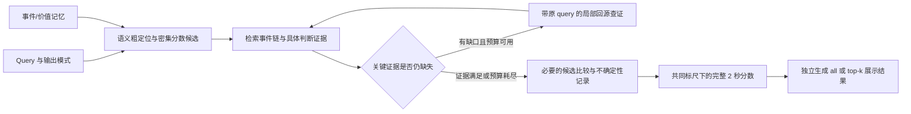

# 面向高光价值与证据补全的 MERIT 扩展：研究方案与原型

> 发布说明（2026-10-22）：保留原报告的日期、指标和结论；调整引用链接与机器路径。历史命令和本地资料不表示本仓库附带完整运行环境，详见[报告发布约定](report_publication_workflow.md)。

日期：2026-10-16。依据用户提出的 value memory、事件证据图、候选比较及回源查证想法，使用 `brainstorming-research-ideas` 的失败分析、模块拆分、简化检验三个视角整理。

相对原方法与已有适配的变化，另见[方法新增内容说明](merit_method_additions_2026-10-16.md)。

**2026-10-17 近期计划调整：** 纯记忆测试发现已有查询证据未被有效使用，以及完整分数数组的长段重复。
下一轮优先复用记忆诊断读取端，先跑带 ID/引用的输出对照，再按固定条件决定是否缩短目标输出。
具体变量、20/120 次文本调用预算及停止规则见[调整后的执行方案](highlight_memory_reader_plan_2026-10-17.md)。
R1 已完成 20 条，mAP/Hit@1 为 25.55/30.00，通过开发门槛而未执行 R2，详见
[运行结果](highlight_memory_reader_run_2026-10-17.md)。下文保留原研究方向，cue、事件图、比较及回看后续分别检验。

**执行更新：固定 20 条训练查询的工程评估已完成，包含 6 条回退；D0 / E3 的 VeryGood mAP 为 26.07 / 23.94，Hit@1 为 30.00 / 40.00。mAP 未改善，未扩大实验。** 见[完整测试报告](highlight_evidence_pilot_2026-10-16.md)。下文保留研究方案及初版原型记录；四类 cue 为 event、emotion、novelty、importance，不自动补造第五类。原 M0/D0/H1 冻结实验保持原样，100 条 confirmation 未使用。

## 1. 研究问题与已有证据

两句话描述研究问题：现有适配能够找到与查询相关的片段，但重看相同图像未稳定改善高光排序，短时动作和相似候选之间的差异可能缺乏直接证据。新方法记录与高光判断相关的可追溯观察，针对具体证据缺口补看原视频，并在共同条件下比较候选；是否提升排序需要受控实验验证。

固定 100 条 train 探索查询的 VeryGood 结果：

| 方法 | mAP | Hit@1 | 成功/失败 |
| --- | ---: | ---: | ---: |
| M0：原 MERIT 适配 | 22.72 | 29.00 | 98/2 |
| D0：密集视觉初始化 | 30.80 | 48.00 | 99/1 |
| H1：D0＋MERIT 选区间重评分 | 30.31 | 48.00 | 97/3 |

本次新增诊断见 analysis.json（本地资料：`../comparisons/qvhighlights/hd_adapter_analysis_2026-10-16/analysis.json`） 与 逐查询记录（本地资料：`../comparisons/qvhighlights/hd_adapter_analysis_2026-10-16/per_query.json`）。使用冻结官方评估代码重算并核对已存结果，100 个不同源视频为抽样单位、10,000 次配对 bootstrap、seed 42：

- 全 100 条未舍入 mAP 差值为 **−0.4839 pp**，95% CI **[−1.3423, +0.3582]**；Hit@1 差值 0，CI [−5, +5] pp。表中分别舍入的指标相减为 −0.49 pp。
- 两组均成功的 97 条上，mAP 为 D0 **31.3681**、H1 **30.9790**，差值 **−0.3891 pp**，CI [−1.2771, +0.4613]。该子集只用于诊断，不能替代完整分母。
- 全分母差值可分解为共同成功记录贡献 −0.3774 pp，其余失败记录贡献 −0.1065 pp。生成失败解释了一部分差距；修复失败并不能直接证明检索有效。
- 97 条中 73 条分数向量改变、24 条完全不变；重评分 2,038/7,212 个区间，实际改分 644 个。mAP 30 胜、27 负、40 平。
- D0、H1 各有 **96/97 条最高分并列**。这提示要检查比较、分数标尺和并列行为；并不证明 pairwise 比较一定有效。
- 在有任意标注者 VeryGood 区间的 94 条上，H1 选区间的平均正例覆盖率为 **64.60%**，2 条一个正例也未覆盖。覆盖率按“至少一名标注者为 VeryGood”统计，属于事后标签诊断；不输入推理，不是证据图质量指标。
- 逐批核验确认：H1 使用 D0 的相同图像哈希。H1 最终局部评分没有读入记忆文本或更密集图像，主要改变选区间、批次上下文及提示。因此当前结果并未直接检验用户提出的证据补全方法。

为什么继续这条方向？因为相同视觉信息上的重复评分缺少稳定收益。为什么需要记忆？为了定位“还缺哪类判断证据”、串起时序上下文并复用观察，而不只保存事件名称。为什么需要 agentic 查证？只有新增观察能够影响候选筛选或排序时，其调用成本才有理由；简单密集复查仍是必须比较的基线。

## 2. 候选方向与收敛

保留如下候选清单，避免一次加入全部组件后无法归因：

| 编号 | 候选机制 | 决定及原因 |
| --- | --- | --- |
| C01 | 查询无关的价值线索记忆，查询时选择相关维度 | 优先；对应当前 memory 任务目标 |
| C02 | 区分 observed / unknown / not_applicable | 优先；避免未观察被当作不存在 |
| C03 | 帧引用与事件先后图 | 优先做轻量版本；先验证链条有用性 |
| C04 | 显式证据缺口驱动的高帧率局部回看 | 优先；提供真正新增信息 |
| C05 | 候选间同维度比较证据 | 优先；针对相似候选及并列 |
| C06 | 主体、群体及上下文分别查证 | 纳入问题模板；先不增加专用模型 |
| C07 | 两候选同一请求联合判断与位置交换诊断 | 纳入小实验；控制跨批次标尺与位置偏差 |
| C08 | 以候选排序是否仍有未决问题为停止条件 | 纳入；LLM 自报 confidence 不作为唯一门槛 |
| C09 | all / top-k 的覆盖和输出策略 | 纳入；评估分数向量保持完整 |
| C10 | 不相关但“很激烈”的负例约束 | 纳入；避免一般吸引力压过 query |
| C11 | 同预算均匀回看对照 | 必须；检验 agentic 选择而非更多计算 |
| C12 | 带来源的增量记忆更新 | 后续；查证观察可缓存，查询偏好单独保存 |
| C13 | 人脸/群体区域放大 | 暂缓；确认分辨率瓶颈后再做 |
| C14 | 音频、欢呼声、ASR 信号 | 暂缓；当前实验只有视觉，不推断未输入的音频 |
| C15 | 大规模知识图谱、图神经网络、训练新评分头 | 暂缓；当前没有证据支持增加这一规模 |

首选最小组合为 **可追溯的价值/事件记忆 → 有明确问题的回源查证 → 必要的候选比较**。核心矛盾是有限预算下的证据完整性与全视频高光排序，而不是图规模。

## 3. 记忆：观察事实、事件结构与查询偏好分开

### 3.1 用户提供的四类 cue 与操作定义

用户明确给出 **event cue、emotion cue、novelty cue、importance cue**。[用这四类替换上一版助手提出的五类示例；见 cue 配置](../configs/highlight_value_schema.example.json)。名称来自用户，下表为建议的操作定义，尚未冻结为实验协议。它们是可同时出现的证据维度，不是互斥的事件类别，也不是 QVHighlights 官方标注类型。

| Cue / 配置 ID | 主要问题 | Memory 保存什么 | 缺证据时查什么 |
| --- | --- | --- | --- |
| event cue / `event_cue` | 发生了什么？动作到哪一步、结果如何？ | 主体、动作阶段、状态变化、可见结果及引用帧；串联传球、射门、进球节点 | 用密集源帧确认接触、入网或动作完成，必要时扩展前后窗口 |
| emotion cue / `emotion_cue` | 出现了怎样的可见反应，程度如何？ | 可辨认表情、身体动作、持续时间、参与人数；主体与群体分别记录 | 查主体/群体反应和持续过程，区分景别变化与实际强度 |
| novelty cue / `novelty_cue` | 相比已观察的背景，有何新变化？ | 当前变化、参照事件及时间；保留形成比较所需的上下文 | 检索此前同类事件/常态片段，判断是否有足够参照支持“不同” |
| importance cue / `importance_cue` | 对事件进展、目标或结果有何关键作用？ | 目标完成、关键转折、结果改变及相应上下文证据；在线再判断其对 query 的价值 | 补看结果或前后状态，确认该动作在事件链中的作用 |

`event_cue` 描述事件内容，`importance_cue` 描述有上下文支持的作用。进球属于 event cue；能否支持“扳平/决定胜负”等 importance 判断，还需要可见比分、比赛阶段等证据。强烈庆祝不自动证明进球重要，也不自动说明这一场景新颖。

`novelty_cue` 必须说明相对哪个参照；不能从单帧“看起来特别”推断罕见。20 条工程流程已增加参考事件 ID 校验及前两个窗口的上下文，尚不构成全视频稀有度判断。无充分参照时记录 unknown；importance 同样不能脱离上下文生成确定结论。

每一维保存 `status、level、cue、evidence_ids`：有直接证据时使用 0–3 级描述和简短观察；未知或不适用时 `level=null`。未知不赋零分。强度等级是模型观察的有序描述，不是校准概率，也不直接等于最终高光分数。

视频级 memory 保存可复用的事实与线索；query 级 policy 决定哪些线索重要。诸如“展示全部进球”和“最激烈的观众反应”可以检索相同事件，但采用不同的比较标准。不要将四类分数固定加总，也不要让与 query 无关的激烈画面获高分。QVHighlights 的标注是查询对应的 2 秒 saliency，详见[官方数据说明](https://github.com/jayleicn/moment_detr/blob/main/data/README.md)。

### 3.2 事件证据图

最小节点包含事件 ID、时间范围、可见描述、引用帧及 value 观察。正式集成时补入实体/场景关联及跨窗待验证链接。保留现有 MERIT 的语义键，另建价值线索键；候选召回先关注查询相关性，再沿相关价值键和事件邻域找证据。

对于“传球 → 射门 → 进球”，分别保存三个节点及各自帧证据；可以记录已观察的先后关系，未证实的关联仅记 `possible_link`。拍到庆祝不能直接证明进球；剪辑前后的相同球衣不能直接证明同一次进攻。跨镜头、缺帧、球不可见等都可能构成证据缺口。当前原型禁止 `causes` 边，图结构有效不等于视觉解释正确。

上下文与最终高光区间分别保存：前面传球可能是确认进球的重要证据，但当 query 只找进球时，不应因此把整段传球全部提高到最高分。

### 3.3 比较证据

基础 memory 保存“持续举臂、身体跳跃、多名观众同时回应”等可见线索。查询阶段再保存“候选 B 相对 A，在群体反应维度上更强/相同/无法判断”的比较记录，引用双方图像，并绑定 query、比较维度、模型版本和输入来源。

比较维度可包括幅度、持续时间、参与人数以及上下文；景别不同、剪辑频率不同、脸部不可辨认时允许 unknown。幅度大不自动等于更有高光价值。避免为 N 个事件预先生成 N² 比较；优先比较相近高分候选及 top-k 边界。

## 4. 固定检索与回答阶段

1. **查询解析与粗定位。** 明确主体、动作/事件、相关价值维度及输出需求。候选使用 MERIT 语义召回与 D0 时间峰值的并集，避免过早只保留一个时间点。保留不确定的低分区域检查入口；是否有足够覆盖需单独记录。
2. **证据检索。** 沿事件链检索前因、过程、结果及反应，把判断转成短的可验证问题。示例：“球是否实际进入球门？”“主体是否持续跳跃或举臂？”“有几名可见观众同时做出明显动作？”问题始终附原 query。
3. **缺口判断与回源。** `unknown`、缺少结果帧、缺少前后状态或两候选不可比可触发新视图。已观察的否定答案可以结束该检查；它不意味着该片段是高光。模型自称“足够”不能代替时间覆盖及引用检查。
4. **候选比较。** 将可比候选放在共同上下文中判断，允许 tie/unknown，并检查交换左右顺序后是否翻转。优先处理最可能影响 top-k 或整体排序的候选，不穷举所有配对。
5. **最终评分与输出。** 最终评分器消费观察及比较证据，使用共同 0–4 标尺；不把 pairwise 胜负随意加到原分数。未受新证据影响的区间保留 D0。新方案若采用失败时保留 D0，必须对所有新对照一致应用并单独统计回退；旧 H1 的冻结零回退不回改。

### “慢动作回放”的实现含义

对短动作，从原视频取更密集的**不同真实帧**；例如 2 秒取 16–24 帧，用原时间戳标注。对传球到射门的背景链，用较长区间和较低采样密度。重复原图片、只更改播放速度或生成插帧不会增加真实证据，不能当作补证据收益。

当前原型为每视图最多 24 帧、每 query 最多 2 个新视图/48 帧。视图窗口由证据问题指定；采样使用真实 PTS、去重、去掉已见帧，时间轴始终是原视频时间。预算耗尽后输出未解决项，不把未知补成确定事件。帧间隔检查只是结构性必要条件，不能保证模型理解正确。

### 多高光、all 与 top-k

| 场景 | 行为 | 必须避免 |
| --- | --- | --- |
| all | 保留所有已确认满足 query/固定门槛的独立事件；记录未检查范围与未解决候选 | 固定只召回前几个后声称找全；因为事件相似而删掉不同时间的真实高光 |
| top-k | 先按事件聚合，比较高分邻近候选及第 k/k+1 名；重复视图可合并 | 把同一事件连续多个 2 秒 bin 当成多个高光；强迫 unknown 排出确定胜负 |
| QVHighlights HD | 每个 query 输出全长 `floor(duration/2)` 分数向量 | 按展示 top-k 把其他分数清零，改变既有评估任务 |

`all` 的完备性比 `top-k` 更贵。小预算原型只能声明“已检查候选中的全部符合项”；若用户要求完整发现，就必须扩展全视频覆盖检查，不能用自信分数代替。top-k 并列处可以按固定时间顺序展示，同时保留并列标记；这种确定性排序不代表确认了质量差异。

## 5. 小规模验证与反证条件

先复用已使用的 100 条 train exploration；按固定、与分数无关的哈希顺序取 20 条做工程 pilot，不能只挑体育或情绪案例。100 条 source-disjoint confirmation 继续保留给选定版本，不在调参时查看。原 1,550 条 val 已经被查看，只作为后续完整评测，不能称未触碰测试集。

| 实验问题 | 最小对照 | 能证实什么 / 反证 |
| --- | --- | --- |
| 价值和事件结构能否改善判断？ | 相同候选、像素、最终评分器下，普通事件记忆 vs 价值/时序证据记忆；记录构建 token 差异 | 若结构更完整但排序不改善，不能以可解释性代替精度收益 |
| 缺口驱动回源是否有用？ | 同一记忆和评分器，定向回看 vs 同预算均匀回看；另报告不回看版本 | 若均匀回看同样有效，收益可能主要来自新增帧；不足以主张 agentic 调度优势 |
| 候选比较是否改善排序？ | 同一证据、候选和预算，独立绝对评分 vs 联合比较；少量位置交换诊断 | 若 pairwise 只是打破并列而 mAP/Hit@1 不改善，保留简单评分 |

按顺序推进，不一次铺满组合。先验证短时动作、上下文缺失和候选混淆是否真实存在，再扩大到 100 条探索。memory 构建、检索、查证、比较和最终评分分别计费/计时；48 帧只是回源增量上限，**不包含 memory 建库、比较时复用帧以及失败重试**。预算相同也不等于实际用量相同，两者都记录。

主指标保持完整分母的 VeryGood mAP/Hit@1、失败与回退率，并报告 paired CI、候选覆盖、改分正负收益、并列、真实新增帧及 token/墙钟时间。事件图和这四类 cue 没有现成官方真值；少量盲审可检查帧引用、动作链、比较理由与 unknown 判断，但不能伪称“价值准确率”的标准基准。

延续先前的工程筛选门槛：探索阶段相对最强简单基线 mAP 提升至少 1 pp、Hit@1 下降不超过 1 pp、失败率不更差且预算满足，才考虑冻结候选进入 confirmation。该门槛不是显著性证明；同时检查改善是否只来自失败回退政策或新增计算。

两周安排建议：第 1–2 天定 value 定义与判定模板；第 3–5 天接候选、索引和最终评分并跑 20 条 pilot；第 6–9 天只推进有效模块的 100 条探索及同预算对照；第 10–14 天冻结一个版本，满足门槛再做 confirmation。具体计算耗时需由新格式的真实小样本测量，不能沿用旧 H1 的速度保证。

## 6. 新颖性边界

本次只做了针对性主源核对，尚非系统文献查新：

- [EM²Mem](https://arxiv.org/abs/2609.00551) 已提出以事件为中心绑定多模态证据、时序上下文、图关系和来源的记忆。因此“事件＋证据＋memory”本身不能作为首创主张。
- [Semantic Action Graph / SportSAGE](https://arxiv.org/abs/2609.20768) 已将动作、角色、时序与结果结构用于体育高光 agent 和用户解释。该工作以体育图表示与用户研究为主；本方案需证明面向查询高光排序的证据缺口、取证选择和价值比较有独立作用。
- [EviDETR](https://arxiv.org/abs/2609.30724) 研究查询相关时间证据在 MR/HD 网络中的保留。因此“保留高光证据”也需要落实到可检验、不同于现有机制的具体贡献。

最强质疑是“通用 RAG＋图＋多看几帧”。回应应来自同预算对照：图中的缺失项是否预测排序错误、定向取证是否更容易修正这些错误、候选比较是否有稳定增益。当前只提出这些假设，不预先声称论文创新性成立。

## 7. 已落地内容与边界

本节以下保留初版原型完成时的记录。随后已接通四类 cue 的跨事件参照、前两个窗口的证据链接、query 检查项、候选检索、密集评分及 20 条工程 runner，并启动真实模型测试；最新状态以[小规模测试报告](highlight_evidence_pilot_2026-10-16.md)为准。跨镜头实体关联与完整事件聚合仍未实现。

[独立实现位于 experiments/highlight_evidence](../experiments/highlight_evidence/README.md)：

- 可配置 value schema、视觉 memory 提取接口、事件边/引用校验及价值检索文本导出。
- 明确的 query 检查项、时序覆盖检查、原 PTS 新帧采样、累计预算控制器。
- 面向具体问题的 VLM 查证接口、引用双方证据的两候选比较接口。
- all/top-k 选择、边界并列记录及保持完整 2 秒向量的更新函数。
- 可运行的真实视频 CPU 解码入口和离线测试。

真实视频检查已从第一个冻结 exploration 视频的 0,6) 秒解码 24 个互不相同的源帧，模型调用数为 0。该检查只验证媒体操作；原型中的模型响应测试使用假客户端，不能当作语义正确性或精度证据。

验证结果：新增 15 项行为测试通过，整个当前 CPU 测试集 **62 passed**；新代码及诊断脚本的 Ruff 检查、格式检查通过。原冻结源码/数据哈希与全部诊断输入哈希再次核验一致。真实帧时间范围为 0.125125–5.880875 秒；解码产物保存在既有 SSD 实验根目录下 `evidence_v1/media_smoke_2026-10-16/`。

四类 cue 的名称及建议操作定义已写入配置，通用原型无需把维度数量写死。尚待正式实现/集成：按四类 cue 编译 query→criterion、语义/价值索引融合、novelty/importance 的跨事件参照约束、跨窗口实体关联与事件链、候选构造、共同标尺的最终密集评分、新协议冻结和完整 runner。现有函数提供这些环节的接口和约束；当前不应称为端到端已验证方法。

初版离线诊断入口为 [[scripts/analyze_hd_adapter.py](../scripts/analyze_hd_adapter.py)。原始查询/预测/报告输入 SHA-256 与评估器 SHA-256 已记录，诊断前后均核验输入未变。该初版诊断阶段未启动新的 GPU 推理；后续 20 条工程测试及其失败记录见文首链接，仍未运行 confirmation 或全量 val。
