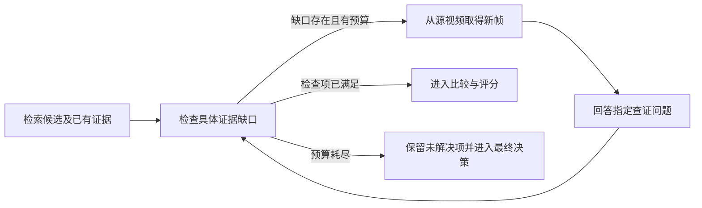

# 基于 MERIT 的高光检测方法新增内容说明

> 发布说明（2026-10-22）：保留原报告的日期、指标和结论；调整引用链接与机器路径。历史命令和本地资料不表示本仓库附带完整运行环境，详见[报告发布约定](report_publication_workflow.md)。

日期：2026-10-16。

2026-10-17 更新：本文保留完整方法的设计目标。近期执行优先级已调整为
[复用 2s 记忆、先诊断读取与评分](highlight_memory_reader_plan_2026-10-17.md)，
D0 在该轮仅作外部参照；四类 cue、事件链、比较和回看待基础读取验证后分别测试。
随后 R1 已完成 20 条纯记忆读取测试，结果为 25.55 mAP / 30.00 Hit@1，
仍未超过 D0；实际检验范围见[运行结果](highlight_memory_reader_run_2026-10-17.md)。

按照当前方案，方法在 MERIT 的多键记忆检索和时序邻域扩展基础上，新增三项核心设计：**高光证据记忆、证据缺口驱动的回源查证、候选高光的价值比较**。四类 cue、事件证据图和预算控制共同服务于查询相关的高光排序。

本文说明相对原 MERIT 和本项目已有适配增加了什么。已接通四类 cue、候选检索、查证和比较的 20 条工程流程；当前运行与验证边界见[小规模测试报告](highlight_evidence_pilot_2026-10-16.md)。下文区分设计目标与已实现范围。

## 1. 方法继承了什么

已有基础包括：

- **MERIT 的检索框架**：查询无关的分段记忆、多键索引、查询驱动检索、邻域证据过滤和多轮决策。本项目已实现 event/object/summary 三类语义键。
- **现有模型**：沿用 Qwen3-VL-8B-Instruct 进行视觉理解，Qwen3-Embedding-4B 进行文本检索，当前方案继续以冻结模型为基础。
- **QVHighlights 任务接口**：对完整视频的每个 2 秒区间输出高光分数，使用官方 HD 评估方式。
- **D0 密集初始化**：每个 2 秒区间取一个真实代表帧，为完整时间轴提供初始分数。

这些内容构成新方法的基础，不计作本轮新增贡献。MERIT 本身已有多轮检索与证据是否充分的判断；本轮新增的是面向高光的具体证据缺口、相应取证动作及候选排序机制。

## 2. 相对当前适配的变化

| 环节 | 已有 MERIT / H1 适配 | 本轮方案新增 |
| --- | --- | --- |
| 记忆内容 | 片段描述及 event/object/summary 语义键 | 四类高光 cue、可见证据、引用帧、未知状态及参照信息 |
| 事件关系 | 按时间邻近扩展片段、过滤邻域文本 | 显式事件节点及有证据支持的时序关系，记录动作链缺失部分 |
| 检索目标 | 查找与 query 相关的片段和上下文 | 同时查找支持高光判断、比较候选所需的具体证据 |
| 补充观察 | H1 局部重评分复用 D0 的相同 JPEG 图像 | 根据缺口读取原视频中新的真实帧，必要时扩大时间上下文 |
| 候选排序 | 主要通过各批次的绝对分数形成排序 | 同 query、同维度比较候选，保存双方证据及比较结果 |
| 停止条件 | 原多轮决策及轮数上限 | 具体检查项是否得到支持、是否仍有比较歧义、是否达到预算 |
| 结果组织 | 完整的 2 秒分数向量 | 在保持评估向量的同时，组织事件级 all / top-k 展示结果 |

现有 100 条探索中，D0 的 VeryGood mAP 为 30.80，H1 为 30.31；共同成功的 97 条上，H1 仍低约 0.39 个百分点。该结果说明当前重评分没有表现出稳定附加收益，并不能直接证明某一种新模块有效。H1 复用相同图像的核验结果，为检验“新增视觉证据是否改善排序”提供了明确起点。详见离线诊断（本地资料：`../comparisons/qvhighlights/hd_adapter_analysis_2026-10-16/README.md`）。

## 3. 新增一：面向高光判断的证据记忆

### 3.1 四类 cue

记忆新增用户指定的四类证据维度。它们可以同时出现在一个事件上，不是互斥标签。

| Cue | 保存的内容 | 示例 |
| --- | --- | --- |
| **Event cue** | 主体、动作阶段、状态变化和可见结果 | 传球、射门、球进入球门及其时间位置 |
| **Emotion cue** | 可辨认表情、身体动作、反应持续时间、参与人数 | 一人短暂举臂，或多名观众持续跳跃 |
| **Novelty cue** | 相对已观察参照的变化或差异 | 多次常规传球之后出现与此前不同的突破动作 |
| **Importance cue** | 对事件进展、目标完成或结果的关键作用及依据 | 在有比分和比赛阶段证据时，判断一次进球是否扳平比分 |

原 MERIT 已有 event 语义键，因此 `event_cue` 的名称本身不构成新的机制。新增内容在于将这些线索组织为可引用、可检索、可检查缺口的证据，而不只是换一组关键词。

每类 cue 保存 `status、level、cue、evidence_ids`。未知或不适用时使用 `level=null`；未观察不能解释为不存在。强度描述也不直接等于高光分数。

视频级 memory 保存可复用的观察；查询阶段再决定哪些维度值得关注。例如，“全部进球”优先检查事件及结果，“最激烈的观众反应”优先检查反应程度。四类 cue 不固定等权相加，语义相关性仍是高光判断的基础。

### 3.2 事件证据图

在片段描述之外，增加事件节点、引用帧和关系。例如：

```text
传球事件 ──先于──> 射门事件 ──先于──> 进球事件
   │                 │                 │
时间与源帧         时间与源帧         时间与源帧
```

检索到进球候选后，可沿关系补查射门及之前的配合；若缺少球入网的画面，则保留“结果未确认”的缺口。当前原型支持 `before` 和 `possible_link`，不把先后关系直接写成因果关系。

图还需区分**证据范围**和**输出高光范围**：传球可能帮助理解进球，但查询只找进球时，不应因此把整个进攻过程都标为最高分。

### 3.3 上下文参照

Novelty 和 importance 都需要参照。前者需要说明“相对什么不同”，后者需要说明“对什么目标或结果重要”。拟增加参考事件 ID、时间和证据引用，使这些判断可回查；无充分参照时保留未知。

因此，这部分新增的完整目标是：**语义记忆＋高光 cue＋事件关系＋证据来源＋缺失状态**。工程测试已接入参考事件 ID，以及当前窗口与前两个窗口间的证据链接；跨镜头实体关联仍待实现。

## 4. 新增二：证据缺口驱动的回源查证

将高光判断分解成短的可验证问题，再选择获取相应证据的动作。

| 证据缺口 | 查证问题示例 | 对应操作 |
| --- | --- | --- |
| 短动作缺少结果帧 | 球是否实际进入球门？ | 在动作附近密集采样新的真实帧 |
| 情绪反应程度不明 | 主体是否持续举臂或跳跃？ | 检查主体动作及持续过程 |
| 群体反应不明 | 是否有多人同时明显回应？ | 检查可见群体及前后变化 |
| 新颖性缺少参照 | 此前是否出现过相同动作模式？ | 检索已有事件及必要的参考片段 |
| 重要性上下文不足 | 该动作是否改变结果或完成目标？ | 补查前后状态与结果证据 |

每次查证都携带原 query、目标事件和具体问题。查询粗定位之后，控制过程固定为：



“慢动作回放”在这里落实为更密集的原视频采样。例如对 2 秒动作读取 16–24 个不同源帧，全部保留原时间戳。重复已有图像或生成插帧不算新增真实证据。

原型默认每条查询最多两个新视图、每视图最多 24 帧，共 48 个新帧预算。该上限只约束回源增量；记忆构建、比较和重试另行记录成本。证据满足指定检查项时可停止，预算耗尽时保留未知，结构性覆盖检查不等于语义正确性保证。

## 5. 新增三：候选高光的价值比较

在多个片段都与 query 相关时，新增显式的比较证据。例如，两个候选都有庆祝画面，比较时分别检查反应幅度、持续时间和参与人数，而不只重复给两个片段独立打分。

比较记录绑定原 query、比较维度、双方事件和引用帧，允许 `left / right / tie / unknown`。景别、遮挡或时间覆盖不一致时，不能强行判定谁更强。基础观察可以跨查询复用，“哪个更值得作为高光”的结论则依赖 query。

为控制开销，优先比较相近高分候选及 top-k 边界，避免预先构建全部事件之间的两两比较。原型提供最多三对相邻排序候选的调度函数；工程测试使用最多三个窗口、两对比较，再让评分器读取比较证据生成 0–4 分数，不将胜负机械加到 D0 上。分数的一致性与实际收益仍待验证。

## 6. 配套新增：多高光输出策略

| 输出需求 | 处理方式 |
| --- | --- |
| **all** | 保留所有已确认符合条件的独立事件，并标明未检查范围和未解决项；有限候选上的全部结果不等于完整视频的穷尽发现 |
| **top-k** | 先将同一事件的重复候选合并，再比较排名边界；并列或证据不足时保留相应标记 |
| **QVHighlights HD** | 继续输出完整的 2 秒分数向量，不因展示 top-k 而清零其他区间 |

这部分属于任务输出与实验协议的完善。事件级聚合、全视频覆盖检查和最终评分集成尚未完成；已有选择函数只作用于调用方提供的候选。

## 7. 哪些已经实现，哪些仍是方案

| 内容 | 当前状态 |
| --- | --- |
| 四类 cue 配置、未知状态、事件时间及引用校验 | 已有配置和原型代码 |
| 视觉记忆提取接口、event/value 检索文本导出 | 已真实运行 20 条工程评估，精度收益未成立 |
| `before` / `possible_link` 事件边 | 工程测试加入当前/前两个窗口链接与参照；跨窗口实体关联待实现 |
| 缺口检查、预算控制、真实 PTS 补帧 | 已有原型；真实视频 CPU 检查成功解码 24 个不同源帧 |
| 定向查证、两候选比较 | 已有模型调用接口及离线契约测试 |
| all/top-k 选择、完整分数向量更新 | 密集评分已接通；事件聚合及 all/top-k 产品输出待实现 |
| 自动 query→检查项、语义/价值索引融合、完整 runner | 已接通 20 条工程测试，保留分阶段输出与失败记录 |
| 新方法 mAP/Hit@1 及模块收益 | 20 条上 E3 为 23.94/40.00，D0 为 26.07/30.00；mAP 下降，尚不支持模块收益 |

初版原型验证为 15 项行为测试、全套 62 项 CPU 测试通过；接入工程流程后为 75 项通过。测试说明部分接口与行为约束有效，不代表模型判断或检测精度有效。

## 8. 可以提出的研究贡献与验证方式

方法层面可以围绕三项贡献组织：

1. **面向高光排序的证据记忆**：将四类 cue 与事件结构、来源和未知状态结合，使记忆能够服务于价值判断和后续查证。
2. **有预算约束的定向证据补全**：将查询相关的未决判断转成源视频取证动作，优先获取可能改变候选决策的信息。
3. **有双方证据支撑的候选比较**：通过同维度比较处理相关候选之间的差异，并支持多事件选择。

这些是当前方案的贡献候选。相对本项目增加了模块，并不自动意味着文献层面具有新颖性或实验上优于基线。需要的最小验证分别是：

- 固定候选、像素和评分器，比较普通记忆与 cue/事件证据记忆。
- 固定记忆、评分器及取证预算，比较定向回看、均匀回看和不回看。
- 固定候选与证据，比较独立评分和联合比较，并检查候选左右顺序偏差。

先在固定 20 条探索样本上接通流程，再根据结果推进有效模块。报告完整分母的 HD 指标、失败/回退、并列和实际计算成本，避免把新增计算或失败策略变化解释为检索机制的独立收益。

## 相关材料

- [完整研究方案](highlight_evidence_research_2026-10-16.md)
- [原 MERIT 的 QVHighlights 适配](merit_qvhighlights_adaptation.md)
- [M0/D0/H1 实现与实验结果](merit_hd_adapter_implementation_2026-10-16.md)
[- 四类 cue 配置](../configs/highlight_value_schema.example.json)
[- 新模块原型与运行说明](../experiments/highlight_evidence/README.md)
- [本地 MERIT 论文](../papers/MERIT_2608.07663v2.pdf)
