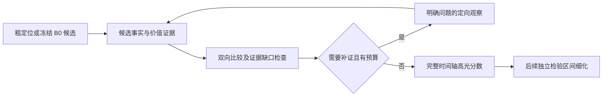

# 结合 10.13–10.20 会议纪要的下一步研究计划

> 发布说明（2026-10-22）：保留原报告的日期、指标和结论；调整引用链接与机器路径。历史命令和本地资料不表示本仓库附带完整运行环境，详见[报告发布约定](report_publication_workflow.md)。

整理日期：2026-10-22。依据：[最新实验汇总](experimental_results_report_2026-10-22.md)、本次提供的会议纪要、已有实现，以及 LensWalk / VideoJev 的公开资料。

本文确定研究方向与分阶段对照，尚未启动 GPU 实验。旧 REZE v1 的 A 阶段停止决定和全部冻结结果保留；以下作为新的 v2 计划，具体数据清单、提示、参数和预算需在对应阶段开始前冻结。

## 1. 推荐主线与当前证据

**主线：围绕高光候选的价值比较，按需收集能够改变判断的证据，并在长视频上验证精度与观察成本。**

近期以 REZE 和现有 P_pair 为基础，依次验证候选覆盖、定向补证和有限预算下的粗到细观察。记忆先保存候选证据，区间细化随后独立验证。

支撑这一排序的证据是：

- QVHighlights 上 P_pair 相对 B0 为 **+0.771 mAP、+5.161 Hit@1**，主要收益在首选高光；P_pair 相对 P_abs 的 mAP 区间仍跨零。
- 既有 MERIT train20 的复杂 cue、事件图和回看没有超过直接视觉评分，纯记忆 R1 也尚未匹配共同有效样本上的 D0。新增模块需要逐项证明收益。
- TVSum 已有高于随机的迁移结果，适合低成本检验高光价值提示；MR.HiSum 排序与摘要选择存在不同问题，应优先保持 HD 主任务。
- 长视频回看尚缺有效的 REZE / SVHighlights 基线，因此先补这项工程缺口，再评价回看策略。

可检验的研究问题是：**相同模型、相同候选及新增观察预算下，针对具体证据缺口选择回看位置，是否优于均匀补看，并能改善完整时间轴的高光排序？**

## 2. 更新会议纪要中的状态

| 纪要项目 | 截至目前的实际状态 | 下一步安排 |
|---|---|---|
| REZE / QV 与候选复评 | val1550 已完成；B0 / P_pair 为 42.99 / 43.76 mAP、71.68 / 76.84 Hit@1 | 保留强基线，定位候选覆盖和比较瓶颈。 |
| MR.HiSum 基线 | 可用 test 1,888/2,000 已完成；mAP50 / mAP15 / F1 为 57.00 / 23.90 / 38.27 | 后续适配先用训练/验证小样本，不立即重跑 1,888 条。 |
| TVSum | 50 条已完成；固定 val10 / all50 Top-5 mAP 为 61.32 / 54.89 | 用官方训练划分开展任务提示与候选比较开发。 |
| QFVS | 四条完整视频、四查询完成；Oracle F1 38.63，低于均匀选片 50.15 | 保留补充诊断，先检查概念提示和覆盖，不扩全部 180 查询。 |
| SVHighlights | 七场 pilot 因 GPU UUID 解析问题停止，无有效 REZE 指标 | 修复启动链路，完成相同七场的原 B0 结果。 |
| TVHighlights | 尚无可用原视频与标注 | 保留数据获取事项；与 TVSum 分开，不占据方法开发的关键路径。 |
| 高光 Agent | 比较已有实现；完整价值记忆、边界细化、定向回看尚无联合验证 | 拆成可独立开关和计费的模块。 |

P_abs 的准确描述为“**共享其他候选上下文的绝对复评**”，并非只看当前片段的无上下文基线。现有 P_pair 只置换原前五格的分数，未产生完整事件级排序或新高光边界。

## 3. 首先处理候选问题

本次对冻结 B0 预测补做了不使用标签的 CPU 统计，按原规则选择最高分五个 2 秒格，同分按 clip ID：

| Top-5 按时间排序后的连续区间数 | 查询数 |
|---|---:|
| 1 | 286 |
| 2 | 646 |
| 3 | 447 |
| 4 | 148 |
| 5 | 23 |

**932/1,550＝60.1%** 的查询最多形成两个连续区间，包围五个候选的总时间跨度中位数为 22 秒。连续格定义为 clip ID 相差 1；这只是时间集中程度，不能当成语义事件标签或重复内容证明。

这说明当前 Top-5 常常是少数局部区域内的多个格，直接将其解释为“五个不同事件”不准确。建议先做一个便宜、可归因的候选对照：

| 条件 | 候选策略 | 后续评分 |
|---|---|---|
| C0 | 原逐格 Top-5 | 冻结 P_pair，20 次双向比较/query。 |
| C1 | 从时间峰值或相邻格合并后选择五个代表位置 | 与 C0 相同 P_pair、每候选最多四张 B0 已观察帧、相同调用上限。 |

C1 的抑制范围、代表位置和不足五候选时的处理先用工程样本确定，禁止根据验证集成绩不断调整。候选区间合并不等于已经识别出真实事件。

先在既有训练 explore100 检查 mAP、Hit@1、候选时间覆盖、并列和逐查询变化。标签只供离线评价；可做“候选内理想排序”的诊断上限，但不得把理想排序或标签筛选作为模型结果。C1 未达门槛时继续使用 C0。

## 4. 数据集分工与适配顺序

| 数据集 | 研究职责 | 初始规模与原则 |
|---|---|---|
| QVHighlights | 查询相关性、候选比较、证据补全的主消融 | 既有训练 explore100 开发；未参与方案选择、源视频不重叠的 confirmation100 用于冻结后的确认。 |
| TVSum | 查询无关的重要性与观看价值迁移 | 优先从官方训练 40 条中预先划定小开发集；先只比较原动作核验与重要性核验，再单独试标题或比较。 |
| SVHighlights | 长视频、运动事件、粗到细观察的成本收益 | 先完成原七场开发 pilot；确认时另选源视频不重叠的比赛，不能把同场裁剪当独立样本。 |
| MR.HiSum | 观众重播价值的外部迁移 | 先从官方训练/验证范围固定约 50 条，按时长等无标签元数据选取；HD 为主，摘要 F1 暂作诊断。 |
| QFVS | 长时序概念匹配、摘要覆盖和多查询复用 | 当前四查询用于问题定位；新方向成立后才取预先确定的新查询验证。 |

不同时对全部数据集做所有模块的笛卡尔积实验。先在 QV 证明核心机制，在 TVSum 检查任务价值接口，在 SVHighlights 检查长视频成本；MR.HiSum 和 QFVS 后续扩展。

TVSum 的通用高光提示与严格动作核验存在目标差异，应单独做提示对照。提示改进的收益不能归入 Agent 模块。MR.HiSum 的常数分数摘要有短镜头偏好，低摘要 F1 也不能直接归咎于未使用 Agent。

## 5. 第二个核心对照：定向补证是否超过均匀补看

在 C0/C1 选定后冻结候选和比较器。先检验新增证据，不同步改变全片评分、五类价值权重、记忆粒度和区间边界。

| 条件 | 新增证据 | 用途 |
|---|---|---|
| E0 | 保持已观察帧，使用冻结候选上的 P_pair | 无补看参照。 |
| E_uniform | 在允许的候选上下文内均匀补充源视频帧 | 测量“增加观察”本身的作用。 |
| E_targeted | 根据缺失问题选择局部时间范围及采样密度 | 与 E_uniform 对比定向观察的额外作用。 |

E_uniform 与 E_targeted 共享仅从初始证据生成的触发集合和查证问题，配平实际新增帧数、观察调用及比较调用；第一轮优先隔离“在哪里采样”的差异。规划、观察、重新比较、解码和缓存依赖全部计入成本，不能只计算观察器。

建议初始上限为每 query **最多两次观察调用、最多 48 个新增源帧**；工程检查后冻结具体窗口和 token 总预算。48 是拟定资源上限，不是已经实测的最优参数。需要记录新帧 PTS/帧 ID，重复输入旧帧不计为获取新证据。

每次回看包含四个明确项：

1. **缺少什么证据**：例如动作结果未见、个体反应与群体反应难以区分、比较方向冲突。
2. **看哪里**：已有事件附近、结果之后或需要比较的另一候选；保持原 query 约束。
3. **如何观察**：时间范围、FPS、帧数上限及必要的前后上下文。
4. **怎样结束**：问题被证实/否定、观测不足、无新帧或预算耗尽；不足时保留 unknown。

“球是否入网”“反应是否持续、可见参与者是否更多”是可查证问题。“重新看看是否精彩”过于宽泛。慢动作回放应意味着以更密采样获得额外时间证据，单纯重复同一组图像没有增加信息。

第一轮固定触发后，再独立检验自适应触发/提前停止是否节省成本。Yes/No 输出概率不默认是校准的不确定性；低 Yes 概率不自动触发回看。

## 6. 记忆、比较与边界模块的职责

### 6.1 候选证据记忆

先保存候选及已观察上下文，不再预先对整条视频密集生成复杂描述。建议最小字段：

```text
candidate_id / time_range / actor_or_event
value_type / observed_facts / evidence_frame_ids
reference_candidate_ids / missing_evidence / verification_status
query_conditioned_comparison / source_and_model_version
```

纪要提到“五类高光价值”，现有配置只有用户此前指定的四类证据维度：event、emotion、novelty、importance。**五类价值定义待确认，暂不补造第五类。** 若五类是高光类型，而四类是判断线索，应分别存为 `value_type` 与 `evidence_cues`，允许多标签和 unknown。

“值得观看的原因”须由可见事实、参照和任务目标支撑。进球、剧烈庆祝、决定胜负分别需要不同证据；镜头变化本身不能证明新颖，庆祝不能证明入球或重要性。基础事实与 query 条件下的最终价值判断分开缓存。

先验证证据引用、跨候选检索和缓存复用是否可靠。之后在相同观察事实下比较原始历史文本与结构化证据卡，检查精度、文本长度和重复调用；记忆即使只降低成本，也应按这一实际作用报告。

### 6.2 同类事件比较

复用 P_pair 的双向比较、位置偏差检查和保守重排。先确保候选与 query 相关，再按任务所需维度比较。只有具备足够前后证据时，才比较事件结果、反应强度或作用；缺少参照时允许不可比。

事件类别、比较标准和额外观察分别做消融，避免把更强提示、更多帧和新排序算法的收益混在一起。最终 HD 输出始终覆盖完整时间轴；用户要求的 all/top-k 展示结果另行生成。

### 6.3 区间细化

放在候选识别与证据补全验证之后。分别保存“用于理解的上下文区间”与“最终高光区间”，不能因为查看了传球过程，就把整段上下文都提升为高光。

已有 Gemini 提示测试可作为候选模板；当前工作区未定位到对应提示和正式评估记录，迁移 Qwen 时应固定输入、输出及边界规则重新检查。QV 的 2 秒 HD 标注不能证明亚秒级起止边界正确。若使用 moment annotations 评价，需标明这是事件区间代理；高光边界质量还需要相应标注或盲审，不能替换主 HD 结果。

## 7. 框架选择：现有运行底座＋可替换模块

**建议保留现有 REZE 的运行、计费、断点恢复和官方评价代码；用一个有限状态控制器连接比较、记忆和观察工具。**

| 来源 | 推荐复用 | 当前边界 |
|---|---|---|
| 本地 REZE | B0、P_abs/P_pair、候选帧来源校验、逐查询预测、成本账本与评估 | 最接近当前实验，作为主运行底座。 |
| MERIT | 多键索引、时间范围与邻域检索、事实记录的缓存思路 | 原始类以 caption/key 检索为主，不能直接当成高光价值或新帧获取模块。 |
| LensWalk | 时间区间、FPS、帧预算可配置的扫描、局部观察、跨段核验接口 | 已核对公开 README 和工具配置；尚未验证本地 Qwen 的运行兼容性。 |

LensWalk 公开了 `scan_observer`、`segment_observer`、`stitched_observer`，局部和跨段观察都接受时间范围、查证问题及采样预算；其当前默认任务是视频 QA，需要接入本项目的完整高光分数与评价接口。[作者仓库](https://github.com/likanchuan09171/LensWalk)、[工具配置](https://github.com/likanchuan09171/LensWalk/blob/release/tool_configs/vcs_standard.yaml)

因此，框架层面的优先选择是借鉴 LensWalk 的观察方式，保留 MERIT 的可检索记忆组件。是否直接引入其依赖，由独立小样本接口检查决定；静态接口核对尚不能证明运行兼容或高光收益。



这里先采用固定阶段和有限回看轮数，保证每次调用可归因；不把自由工具循环本身当成已验证的研究贡献。

## 8. 粗到细实验应证明什么

新增两个不同目的的实验分支：

- **精度分支**：在完整 B0/P_pair 后补证，检查额外观察能否提升精度。它包含完整密集评分成本。
- **效率分支**：从低成本全片粗扫开始，先筛候选，再局部密集评分；未细看区域保留冻结的粗评分，完整评价分母不变。

效率分支与全片密集 B0 比较精度—成本曲线；另设相同帧/调用预算的均匀采样或均匀补看对照。粗阶段先报告候选高光召回，避免把漏掉高光的低成本结果描述为成功。

在 SVHighlights 上优先使用原七场 pilot 做工程与趋势检查，报告逐场结果。七场不能提供稳定的完整数据集结论；后续在未用于选择策略的源视频上确认，不把成千上万个相邻 clip 当独立样本。

## 9. 门槛、规模与推进顺序

以下为待冻结的 v2 开发筛选规则，不是效果承诺或统计显著性标准：

- **精度路线**：在固定开发集上相对最强适用对照，主 HD mAP 点估计至少提高 1 pp，Hit@1 不下降超过 1 pp；完整分母、失败率不恶化，并满足预先设定的实际成本上限。E_targeted 还须优于同预算 E_uniform，才支持定向补证的贡献。
- **效率路线**：若精度增益不足，只有预先声明转入该路线后，才按“总成本至少降低 30%、主 mAP 下降不超过 0.5 pp”的候选门槛筛选；不能看过结果后临时换目标。正式结论仍需配对确认，不能凭点估计证明非劣。
- **确认方式**：冻结选定版本再使用独立确认样本；报告逐视频/源视频聚类配对区间和完整成本。原 val/test 已查看的事实如实披露。

| 顺序 | 工作包 | 交付与停止条件 |
|---|---|---|
| 1 | 补齐 SVHighlights 七场基线；核对类别定义和评价协议 | 完整结果或明确工程阻断记录；其他已完成大集不重复跑。 |
| 2 | QV 固定 explore100 的 C0/C1 候选对照；TVSum 小规模任务提示对照 | 选定候选和提示，各自单独判断；不凭复杂度进入下一步。 |
| 3 | QV 同候选的 E0 / E_uniform / E_targeted | 证明新增证据与定向观察各自的收益；未达门槛则保留基线并分析失败。 |
| 4 | 将通过筛选的策略移到长视频，检验粗到细成本 | 报候选召回、完整 HD 指标、调用/帧/token/墙钟与缓存口径。 |
| 5 | 独立确认后扩展 MR.HiSum；再评记忆与边界细化 | 先约 50 条开发，再决定是否值得全量；QFVS 继续补充诊断。 |

下一次组会优先展示三份结果：**SVHighlights 基线、候选时间去重对照、同预算均匀/定向补证对照**。根据实际完成情况汇报，不将计划中的模块写为已完成结果。

## 10. 文献与待补资料

| 资料 | 服务于哪个决策 | 当前判断 |
|---|---|---|
| LensWalk | 如何选择观察位置、密度与跨段核验 | 接口与工具配置已核对，作为观察模块参考。 |
| Jev | 将查证/路由拆成可调用的结构化判断 | TypeSafe 的官方接口强调带概率的结构化决策；这是接口设计参考，不证明在本任务上的校准或性能。[官方资料](https://typesafe.ai/) |
| VideoJev | 高效候选评分、多查询视觉计算复用 | 作者方法直接评分时间区间或选项，并支持缓存/联合查询。可作为后续独立评分器对照；先核对训练数据重叠、任务定义和硬件成本。[论文](https://arxiv.org/abs/2610.18615)、[作者代码](https://github.com/MCG-NJU/VideoJev) |
| 吴老师推荐的显著性论文 | 区分空间显著性、时间重要性与高光价值 | 尚缺具体标题/链接，暂不归纳其贡献或假设能直接迁移。 |
| 何恺明团队 coarse-to-fine 工作 | 借鉴分阶段资源分配与停止规则 | 纪要未给标题，检索尚未唯一定位，待补链接核对。 |
| 五类价值定义与 Gemini 提示 | 冻结 memory 类型及边界细化规则 | 当前只有四类 cue 配置和纪要描述，待补具体定义与提示内容。 |

VideoJev 的模型与训练方式不同于现有 Qwen3-VL-8B B0，替换后属于新模型对照，不能把模型变化的收益归入 Agent 模块。当前优先保留统一 Qwen 骨干。

## 11. 本次新增诊断的复查

输入：[B0 全量预测](../comparisons/qvhighlights/reze_fullval_2026-10-20/fullval/results/B0_predictions.jsonl)；候选规则：[冻结排序实现](../comparisons/qvhighlights/reze_fullval_2026-10-20/fullval/run/source_snapshot/experiments/reze_evidence/ranking.py)。无模型调用、无标签读取、无原预测修改。

```python
selected = sorted(sorted(range(len(scores)), key=lambda i: (-scores[i], i))[:5])
contiguous_runs = 1 + sum(b - a > 1 for a, b in zip(selected, selected[1:]))
enclosing_span_seconds = (selected[-1] - selected[0] + 1) * 2
```

上述统计仅支持优先检查候选集中现象；C1、价值记忆、定向回看和粗到细效率仍需新的冻结实验验证。
