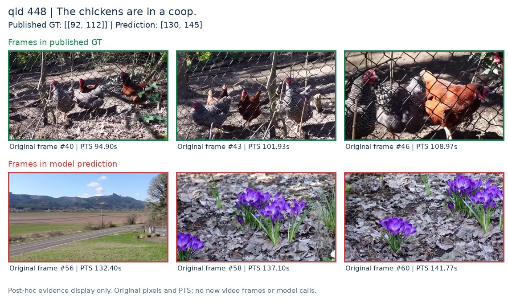
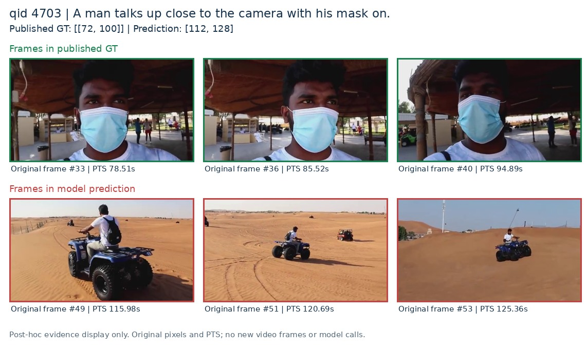
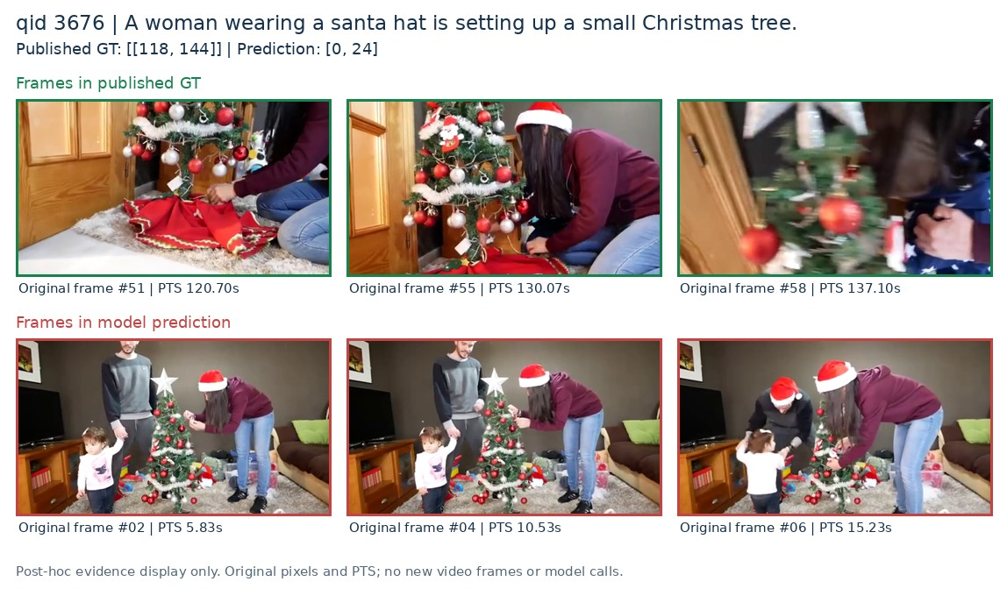
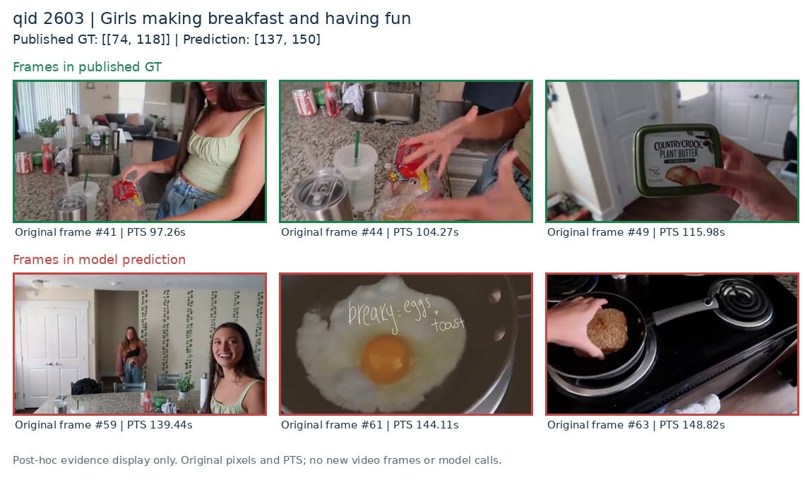
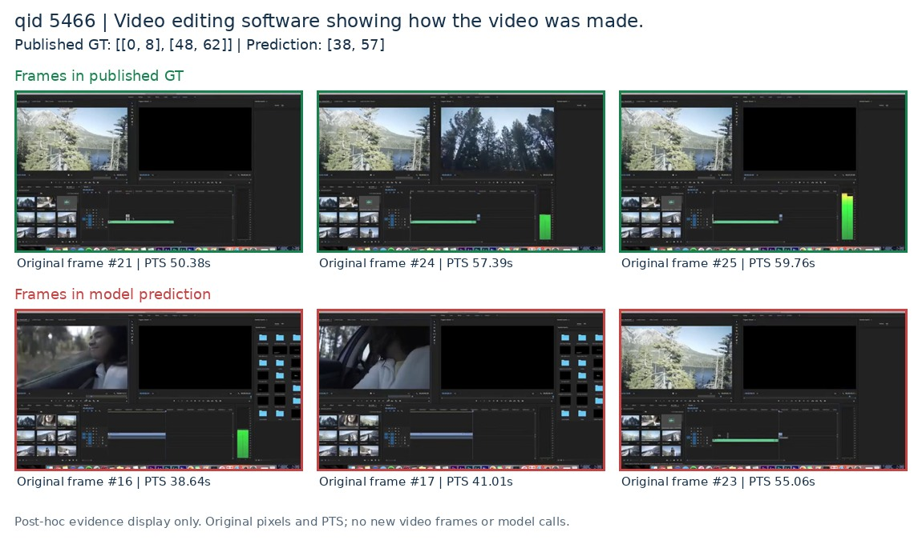

# QV Direct Grounding：52条指标反例的语义核查

> 发布说明（2026-10-30）：本报告随组会 PPT 和总结同步。保留原实验事实、历史状态与预算；机器路径改用别名，未包含的运行材料明确标为本地资料。文中原“不推送”描述属于编写时记录，本次推送依据后续用户授权。

日期：2026-10-29。覆盖冻结的全部52条合法输出失败样本；基于模型实际读取的原始64帧、真实PTS、Query、预测和发布GT进行助手视觉初筛。

## Material Passport

- Origin：用户要求区分真实定位错误与标注问题；academic-research-suite 的实验解释规范。
- Verification Status：**ANALYZED**。逐例可追溯，尚无独立人工复核；“疑点”不等于已确认标注错误。
- 这是事后错误分析，不是新的模型预测或修正后评测。新增实验模型/API调用、实验token、GPU和解码新帧均为0；没有推送。

## 1. 结论与完整分母

**52条指标失败不能全部认定为真正的模型定位错误。** 初筛将其分为四类：

| 分类 | 数量 | 解释 |
|---|---:|---|
| 较明确的模型定位错误 | **22** | 可见主体、场景或动作段与预测有实质错位，或同一事件被明显截短／混入无关镜头；并不保证GT精确到秒。 |
| 标注覆盖或查询范围疑点为主 | **15** | 预测可能命中未标出的另一次实例，或连续事件被分段、查询与标注范围不一致；不表示整条预测已证实正确。 |
| 模型错误与标注／范围疑点并存 | **10** | 能看到模型遗漏／扩展，也能看到GT漏段或任务范围含混。 |
| 现有证据不足 | **5** | 静帧无法判定关键语音、状态或动作；保留未决。 |

因此，22条可优先作为较明确的定位诊断样本；另外10条也含可见模型问题，但应与标注疑点分别讨论。15条需先核查标签和查询，5条需补充连续视频／音频的人工判断。这里没有将任何样本重新标成“成功”。

一个关键检查是：**14条与全部GT零重叠的样本中，9条有较明确的定位错误，5条主要是标注／实例范围疑点。** “IoU为0”只说明没有命中发布区间，不能直接说明完全理解错事件。

本报告仅覆盖这52条：49条合法区间失败与3条not_found。它不包含1条OOM、1条非法区间及4条未尝试，也不包含14条只在0.7阈值失败的样本。原100条全分母R1@0.5=42%、R1@0.7=28%保持不变，不剔除疑似标签问题重算成绩。

## 2. 较明确的定位错误：具体例子

### qid448：鸡舍被定位成花景和道路

- Query：The chickens are in a coop.
- 发布GT：92–112秒；预测：130–145秒；IoU=0。
- 92.57、99.60、104.27、108.97秒清楚显示围栏内的鸡；预测段130–145秒主要是道路、紫色花朵和文字牌。
- **判断：选错事件位置。** GT边缘可能含转场，但无法解释十几秒预测落在另一场景。

### qid4703：戴口罩的近景被定位成沙地骑车远景

- Query：A man talks up close to the camera with his mask on.
- 发布GT：72–100秒；预测：112–128秒；IoU=0。
- 73.81–97.26秒可见戴浅蓝口罩男子近距离面对镜头；预测115.98–127.73秒显示沙地四轮车的侧后方／远景。
- **判断：没同时满足主体属性与镜头距离。** 不需要从静帧确认“说话”，明确的近景条件差异已足以支持定位错误。

### qid4165：找到了环形灯，却把后面的开车段也包含进去

- Query：Man sits next to a large circle light.
- 发布GT：62–90、98–100秒；预测：60–135秒；IoU=0.3733。
- 62–88秒及约98–100秒可见人物和环形灯；101.94秒之后已切为驾驶、汽车和户外镜头，模型仍延伸到135秒。
- **判断：结束边界明显过晚。** 这条不是完全找错事件，而是正确事件之后没有及时停止。

### qid9160：只匹配到“牛”，没有匹配“站在道路中间的多头牛”

- Query：Cows are standing in the middle of the road.
- 发布GT：54–68秒；预测：19–25秒；IoU=0。
- 19.64秒是池边树旁的单头牛，后续切到池水和人物；56.64–65.88秒才是道路和石墙旁的两头牛。
- **判断：实体类别相似，但数量和空间关系未对齐。** 可作为后续检查查询条件是否完整满足的例子，不据此声称已证明模型内部机制。

### qid4605：存在明确目标动作，却输出not_found

- Query主要内容：女孩从包里拿出毛巾，放到椅子上。
- 发布GT：72–108秒；模型无预测区间。
- 73–76秒可见袋子，78.51–83.18秒出现黄色图案毛巾，85–87秒展开，90.23–104.27秒与椅子位置对应。
- **判断：有可见状态序列支持目标动作，属于较明确漏检。** 不从画面推断查询中人物的族裔属性。

## 3. 标注或任务范围疑点：具体例子

### qid3676：模型找到了前一次布置圣诞树，GT只标后一次

- Query：A woman wearing a santa hat is setting up a small Christmas tree.
- 发布GT：118–144秒；预测：0–24秒；IoU=0。
- 5.83、8.20、10.53、15.23、17.57秒已经可见戴圣诞帽女子在小树旁调整枝叶／装饰；118秒以后出现后续整理过程。
- **疑点：同类事件的另一实例可能未标注。** 当前任务允许输出一个最明确的实例，查询也没有指定“最后一次”。需人工区分setting up究竟只指树体安放还是也包括装饰，不能据此直接改GT。

### qid2603：GT结束以后仍在准备早餐

- Query：Girls making breakfast and having fun.
- 发布GT：74–118秒；预测：137–150秒；IoU=0。
- 137.10、139.44秒女孩们仍在厨房互动；141.77秒咖啡、144.11秒锅中的蛋、146.48秒煎蛋、148.82秒继续烹饪。
- **疑点：后段相关活动可能没有被覆盖。** “早餐”和“开心”不能仅凭静帧完全确认，但预测并非落在无关事件，不能直接认定定位失败。

### qid9319：同一发布会被拆成三个GT区间

- Query：Official brief press about NOVA SCOTIA HURRICANE.
- 发布GT：20–80、82–142、144–150秒；预测：20–150秒；最大单段IoU=0.4615。
- 视觉上大部分时间是同一女性在发布会上发言；GT两个2秒空隙附近未见足以说明事件改变的场景证据。
- **疑点：事件连续性与标注分段口径冲突。** 当前指标取任一单段GT的最大IoU，因此合并段会失败；评价公式本身执行正确。是否确有话题切换仍需音频／人工核查，不能用视觉连续直接证明标签错。

### qid4699：查询说“在喷泉里”，画面主要是“在喷泉池塘旁”

- Query：A group of girls are playing in a fountain together.
- 发布GT：100–124秒；模型返回not_found。
- 101.94、111.31、113.65、120.69、123.02秒女孩在池塘草岸；104.27–108.98秒可见池水、水鸟和喷泉，未见女孩进入水中。
- **疑点：查询文字的活动／空间范围可能不准确。** “在喷泉旁”宽解与“在喷泉里”字面理解会得到不同判断。静帧间可能存在短动作，仍不能确诊标注错误。

其他类似待核查项包括qid22（同一服装与谈话人物在GT以外再次出现）、qid3631（较早的一轮相似互动）、qid2760（人物出镜与插入画面／旁白主题范围不同）。

## 4. 两类问题并存，以及暂时不能裁决的情况

**qid5466：视频编辑软件。** GT为0–8、48–62秒，预测38–57秒。38.64、41.01、43.34、45.68秒已经显示编辑软件，提示GT第二段可能起得过晚；但57.39、59秒多仍有软件界面，预测57秒结束又漏掉可见尾部。因此既有标签起点疑点，也有模型终点偏早，不能强行归到某一方。

**qid6506：宫殿游览。** GT48–80秒，预测51–130秒。80–100秒第一处宫殿园林还在继续，GT范围值得核查；预测又跨过约102秒转场、另一宫殿和约128秒船上镜头，存在跨实例扩展。本例初审为“标注／范围疑点”，主审查看全64帧后改为“混合”；初审原文和裁决记录分别保留。

**5条证据不足：4008、4024、2677、2650、4249。** 例如4008查询女孩“介绍早餐”，无音频无法确认介绍从何时开始、何时结束；2677“谈论巧克力”不等于画面必须一直展示巧克力；4249“同步设备”不能用手机出镜代替同步状态；4024杯子不再入镜不等于已放下。这些目前不计作已确认模型错误或已确认标签错误。

## 5. 对后续工作的含义

1. 优先用较明确的错误检验grounding机制：选错场景（448、4703）、查询条件未同时满足（9160）、结束位置越界（4165）、空输出漏检（4605）。保持事件定位、关系条件、边界问题分别解释。
2. 对15条范围疑点及10条混合样本，先人工看连续视频；依赖语音的项目需核对音频。记录是重复实例漏标、边界口径、话题范围还是查询措辞，保留原GT并另存审阅意见。
3. 不把这52条错误子集上的修复率写成总体性能，不用去掉疑似坏标签后的分数代替原指标。若后续需要修订评价口径，须事前写清规则，并保留原官方口径对照。
4. 本轮只形成诊断证据，没有启动回看、记忆、比较器或新Direct条件，也没有改变失败样本或预算。

## 6. 方法、限制与CPU验证

- 全52条都查看了模型实际输入的全部64帧，而不是只查看GT或预测区间。由主助手及三个分组助手完成；主助手另行交叉查看15条，总计直接查看19条。它不是52条各有多位独立人工评审，不报告一致性统计。
- 原64帧通常约2.34秒间隔，无声音；只能定位可见的实质差别，不能确定精确真边界、动作瞬间、旁白或屏幕外状态。部分“较明确错误”置信度为中，详见逐条JSON的限制字段。
- 分类描述的是证据支持程度，不等价于模型内部因果机制；“猜到主题”“忽略约束”等仅作现象解释。
- 52/52唯一qid、冻结顺序、GT、预测和帧文件哈希校验通过；三组原审阅与主审记录完整保留，6506的分类改变单独记账。案例展示帧是事后选取，仅用于解释；不参与新模型输入、子集选择或评分。
- 原diagnostic、inputs、ledger、manifest、prediction_freeze五份文件SHA256全部与冻结值一致。原调用账本仍96次尝试；本轮新增实验模型调用／token／GPU／worker为0，不读取新视频或音频，不重算或调整原成绩。
- 这些数量只描述被筛出的52条指标失败，不能外推成整个QVHighlights的标签错误率；疑似标签问题不是已确认人工标签。

## 7. 完整产物

- [全部52条CSV](../comparisons/qwen_direct/grounding_expand100_case_audit_2026-10-29/all52_case_reviews.csv)：分类、预测、GT、结论与证据路径。
- [全部52条详细JSON](../comparisons/qwen_direct/grounding_expand100_case_audit_2026-10-29/final_case_reviews.json)：逐例时间点、观察、限制、初审与最终分类。
- [CPU验证收据](../comparisons/qwen_direct/grounding_expand100_case_audit_2026-10-29/validation_receipt.json)、[单独裁决记录](../comparisons/qwen_direct/grounding_expand100_case_audit_2026-10-29/adjudications.json)。
- [原扩样结果报告](qwen_direct_grounding_expand100_results_2026-10-29.md)：原100分母的结果、失败和独立旧账。
- 全52张64帧证据图留在SSD审阅目录，逐条链接见下表；项目只保存五张代表证据图与轻量审阅记录，没有复制原视频或模型权重。

## 附录：全部52条逐例结论

顺序沿用冻结输入。所有区间单位为秒；“疑点为主”不表示预测全段已证实正确。更详细的时间戳和限制见JSON。

| qid／全64帧证据 | 最终类别 | 预测 | 全部GT | 判断依据 |
|---|---|---|---|---|
| 2781（本地资料：`$ZEROSHOT_ARTIFACT_ROOT/qwen_direct_grounding_expand100_case_audit_v1_2026-10-29/sheets/qv_2781_all64.jpg`） | 标注覆盖或查询范围疑点为主 | [114, 150] | [[56, 60], [72, 98]] | 发布GT与预测无交集，但预测包含另一段视觉上可能符合泛化query的室内投掷；query并未限定某个靶或某次投掷，不能据零IoU直接认定选错事件。 |
| 2760（本地资料：`$ZEROSHOT_ARTIFACT_ROOT/qwen_direct_grounding_expand100_case_audit_v1_2026-10-29/sheets/qv_2760_all64.jpg`） | 标注覆盖或查询范围疑点为主 | [0, 10] | [[0, 92], [96, 138], [140, 150]] | 任务允许选一个最清楚的实例，而GT可能按整个叙述主题/旁白段覆盖B-roll；不能把预测首个有效出镜片段直接当成漏掉92秒连续动作。 |
| 5466（本地资料：`$ZEROSHOT_ARTIFACT_ROOT/qwen_direct_grounding_expand100_case_audit_v1_2026-10-29/sheets/qv_5466_all64.jpg`） | 模型错误与标注／范围疑点并存 | [38, 57] | [[0, 8], [48, 62]] | 预测起点38秒有可见证据，GT48秒起点疑似遗漏；同时预测终点57秒偏早、仍漏掉后续明确软件画面。标签疑点和真实边界不足并存。 |
| 9319（本地资料：`$ZEROSHOT_ARTIFACT_ROOT/qwen_direct_grounding_expand100_case_audit_v1_2026-10-29/sheets/qv_9319_all64.jpg`） | 标注覆盖或查询范围疑点为主 | [20, 150] | [[20, 80], [82, 142], [144, 150]] | 单段最大IoU惩罚模型合并发布会段落，但静帧没有提供必须断成三个事件的明显场景依据，属于连续事件/标注分段定义疑点。 |
| 448（本地资料：`$ZEROSHOT_ARTIFACT_ROOT/qwen_direct_grounding_expand100_case_audit_v1_2026-10-29/sheets/qv_448_all64.jpg`） | 较明确的模型定位错误 | [130, 145] | [[92, 112]] | 查询的核心对象与场所能在GT段获得直接视觉支持，预测则选择了明显不同的花景和道路段，构成明确的定位错位。 |
| 3790（本地资料：`$ZEROSHOT_ARTIFACT_ROOT/qwen_direct_grounding_expand100_case_audit_v1_2026-10-29/sheets/qv_3790_all64.jpg`） | 标注覆盖或查询范围疑点为主 | [0, 25] | [[8, 150]] | 预测没有选到无关场景；主要冲突是一个很宽泛的乡村展示查询应覆盖短展示片段还是整段农事记录。GT采用8–150秒的宽范围，静帧不足以证明该范围是唯一合理动作单元。保留模型明显截短这一事实，但不单凭截短认定真正定位错误。 |
| 3506（本地资料：`$ZEROSHOT_ARTIFACT_ROOT/qwen_direct_grounding_expand100_case_audit_v1_2026-10-29/sheets/qv_3506_all64.jpg`） | 标注覆盖或查询范围疑点为主 | [13, 23] | [[10, 44]] | 预测是可见查询事件的合理子片段，GT混入桥梁建立镜头、桥上停留近景及场景切换。低IoU可能来自“过桥动作”与“整段桥上游览”的范围差异。 |
| 7435（本地资料：`$ZEROSHOT_ARTIFACT_ROOT/qwen_direct_grounding_expand100_case_audit_v1_2026-10-29/sheets/qv_7435_all64.jpg`） | 模型错误与标注／范围疑点并存 | [19, 30] | [[12, 38]] | 可见的持橙蛇过程在预测两侧继续，存在截短；同时GT也纳入未直接表现持蛇的上下文。两者都能影响本例低IoU，不能归为纯粹选错场景。 |
| 10293（本地资料：`$ZEROSHOT_ARTIFACT_ROOT/qwen_direct_grounding_expand100_case_audit_v1_2026-10-29/sheets/qv_10293_all64.jpg`） | 较明确的模型定位错误 | [65, 130] | [[66, 98]] | 预测找到了相关现场，却把明显不同的发布会与声明卡也延长纳入；这是实质性的结束位置过晚，而不是仅差几个边界秒。 |
| 5361（本地资料：`$ZEROSHOT_ARTIFACT_ROOT/qwen_direct_grounding_expand100_case_audit_v1_2026-10-29/sheets/qv_5361_all64.jpg`） | 较明确的模型定位错误 | [55, 63] | [[62, 70], [78, 84]] | 在可判定的“拿黄色布”视觉条件上，预测偏早并漏掉后续清楚展示该物品的镜头；其大部分区间由天空和尚未清楚展示布的近景构成。 |
| 4324（本地资料：`$ZEROSHOT_ARTIFACT_ROOT/qwen_direct_grounding_expand100_case_audit_v1_2026-10-29/sheets/qv_4324_all64.jpg`） | 标注覆盖或查询范围疑点为主 | [40, 130] | [[50, 84]] | GT50–84秒似乎更偏向舞台全景段；预测覆盖更宽的同一仪式场景，并含GT前后直接可见的舞台内容。应复核“站在舞台上”与“整段仪式”的范围，不能把整个超出段认定为无关内容。 |
| 8894（本地资料：`$ZEROSHOT_ARTIFACT_ROOT/qwen_direct_grounding_expand100_case_audit_v1_2026-10-29/sheets/qv_8894_all64.jpg`） | 模型错误与标注／范围疑点并存 | [81, 128] | [[56, 76], [78, 90]] | 模型只抓到呈餐尾段，并延长纳入另一组食品；与此同时，GT56秒之前已有连续的面饼制作，标注对cooking的起点范围也有疑问。 |
| 9491（本地资料：`$ZEROSHOT_ARTIFACT_ROOT/qwen_direct_grounding_expand100_case_audit_v1_2026-10-29/sheets/qv_9491_all64.jpg`） | 标注覆盖或查询范围疑点为主 | [35, 45] | [[14, 24], [26, 52], [78, 116], [118, 120], [126, 134], [142, 144], [146, 148]] | 预测包含有直接视觉支持的一个冲突现场片段；GT则以较宽报道段和多处蒙太奇片段表达查询。单一最佳连续事件规则不要求覆盖所有发生位置，不能将遗漏其他GT直接计为真正定位错误。 |
| 4165（本地资料：`$ZEROSHOT_ARTIFACT_ROOT/qwen_direct_grounding_expand100_case_audit_v1_2026-10-29/sheets/qv_4165_all64.jpg`） | 较明确的模型定位错误 | [60, 135] | [[62, 90], [98, 100]] | 预测终点135秒跨越了清楚的场景切换，将三十余秒的车辆/户外场景纳入。GT附近约一秒的遗漏不足以解释这段大幅延长。 |
| 4008（本地资料：`$ZEROSHOT_ARTIFACT_ROOT/qwen_direct_grounding_expand100_case_audit_v1_2026-10-29/sheets/qv_4008_all64.jpg`） | 现有证据不足 | [38, 43] | [[18, 44]] | “sharing her breakfast menu”很可能需要语音语义。没有音频，不能判断GT18–38秒是否为持续介绍早餐，也不能判定预测只取38–43秒是严重漏段还是抓住食物展示。 |
| 6548（本地资料：`$ZEROSHOT_ARTIFACT_ROOT/qwen_direct_grounding_expand100_case_audit_v1_2026-10-29/sheets/qv_6548_all64.jpg`） | 较明确的模型定位错误 | [119, 130] | [[82, 102]] | 原GT附近有一组明确的机器取饮品—女子端杯视觉证据；模型却选择后续沙发交谈镜头，未抓住支持查询核心动作的那组画面。 |
| 6264（本地资料：`$ZEROSHOT_ARTIFACT_ROOT/qwen_direct_grounding_expand100_case_audit_v1_2026-10-29/sheets/qv_6264_all64.jpg`） | 模型错误与标注／范围疑点并存 | [0, 43] | [[12, 84], [98, 100], [108, 110], [120, 122], [148, 150]] | 模型对“All angles”明显只覆盖了前半段内饰视角，但GT也漏掉开头0–12秒的清楚内饰和后续部分舱内镜头。属于模型覆盖不足与标注/范围疑点同时存在。 |
| 4296（本地资料：`$ZEROSHOT_ARTIFACT_ROOT/qwen_direct_grounding_expand100_case_audit_v1_2026-10-29/sheets/qv_4296_all64.jpg`） | 模型错误与标注／范围疑点并存 | [0, 150] | [[0, 50], [60, 72], [82, 150]] | 输出覆盖全片而跨过明显骑行插入镜头，违背单一连续匹配区间的要求；但另一个GT空隙中仍有可见持相机内容，不能把所有超出GT的部分都视为无关。 |
| 3676（本地资料：`$ZEROSHOT_ARTIFACT_ROOT/qwen_direct_grounding_expand100_case_audit_v1_2026-10-29/sheets/qv_3676_all64.jpg`） | 标注覆盖或查询范围疑点为主 | [0, 24] | [[118, 144]] | 存在至少一个未被当前GT计分、却清楚支持“戴圣诞帽女子布置小树”的早段。单一最佳区间允许选择另一匹配发生位置；本例零IoU不能作为真正选错事件的证据。 |
| 10032（本地资料：`$ZEROSHOT_ARTIFACT_ROOT/qwen_direct_grounding_expand100_case_audit_v1_2026-10-29/sheets/qv_10032_all64.jpg`） | 较明确的模型定位错误 | [117, 147] | [[70, 106], [108, 126], [144, 150]] | 相较可见的长段连续红衣队列，预测起点偏晚，并将后一段队列返回之前的车辆/人员镜头跨接在一起。可见的定位问题主要是跨镜头扩展，而不是没有覆盖全部多个GT。 |
| 22（本地资料：`$ZEROSHOT_ARTIFACT_ROOT/qwen_direct_grounding_expand100_case_audit_v1_2026-10-29/sheets/qv_22_all64.jpg`） | 标注覆盖或查询范围疑点为主 | [137, 147] | [[64, 82]] | 预测包含标签以外、与查询可见人物和服装特征一致的重复实例。只需输出一段时，不能因为它没有覆盖较早GT就判为模型真错；建议人工核查后段是否同样满足谈话内容。 |
| 4348（本地资料：`$ZEROSHOT_ARTIFACT_ROOT/qwen_direct_grounding_expand100_case_audit_v1_2026-10-29/sheets/qv_4348_all64.jpg`） | 较明确的模型定位错误 | [127, 145] | [[58, 80]] | GT包含查询中可区分的珠宝店浏览画面，预测则选择了后续服装市场/服装店段。虽然两段均在市场，预测没有对应珠宝店这一具体视觉条件。 |
| 4024（本地资料：`$ZEROSHOT_ARTIFACT_ROOT/qwen_direct_grounding_expand100_case_audit_v1_2026-10-29/sheets/qv_4024_all64.jpg`） | 现有证据不足 | [0, 150] | [[0, 62]] | 预测0–150秒可能把持杯事件扩展成整段展会，但仅凭后段杯子没有清晰入镜，不能确认已经放下。GT内持杯证据充分，GT外是否仍持杯在本次静帧证据下无法可靠定责。 |
| 1869（本地资料：`$ZEROSHOT_ARTIFACT_ROOT/qwen_direct_grounding_expand100_case_audit_v1_2026-10-29/sheets/qv_1869_all64.jpg`） | 标注覆盖或查询范围疑点为主 | [110, 148] | [[84, 86], [110, 126], [130, 150]] | 预测有连续市场游览内容，低最大单段IoU主要受110–126与130–150两个标签分段影响；另有84–86秒GT与所见城市景观不一致。应核查标注范围和分段规则，不能据此改GT或合并计分。 |
| 4605（本地资料：`$ZEROSHOT_ARTIFACT_ROOT/qwen_direct_grounding_expand100_case_audit_v1_2026-10-29/sheets/qv_4605_all64.jpg`） | 较明确的模型定位错误 | not_found | [[72, 108]] | GT内有从袋子取出大幅布料、展开，再出现在椅子位置的连续可见状态证据；空预测遗漏了这一明显候选动作段。 |
| 5951（本地资料：`$ZEROSHOT_ARTIFACT_ROOT/qwen_direct_grounding_expand100_case_audit_v1_2026-10-29/sheets/qv_5951_all64.jpg`） | 标注覆盖或查询范围疑点为主 | [135, 145] | [[74, 76], [120, 128], [132, 140], [144, 148]] | 预测包含正确人物的沙滩实例，并跨过132–140与144–148秒两个相邻标签片段之间的镜头变化。可疑点是短暂切走应视为同一沙滩同行场景还是独立事件边界；低最大单段IoU不足以单独说明选错事件，建议人工核查范围。 |
| 2603（本地资料：`$ZEROSHOT_ARTIFACT_ROOT/qwen_direct_grounding_expand100_case_audit_v1_2026-10-29/sheets/qv_2603_all64.jpg`） | 标注覆盖或查询范围疑点为主 | [137, 150] | [[74, 118]] | 预测段包含标签终点之后明确的食物准备和女孩互动，视觉上同样支持查询。GT止于118秒，而后段实际烹饪画面未计入，需核查标签漏标或查询的叙述范围。 |
| 6285（本地资料：`$ZEROSHOT_ARTIFACT_ROOT/qwen_direct_grounding_expand100_case_audit_v1_2026-10-29/sheets/qv_6285_all64.jpg`） | 模型错误与标注／范围疑点并存 | [140, 150] | [[50, 150]] | 预测仅保留最后10秒，遗漏同一拆箱段中52.72–73.82秒最直接的箱内产品展示，存在明显定位过窄；同时50–150秒GT把读卡、自拍与后续互动一并覆盖，查询“三位女子”和“箱内”的范围也不能在全段持续确认，存在实质范围歧义。 |
| 6833（本地资料：`$ZEROSHOT_ARTIFACT_ROOT/qwen_direct_grounding_expand100_case_audit_v1_2026-10-29/sheets/qv_6833_all64.jpg`） | 较明确的模型定位错误 | [137, 142] | [[82, 88], [90, 108], [114, 138]] | 预测大部分可见内容是后续市场标题，只抓住白衣男子段尾帧；GT中有长段清晰的人物对镜头画面，差异远大于采样边界误差。 |
| 9350（本地资料：`$ZEROSHOT_ARTIFACT_ROOT/qwen_direct_grounding_expand100_case_audit_v1_2026-10-29/sheets/qv_9350_all64.jpg`） | 模型错误与标注／范围疑点并存 | [139, 150] | [[88, 140]] | 预测落在主要夜间洪水片段结束后的分屏，错过GT中大量直接夜景，存在实质定位错误；但标签之前已有可见夜间洪水分屏，说明GT可能按画面布局或叙述段落截取，而非包含所有符合宽查询的画面，需另行核查范围。 |
| 4703（本地资料：`$ZEROSHOT_ARTIFACT_ROOT/qwen_direct_grounding_expand100_case_audit_v1_2026-10-29/sheets/qv_4703_all64.jpg`） | 较明确的模型定位错误 | [112, 128] | [[72, 100]] | GT与预测在镜头距离和活动场景上明显不同；预测是沙地骑车段，不能满足查询的近距离戴口罩对镜头画面。 |
| 7038（本地资料：`$ZEROSHOT_ARTIFACT_ROOT/qwen_direct_grounding_expand100_case_audit_v1_2026-10-29/sheets/qv_7038_all64.jpg`） | 较明确的模型定位错误 | [53, 72] | [[52, 54], [64, 82]] | 预测53–72秒把约10秒墙面装饰切镜包含进来，却提前截断64–82秒同一连续抱婴儿段。不是因为没有找出每个重复实例而判错，而是所选一段夹入明显不相关内容并漏掉其自身连续尾部。 |
| 8975（本地资料：`$ZEROSHOT_ARTIFACT_ROOT/qwen_direct_grounding_expand100_case_audit_v1_2026-10-29/sheets/qv_8975_all64.jpg`） | 较明确的模型定位错误 | [129, 150] | [[90, 130]] | 预测基本选择了海滩同行镜头之后的窗边交谈镜头，场景不满足沿海滩这一明确条件；主要偏移不可能只由约2.34秒采样误差解释。 |
| 2677（本地资料：`$ZEROSHOT_ARTIFACT_ROOT/qwen_direct_grounding_expand100_case_audit_v1_2026-10-29/sheets/qv_2677_all64.jpg`） | 现有证据不足 | [0, 150] | [[54, 104]] | 预测0–150秒确实宽于有产品演示的54–104秒，但查询关键是“谈论巧克力片”，仅凭产品未展示不能判断前后口述是否仍围绕该主题。现有无声静帧不足以区分模型过宽和标签只标商品展示段。 |
| 5267（本地资料：`$ZEROSHOT_ARTIFACT_ROOT/qwen_direct_grounding_expand100_case_audit_v1_2026-10-29/sheets/qv_5267_all64.jpg`） | 较明确的模型定位错误 | [10, 16] | [[8, 46]] | 模型找对了目标场景但只截取很短开头；同一连续穿塑料雨披段在17.57–43.33秒仍有充分可见证据，明显遗漏不是标签中另一独立实例。 |
| 658（本地资料：`$ZEROSHOT_ARTIFACT_ROOT/qwen_direct_grounding_expand100_case_audit_v1_2026-10-29/sheets/qv_658_all64.jpg`） | 较明确的模型定位错误 | [0, 15] | [[2, 4], [24, 30], [42, 48], [58, 64], [88, 94], [112, 116], [126, 134], [138, 146]] | 预测0–15秒把极短的正确展示扩展到空手介绍及户外单人拍摄，存在较大不相关范围。输出一段已足够，错误不在于未选择后续其他GT，而在于所选首段本身过宽且跨场景。 |
| 2650（本地资料：`$ZEROSHOT_ARTIFACT_ROOT/qwen_direct_grounding_expand100_case_audit_v1_2026-10-29/sheets/qv_2650_all64.jpg`） | 现有证据不足 | [10, 15] | [[10, 48]] | 不能仅因预测比GT短就认定完整欢呼事件被遗漏。查询的唱歌和欢呼包含关键声音/动作语义，预测之外的观众是否仍在唱歌欢呼无法从静帧裁决；因此保留证据不足，而非判定GT有错或预测正确。 |
| 4725（本地资料：`$ZEROSHOT_ARTIFACT_ROOT/qwen_direct_grounding_expand100_case_audit_v1_2026-10-29/sheets/qv_4725_all64.jpg`） | 较明确的模型定位错误 | [129, 145] | [[8, 12], [80, 114]] | 这是显著时间错位：预测的大部分落在车内和餐饮镜头，未命中查询中在大教堂外与朋友同行的可见实例。 |
| 5538（本地资料：`$ZEROSHOT_ARTIFACT_ROOT/qwen_direct_grounding_expand100_case_audit_v1_2026-10-29/sheets/qv_5538_all64.jpg`） | 较明确的模型定位错误 | not_found | [[90, 98], [102, 116]] | 返回未找到遗漏了可见的目标人物与户外活动段。帽子不是纯白色，帽冠为很浅的灰白色且帽檐深色，但不构成足以解释整段未找到的主要歧义。 |
| 3631（本地资料：`$ZEROSHOT_ARTIFACT_ROOT/qwen_direct_grounding_expand100_case_audit_v1_2026-10-29/sheets/qv_3631_all64.jpg`） | 标注覆盖或查询范围疑点为主 | [43, 57] | [[120, 150]] | 较早一轮同类互动位于预测内，GT只覆盖后面一轮。一段输出任务允许选择一个实例，不能把零IoU直接等同于语义错误；建议人工核查重复实例是否漏标及手势的指向要求。 |
| 9105（本地资料：`$ZEROSHOT_ARTIFACT_ROOT/qwen_direct_grounding_expand100_case_audit_v1_2026-10-29/sheets/qv_9105_all64.jpg`） | 较明确的模型定位错误 | [75, 81] | [[60, 64], [68, 72], [76, 88]] | 模型找到了正确实例但过早结束，遗漏了同一沙滩活动的可见后续；不以未覆盖其他独立GT片段作为错误理由。 |
| 9160（本地资料：`$ZEROSHOT_ARTIFACT_ROOT/qwen_direct_grounding_expand100_case_audit_v1_2026-10-29/sheets/qv_9160_all64.jpg`） | 较明确的模型定位错误 | [19, 25] | [[54, 68]] | 预测混淆了较早的池边牛镜头和后面的道路双牛实例，遗漏查询的复数主体与道路环境组合。 |
| 1835（本地资料：`$ZEROSHOT_ARTIFACT_ROOT/qwen_direct_grounding_expand100_case_audit_v1_2026-10-29/sheets/qv_1835_all64.jpg`） | 较明确的模型定位错误 | [109, 147] | [[72, 102]] | 主体与背景条件共同不匹配，属于明确选错时间段，不能用其他车内活动作为等价实例。 |
| 6506（本地资料：`$ZEROSHOT_ARTIFACT_ROOT/qwen_direct_grounding_expand100_case_audit_v1_2026-10-29/sheets/qv_6506_all64.jpg`） | 模型错误与标注／范围疑点并存 | [51, 130] | [[48, 80]] | GT在80秒结束，但第一处宫殿园林在80–100秒仍延续，存在标注范围疑点；预测同时跨过101.94秒湖面转场、另一宫殿及127.71秒船上画面，存在把不同实例和转场包为单连续区间的可见范围问题。不能把51–130秒整体认可为正确。 |
| 5206（本地资料：`$ZEROSHOT_ARTIFACT_ROOT/qwen_direct_grounding_expand100_case_audit_v1_2026-10-29/sheets/qv_5206_all64.jpg`） | 较明确的模型定位错误 | [73, 127] | [[74, 88]] | 存在可见的动作范围过宽：模型识别了食物/主题，却未把区间收在女子可见进食事件附近。 |
| 4249（本地资料：`$ZEROSHOT_ARTIFACT_ROOT/qwen_direct_grounding_expand100_case_audit_v1_2026-10-29/sheets/qv_4249_all64.jpg`） | 现有证据不足 | [108, 124] | [[88, 124]] | 有漏掉复合查询前半段的明显嫌疑，但“同步”属于当前静帧不能确认的关键动作，且句中放入壳里的“it”与先前小设备的指代不够明确。不能将所有手机演示直接视为同步，故在更严格语义裁决上保留证据不足。 |
| 4601（本地资料：`$ZEROSHOT_ARTIFACT_ROOT/qwen_direct_grounding_expand100_case_audit_v1_2026-10-29/sheets/qv_4601_all64.jpg`） | 模型错误与标注／范围疑点并存 | [126, 133] | [[122, 150]] | 同时存在可见的范围缩短和查询/标注范围问题：预测漏掉134.73、137.10秒仍有自然材料装饰的室内空间，但GT把整段公共区域与装饰展示概括成“豪华酒店房间”，比具体的树枝叶片壁画宽。建议人工确认范围后再解释低IoU。 |
| 8649（本地资料：`$ZEROSHOT_ARTIFACT_ROOT/qwen_direct_grounding_expand100_case_audit_v1_2026-10-29/sheets/qv_8649_all64.jpg`） | 标注覆盖或查询范围疑点为主 | [0, 150] | [[132, 150]] | 这是典型的宽叙述范围疑点：全段视觉连续性支持查询的骑行部分，而GT局限末段。需人工核查旁白的实际起止和内容，不能直接把前132秒判为无关；也不能据此认可整段旁白都匹配。 |
| 5491（本地资料：`$ZEROSHOT_ARTIFACT_ROOT/qwen_direct_grounding_expand100_case_audit_v1_2026-10-29/sheets/qv_5491_all64.jpg`） | 较明确的模型定位错误 | [62, 67] | [[22, 46]] | 属于场景与人物条件未共同对齐：预测不是GT外另一段可见的同类女子池边站立实例。 |
| 4699（本地资料：`$ZEROSHOT_ARTIFACT_ROOT/qwen_direct_grounding_expand100_case_audit_v1_2026-10-29/sheets/qv_4699_all64.jpg`） | 标注覆盖或查询范围疑点为主 | not_found | [[100, 124]] | 查询“playing in a fountain together”的介词和活动范围与GT可见画面不一致；若按“在喷泉旁玩耍”宽解，则GT可成立，按字面“在喷泉里”则未得到支持。not_found不能直接判为明确模型漏检，建议人工核查查询表述与原片。 |
| 4660（本地资料：`$ZEROSHOT_ARTIFACT_ROOT/qwen_direct_grounding_expand100_case_audit_v1_2026-10-29/sheets/qv_4660_all64.jpg`） | 较明确的模型定位错误 | [128, 147] | [[86, 108]] | 模型抓住了街道同行场景但混淆前景人物组合，且遗漏清楚符合“两名男子并排”的GT段。预测开头后方仍有男性，并不能使整个19秒成为该关系的等价匹配。 |
| 8105（本地资料：`$ZEROSHOT_ARTIFACT_ROOT/qwen_direct_grounding_expand100_case_audit_v1_2026-10-29/sheets/qv_8105_all64.jpg`） | 模型错误与标注／范围疑点并存 | [0, 150] | [[2, 4], [8, 12], [20, 26], [28, 38], [40, 44], [46, 50], [54, 60]] | 必须保留模型过宽这一可见错误：不需要覆盖所有GT窗，更不能将用餐、陆地交谈统统包进一个150秒区间。同时，GT对早段作碎片化标注且未收录后段类似乘坐实例，inner tube与多人筏的用词范围值得人工核查，故列mixed而不据此重算分数。 |
