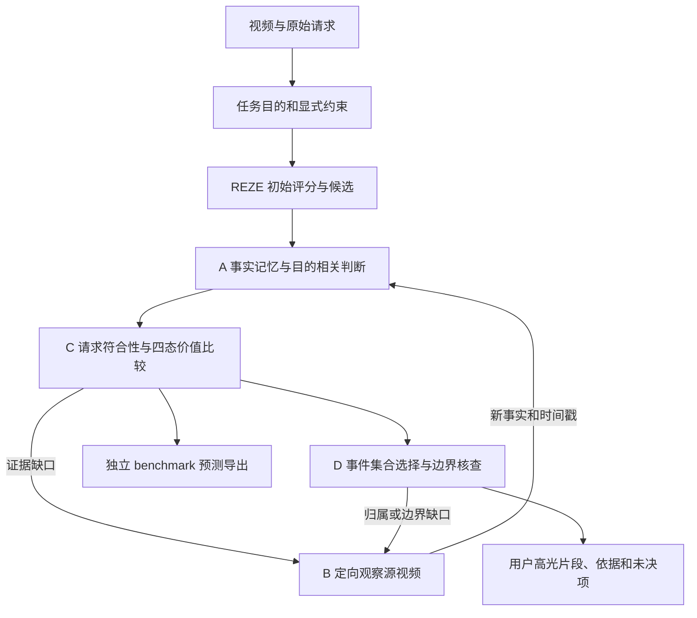

# ReVALUE 现阶段实验方案与下一步安排

整理日期：2026-10-26；结果核验时间：北京时间 11:35。本文汇总原始框架要求、已完成实验和下一步顺序，作为现阶段阅读入口。**本次为方案整理，未启动新实验。**

总体设计继续以[执行方案 v3](revalue_execution_plan_v3_2026-10-23.md)为准，其已对照用户提供的《ReVALUE_高光检测框架与模块图解_原版优化.docx》。已完成 R2 按[修复协议 v3](revalue_r2_repair_protocol_v3_2026-10-26.md)解释。本文不修改历史协议、预测或停止决定；新增诊断对照在执行前另建版本、冻结配置与预算。

## 1. 当前目标与方法定位

优先提高高光检测精度，控制实验规模。以 **REZE 初始化 + Qwen3-VL-8B-Instruct + ReVALUE 记忆、比较、观察和选片模块**为主线。

研究目标是：针对用户观看目的，利用可追溯证据比较候选的观看价值；证据不足时有目的地回看；最后交付满足请求、具有必要上下文的高光片段。当前先验证局部机制，再验证完整闭环和跨数据集迁移。

原始五类价值保持为**结果、信息、情感、动作、感官**。它们根据请求和可见证据选用，不机械平均或固定加权。早期 event / emotion / novelty / importance 四类 cue 是辅助证据，不替代五类价值。

固定骨干为 `Qwen/Qwen3-VL-8B-Instruct`，revision `0c351dd01ed87e9c1b53cbc748cba10e6187ff3b`，BF16、temperature 0；当前不同时更换模型、引入训练或增加音频。

## 2. 完整框架与当前实际流程

### 2.1 原始方案要求保留的完整框架



| 模块 | 应具备的能力 | 现阶段证据与缺口 |
|---|---|---|
| 任务理解 | 原请求、具体/宽泛/通用目的、明确数量和时长；没有说明的限制保持空值 | 已实现 TaskSpec 与原文引用约束；格式通过不代表所有复杂请求已理解正确 |
| A 记忆 | 保存事实、来源、事件关系；与目的判断分层；保留区分候选的细节 | 局部事实、普通/决策记忆和有界更新已运行；尚未证明稳定精度收益 |
| C 比较 | 甲优、乙优、相当、证据不足；双侧证据、目的相关价值 | 已完成双向比较；当前大量结果为相当或未决，是优先诊断对象 |
| B 观察 | 根据覆盖、归属、价值、边界缺口调用 Scan / Segment / Stitch | 工程接口已有；R2 仅检验候选附近观察，实际触发来自控制器规则 |
| D 交付 | 事件去重、必要上下文、数量/时长约束、边界细化后重新选择 | 已有契约和 CPU 行为原型；尚无完整真实模型闭环结果 |

### 2.2 当前 R2 实际做了什么

1. 复用原 REZE 对整条视频的密集评分，保留其全部初始化成本。
2. 固定原 C0 Top-5 的五个 2 秒候选及其旧帧；候选是时间锚点，不等于完整事件。
3. 从每候选最多四张旧帧提取与 query 无关的事实，压缩为最多 1,024 tokenizer token 的活动记忆。
4. 根据 TaskSpec 做五候选的 20 次有向比较。记忆组的比较器仍能读取候选旧帧，**不是纯文本 memory-only 评分实验**。
5. 对可执行缺口一次性规划最多两个观察动作。当前修复版在模型空规划且发生双向冲突时，由控制器生成两端归属查证。
6. 均匀组与定向组共享问题、触发样本和调用次数，每动作最多 24 张新增唯一源帧；更新同容量记忆，再做 20 次比较。
7. 仅置换五候选已有分数，其他 2 秒格分数保持不变，导出完整 QV 评分序列。

两方向一致选出同一赢家才形成胜负边；其余分别记录支持并列或未决。没有胜负边时按原 B0 分数导出。这一轮不能检验候选外召回、完整事件选择、精细边界或降低密集初始化成本。

## 3. 已完成实验与最新结果

### 3.1 阶段状态

| 阶段 | 范围 | 当前结论 |
|---|---|---|
| REZE 基线及 P_abs / P_pair | QV validation 1,550 条 | 已完成；作为历史完整对照，见[全量报告](reze_fullval_results_2026-10-20.md) |
| R0 工程验证 | 固定 20 条及隔离修复检查 | 真实多帧、引用、结构化输出和预算检查已通过；独立人工语义审阅仍未完成 |
| R1 记忆对照 | 原 explore100 中固定 20 条 | 已完成；决策记忆未优于直接比较，普通/决策记忆差异不足以支持稳定收益 |
| R2 v2 | 同一 explore100 的 100 条 | 已完成；7 条解析失败回退、0 条实际观察，保留为失败诊断 |
| R2 修复 v3 | 同一 100 条 | 已完成；0 条技术回退、7 条实际配对观察，精度门槛未通过 |
| R3 完整闭环 | 原固定 20 条，F_once / F_loop | 尚未运行，不能以接口存在视为完成 |
| R4 独立确认及后续全量 | 待核验并冻结确认清单 | 尚未运行；当前没有通过精度扩大条件 |

### 3.2 R2 修复版指标

下表采用官方 **VeryGood** 口径，单位为百分数。全部 100 条保留，属于反复使用的训练开发样本，不是完整验证集或未见确认集。

| 条件 | mAP | Hit@1 | 端到端 token / B0 |
|---|---:|---:|---:|
| B0：原 REZE | 44.41 | 71.00 | 1.000 |
| E0：原 P_pair | **44.58** | **78.00** | 1.556 |
| C_direct4：四态直接比较 | 44.42 | 72.00 | 2.015 |
| E_memory：决策记忆，无新增帧 | 44.49 | 73.00 | 2.889 |
| E_uniform：记忆 + 均匀观察 | 44.41 | 71.00 | 3.028 |
| E_targeted：记忆 + 定向观察 | 44.41 | 71.00 | 3.029 |

R2 于北京时间 **2026-10-26 05:33** 完成，墙钟约 1 小时 26 分钟，累计占卡 **4.4044 GPU 小时**；新增请求 4,450 次，精确复用 566 次，实际新增共享计算 8,414,191 token。之前的失败轮和工程检查成本另行保留，不包含在这 4.4044 小时中。表中各方法 token 比值包含各自独立运行需要的初始化和复用依赖，不能与共享支出混为一谈。

### 3.3 已确认的现象

- 7 条触发规划，模型均返回空动作；控制器为 7 条生成查证。两观察组各 14 次观察、336 张新增源帧。只能确认控制器回看已执行，不能称模型自主规划已成功。
- E_memory 相对 C_direct4 的 mAP 仅增加 **0.0662 pp**，逐查询为 2 胜、98 平；尚未证明稳定记忆收益。
- 100 条共有 1,000 个无向候选对。C_direct4 / E_memory / E_uniform / E_targeted 的确定胜负对分别为 **4 / 6 / 0 / 0**。
- 均匀和定向观察的全部 100 条预测向量均与 B0 完全一致；相对 E_memory，只有 `881、7971、1129` 三条发生分数变化，三条的 mAP 均下降。
- E_targeted 相对 E0 为 **−0.1654 pp mAP、−7 pp Hit@1**，未达到预设进入门槛；配对 95% 区间跨零，不据此宣称统计显著下降。

目前可确认工程修复有效、观察没有产生精度收益。不能直接断言“记忆无用”“视频太短”或“必须强制比较出赢家”。

## 4. 优先诊断的问题

下列机制尚未定位完成，必须区分观察事实和待验证解释。

| 问题 | 需要核对的证据 | 能区分什么 |
|---|---|---|
| 为什么绝大多数比较为 tie？ | 同候选的 P_pair 与四态原始理由、双侧引用、原帧 | 候选确实相似，还是把“都相关”误当“同样值得看” |
| 新观察是否改变了待判断对象？ | 2 秒目标、邻域 PTS、实际观察事实及引用 | 片外上下文是否被误归到目标候选，或有用证据因归属不清未被使用 |
| 记忆更新是否丢失关键差异？ | 更新前后活动记忆、保留/淘汰事实 ID、实际 token | 新事实带来有效补证，还是重复信息挤掉旧依据 |
| 查询问题是否足以改变决策？ | 7 条原缺口、空模型计划、控制器问题和观察回答 | 问题仅确认主体存在，还是能消除具体价值/归属不确定性 |
| 排序导出是否掩盖或撤销变化？ | 双向比较 → 胜负边 → 候选顺序 → 完整评分的 CPU 重放 | 正常按协议回到 B0，还是实现错误；重新全部比较是否使无关旧结论丢失 |

降低 tie 比例、增加回看次数本身不是优化目标。真实相当要保留 tie，证据不足要保留 insufficient；不得靠强迫胜负或放宽引用校验制造增益。

## 5. 下一步实验顺序

### 步骤一：复用现有轨迹，先完成离线诊断

不新增模型推理，先检查全部 100 条的状态分布与评分导出，再逐条检查全部 7 条实际回看：`5172、881、9841、7971、2973、3478、1129`。重点核对三条评分退化样本，同时保留其余四条作为观察未改变结果的对照。

使用原 R1 固定 20 条补充无回看、稳定并列和未决案例；不按 GT 指标重新挑选一个“更容易成功”的开发集。按顺序记录：任务 → 旧证据 → 旧比较 → 缺口 → 问题 → 新观察 → 活动记忆变化 → 新比较 → 评分。

交付逐案例诊断表、记忆保留/淘汰统计、比较转换统计和导出重放结果。将每项原因标为“已复现”“有案例支持”或“尚待验证”。助手核对和独立人工审阅分别记录，后者未进行时保持未评。

**退出条件：**明确至少一个能用单变量对照检验的机制；若观察事实本身不可靠，先修复并验证观察内容；若只发现合理并列，保留负结果，不为进入下一阶段编造缺陷。

### 步骤二：根据诊断选择一个最小对照

继续使用原固定 20 条、原候选和旧帧。每一轮只验证一个有证据支持的问题，其他模块固定；不同时修改比较器、记忆更新、规划问题与排序公式。

| 诊断支持的方向 | 最小对照 | 必须固定的条件 |
|---|---|---|
| 比较把相关性与观看价值混淆 | 当前比较器 vs 明确区分请求符合性、可见差异和观看价值的比较器 | 同帧、同 TaskSpec、同记忆、同四态输出与排序规则 |
| 更新挤掉旧区分证据 | 当前新事实优先策略 vs 保留未被否定的关键旧依据、去除重复新事实的策略 | 同一份真实观察、同比较器、同 1,024-token 容量 |
| 上下文归属错误 | 当前证据接口 vs 明确目标片内/片外及事件关联的接口 | 同一份帧和事实，不额外看视频、不替事实补造身份 |
| 无关结论被整体重算扰动 | 当前整体重算 vs 基于事实依赖使受影响判断失效后重算 | 未受影响条件必须可验证；不能按新分数是否下降决定保留旧结论 |

这些是**候选诊断分支，不是全部同时开跑的消融矩阵**。先冻结一个主对照；有明确必要时再增加一个后续分支。

若只改比较器，每个新条件最多 `20 query × 20 有向比较 = 400` 次；一轮最多两个新条件即 800 次。沿用旧观察的分析不产生新的源帧成本，但仍计入该方法独立获取这些观察的成本。20 条中未发生观察的样本不得伪装成观察机制的有效检验；必要时另报上述 7 条的定向诊断，分母和用途单列。

拟采用最多 **1,000 次新增正式请求、2 GPU 小时**的小规模诊断上限，覆盖比较及必要辅助调用；实际方案、所有子集、瞬时故障额度与绝对 token 上限须在启动前统一冻结。此上限是待执行安排，不重置旧账本，也不允许在 800 次之外无账本补跑。

**退出条件：**目标缺陷得到可审计纠正，严格来源校验通过，没有以新增无依据胜负换取表面改善。mAP、Hit@1、修正/误改、未决率和成本一起报告；20 条最高指标不能独自决定版本。

### 步骤三：冻结一个版本，复核原 100 条

只有最小对照支持相应改动时，建立新的独立 R2 运行。固定原 100 条、模型、候选、旧帧和评价，保留 B0、E0、C_direct4、E_memory、E_uniform、E_targeted 的角色。

若比较器改变，新四态条件全部采用同一个新比较器，保留旧版结果单列；若仅记忆更新改变，只重算受到影响的正式请求。缓存必须按请求、模型、提示、结构约束和实际输入逐项匹配，不能仅按 qid 复用。

正式局部协议仍以 **9,200 次冷启动 Agent 请求、6 GPU 小时、各方法端到端 token ≤6× B0**为上限；按可核验复用扣除实际新增请求，额外瞬时故障最多 460 次。若新设计多出压缩/规划调用，先重新核算并冻结，不套用原 92 次/query 的公式。

沿用原精度门槛：E_targeted 比 E0 / C_direct4 / E_memory / E_uniform 中 mAP 最强者至少高 **1 pp**，Hit@1 最多下降 **1 pp**；技术回退不高于有效父条件且不超过 **1/100**；完整分母、配对问题/帧/调用和预算检查通过，并确有配对观察。

失败则保留诊断和负结果，不自动扩大数据量。不因本轮差距较小而降低门槛。

### 步骤四：完成 R3 的真实 A/B/C/D 功能验收

R3 的接口和 CPU 检查可以继续完善；真实模型实验需单独冻结 R3 执行协议。它不依赖 R2 必须显著提高 mAP，但也不能作为绕过 R2 精度失败、直接扩大性能实验的理由。

在原固定 20 条上比较：

- **F_once：**一次规划、执行观察后完成比较与事件选择，不根据新证据追加问题。
- **F_loop：**观察写回后更新受影响判断，再按新缺口规划；允许新事件入队、修正归属、修改边界并重新选片。

两组使用相同 REZE 初始化、A/C/D 模块和总预算上限。每方法每 query 最多 160 次正式调用、4 次观察/96 张展示帧、3 轮决策、2 个新增事件，活动记忆 ≤1,024 token；两组各 20 条合计最多 6,400 次正式调用、320 次瞬时故障追加、6 GPU 小时，端到端 token ≤10× B0。

重点验收事件身份、证据归属、必要上下文、数量/总时长、边界修正后的重选、预算耗尽及 partial/abstain。真实样本中未出现的行为用夹具单列，不能声称已在视频中验证。两组是相同预算上限，实际消耗不保证相同。

用户片段输出、公共网格评分、审计轨迹分开。QV 的 2 秒标签不能直接验收亚秒边界；D 的片段完整性需要独立审阅，不把进入 D 前的评分增益算到 D 上。

### 步骤五：按通过的命题做独立确认和扩展

R2 通过精度门槛后，核验 confirm100 的历史使用及源视频重叠。若已用于调参或与开发源视频重叠，从 train 的无标签元数据冻结新的 100 条，排除已用开发源视频。确认时只运行冻结版本及必要强对照，不在该集合挑提示或切换版本。

E_targeted − E_uniform 的配对 mAP 区间下界大于 0，才支持稳定的定向位置收益。记忆保留策略的结论需要 M_plain 对照，不能用 E_memory − B0 代替。完整闭环的确认还需要事件发现、片段交付和人工完整性证据。

已有 val1550 已被查看，后续可以做扩大验证，但不能称未见测试集。长视频、效率或其他数据集实验分别冻结清单、对照和预算。

## 6. 各数据集在后续方案中的分工

| 数据集 | 已有范围 | 下一步定位 |
|---|---|---|
| QVHighlights | REZE val1550；ReVALUE R1 20 条、R2 100 条 | 首要开发场景，先分离比较、记忆与局部观察的贡献 |
| SVHighlights | 固定 7 场 REZE 基线 | 优先长视频扩展，检查事件结果、归属和边界；先小规模，同成本均匀观察作对照，确认另选比赛 |
| QFVS | 四源视频全部 180 查询，两组完成；另报排除开发查询后的 176 条 | 概念匹配、重复选择和摘要覆盖诊断；Concept+Temporal Oracle F1 44.86 仍低于 Uniform 46.62，暂不再次全量密集评分 |
| MR.HiSum | 可用 test1888/2000 完成 | 通用高光/摘要迁移；后续开发从 train/val 固定子集，保留官方摘要选片流程，不在已看的 test 上调参 |
| TVSum | 全 50 视频完成 | 通用重要性迁移；标题作为额外输入时单列消融 |
| TVHighlights | 原视频与标注尚未就绪 | 暂不列入运行队列；与 TVSum 明确区分 |

QV 局部机制确认和 R3 功能验收之后，优先推进小规模 SVHighlights，再决定 QFVS 覆盖式观察和通用高光迁移。长视频粗到细需要与密集 REZE、同成本均匀观察比较；报告漏检、精度、完整性与总成本，不能只报省下的局部调用。

## 7. 执行与评价的共同规则

- 推理清单隔离高光标签、摘要和正确数量；预测及账本冻结后才运行官方评价。失败样本保留完整分母，正常 insufficient 与技术失败分开。
- 主报 VeryGood mAP / Hit@1，辅报 Fair/Good；配对统计按源视频聚类、10,000 次 bootstrap、seed42。不同任务的 mAP、语义摘要 F1、摘要 F1 不直接比较绝对大小。
- 均匀/定向观察需要同问题、同触发、同新增帧数和调用数；无动作明确记录，不以零对零配平宣称观察得到检验。
- 每次变更建立新的源码、提示、协议和数据绑定。保存失败、原始响应、记忆版本、引用、淘汰项与完整预测；无语义重试，不生成到满意为止。
- 按用户授权使用任意空闲 GPU，启动前核查进程、显存、利用率与 UUID；可独立查询并行，累计所有 worker 占卡时间，无 GPU 6 保留队列。
- 使用共享账本、query 锁、原子检查点与后台恢复；重启不清零调用、token、帧或时间预算，不抢占其他任务。
- 每阶段交付协议、机器结果、逐样本诊断、成本账本、Markdown 报告及继续/停止决定。按用户要求推送时，将相关报告、方案和索引一起发布。

## 8. 来源、实现与当前交付状态

本报告的 R2 来源是 `$ZEROSHOT_ARTIFACT_ROOT/revalue_r2_v3_2026-10-26/` 下的 `complete.json`、`R2/results/evaluation.json`、六组预测文件及比较审计。这里的路径别名含义见[发布约定](report_publication_workflow.md)；本机完整路径由 `docs/revalue_current_run.local.json` 记录。原始大文件不随 Markdown 自动发布。

```text
R2 binding SHA-256:
b730f089cade44be3d64c7e8166ed3867f014ad9bda2396659145a0df91e2cb1
R2 evaluation.json SHA-256:
f107e358e6f61a1a52e423b8f737749a5983e7f02992f435b1b1ff9b6752c24d
原执行方案 v3 SHA-256（保持不变）:
c1473cf620361cf5ddda06ad36121fab3410f72a17522b15af66e1d2dd771882
```

实现位于 `$ZEROSHOT_ROOT/experiments/revalue/`，本地 Git 发布副本为 `baselines/zeroshot/experiments/revalue/`。当前已有 R0/R1/R2 运行器及 A/B/C/D 基础契约；本方案新增的最小对照、R3 实验运行器和 R4 冻结协议不能视为已完成。

参考入口：[R1 结果](revalue_r1_results_2026-10-25.md)、[R2 故障诊断](revalue_r2_diagnosis_2026-10-26.md)、[R2 修复启动记录](revalue_r2_repair_execution_2026-10-26.md)、[QFVS 全量结果](reze_qfvs_full_results_2026-10-25.md)、[数据集输入输出与指标](datasets_inputs_outputs_metrics_2026-10-22.md)。历史启动记录保留当时状态；现阶段完成情况以本文及不可变运行产物为准。

**下一次执行从步骤一的离线诊断开始。** 在此之前，没有新增 R2、R3、R4 或全量验证任务。
