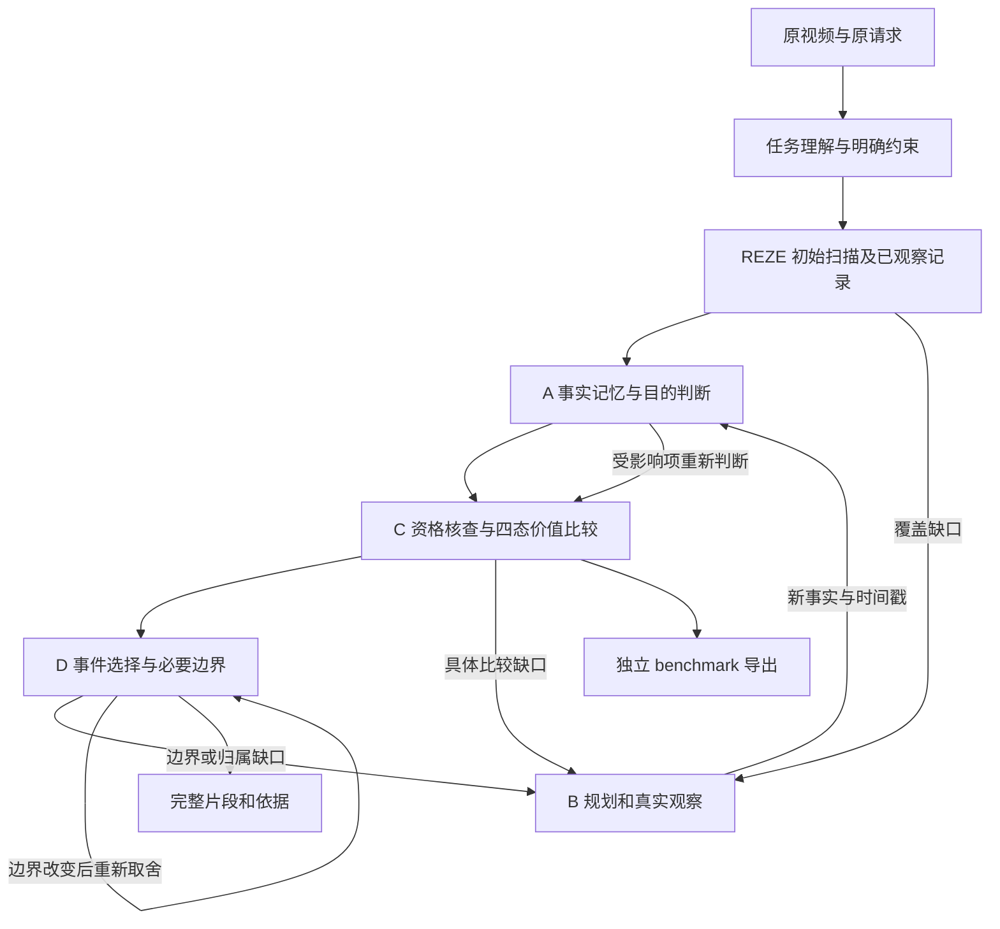

# ReVALUE：基于 REZE 的高光 Agent 执行方案 v3

修订日期：2026-10-23。实验状态核对：北京时间 17:23。
**状态：设计修订；新增 ReVALUE 模块和下述 R0–R4 实验尚未实现或启动。**

本文是后续 ReVALUE 开发与实验的当前依据，替代[执行方案 v2](reze_next_stage_execution_plan_v2_2026-10-23.md)中尚未启动的 Agent 部分。已完成实验、在跑 QFVS 全量验证及其冻结配置继续按各自协议执行；不回写历史结果或停止决定。

## 1. 修订依据与目标

原始依据为用户提供的《ReVALUE_高光检测框架与模块图解_原版优化.docx》，文内日期 2026-10-20，正文及图 1–5 均已核对。文件 SHA-256：

```text
880196d15df70b490639ed83a7a8b22168224fea6a4cb9b01a8833c5a05b4f1f
```

目标保持为**优先提高高光检测精度，控制实验规模**。完整方法需要实现：理解观看目的和明确约束，保存可追溯的事件事实，比较观看价值，按需观察源视频，选择完整片段，并分别输出用户结果和公共基准预测。

原文以 LensWalk 为宿主；依据后续讨论，本项目继续使用 REZE 运行底座与冻结 Qwen3-VL-8B-Instruct。LensWalk 的 Scan、Segment、Stitch 作为观察接口参考，MERIT 原型提供证据索引、时间关系和有界回看的可复用实现。更换宿主不免除原文 A/B/C/D 的能力要求，也不代表已经迁入或复现 LensWalk。

### 1.1 与旧方案的差异及验收对应

| 原文要求 | v3 的落实方式 | 验收阶段 |
|---|---|---|
| 图 1：通用高光、宽泛目的、具体事件；数量与时长由请求明确给出 | TaskSpec 保存原请求、任务类型、显式限制及原文出处；未给出的限制为 null | R0、R3 |
| 图 2：事实层与目的相关判断层分开 | Observation/EventFact 与 PurposeJudgment 分层；换目的只重算判断 | R0、R1 |
| 图 2：保留能区分候选的细节，而非只缓存高分事件 | 同观察、同记忆容量的普通摘要与决策记忆对照；记录保留和丢失内容 | R1，必要时 R4 |
| 图 3：覆盖、事件归属、价值差异、边界四类需求 | 四类 EvidenceGap；支持 Scan、Segment、Stitch 及候选外事件入队 | R0、R2、R3 |
| 图 4：结果、信息、情感、动作、感官五类价值 | 五类目的相关价值，和旧四类 cue 分字段保存；不平均、不固定加权 | R0–R3 |
| 图 4：甲优、乙优、相当、证据不足 | 四态比较、双方证据引用、显式未决问题；保持原 P_pair 强基线 | R0–R2 |
| 图 5：事件集合与完整边界联合选择 | D 按数量、总时长、重复与互补选片；边界变化后重新选择 | R0、R3 |
| 图 1/3/5：观察写回后再次判断 | 有预算的状态控制器；新事实使相关判断、比较和边界失效并重算 | R0、R3 |
| 图 5：用户片段与公共网格分开交付 | 事件结果、benchmark 预测、审计记录三个独立出口 | R0、R3 |
| 原文验证要求 | 同骨干、同证据或同成本对照；评价完整性、请求满足、错误修正及成本 | R1–R4 |

**旧方案“完整五类价值尚未定义”的前提已失效。** 本文明确恢复五类价值；旧配置和已冻结四 cue 实验仍作为历史记录保存。

R2 的固定候选实验只验证局部机制；只有 R3 覆盖 A/B/C/D 的端到端行为，才可称完整框架已接通。框架接通、组件有效、完整方法显著优于基线是三个不同结论。

## 2. 已有证据与当前起点

| 项目 | 核验结果 | 后续处理 |
|---|---|---|
| QVHighlights val1550 | B0 / P_abs / P_pair mAP：42.99 / 43.57 / 43.76；Hit@1：71.68 / 74.06 / 76.84 | 保留为历史完整基准；该验证集已被查看 |
| QV 候选对照 explore100 | C0：44.58 / 78.00；C1：44.66 / 77.00；差值 +0.079845 pp mAP、−1 pp Hit@1 | C1 未过 +1 pp 门槛，后续局部实验固定 C0 原 Top-5 |
| QFVS 四查询 | B0 / Concept Top-k Oracle F1：38.63 / 51.53；Concept+Temporal：54.96；Uniform：50.15 | 属开发诊断，主要提升集中在 P02，不能代替全量结论 |
| QFVS full180 | 17:23 快照：原方法 32/180、概念提示 35/180，均运行中 | 原双卡独立协议继续；完整结果和排除开发查询的 176 条单列 |
| SVHighlights REZE 七场 | mAP / Hit1 / HitK / IoU：16.27 / 14.29 / 16.77 / 9.61 | 已有有效基线；不能再写成“启动失败、无结果”，也不能称全 320 场 |
| TVSum / MR.HiSum | TVSum 全 50 视频完成；MR.HiSum 完成可用 test1888/2000 | 暂不重跑全量，不用跨数据集分数绝对大小判断优劣 |
| REZE Agent 代码 | reze_agent_v2 目录目前只有 V1 候选对照；无完整事实卡、观察器、D 和四态闭环 | 新建独立 ReVALUE 模块，保留旧实现及快照 |
| MERIT 原型 | 已有事实/关系验证、四态比较、有界观察等代码 | 逐项适配和测试，不能按文件存在宣布完整接入 |

历史指标入口：[QV 全量报告](reze_fullval_results_2026-10-20.md)、[跨数据集报告](experimental_results_report_2026-10-22.md)、[QFVS 全量协议](reze_qfvs_full_validation_2026-10-23.md)。

本次核验使用的正式产物路径以 ZEROSHOT_ARTIFACT_ROOT 为根：
- reze_agent_v2_v1_explore100/results/REPORT.md 与 decision.json；
- reze_qfvs_concept_pilot4_gpu4_v2/comparison.json；
- reze_svhighlights_pilot7_gpu5_v2/evaluation.json；
- reze_qfvs_full180_2026-10-23 两条运行的 status.json。

这些路径是本地溯源定位，不表示大型运行产物已经发布到 Git。状态快照不替代下次执行前的实时核验。

## 3. 完整流程及运行模式



**模式一：局部诊断。** 使用已有完整 REZE B0，冻结五个 2 秒候选及原帧，只检验记忆和候选附近补证，输出完整 QV 网格。保留密集 B0 的全部成本；不声称改善全片召回或降低初始扫描成本。

**模式二：完整闭环。** 使用同一 REZE 初始状态，允许事件关联、候选外探索、事件入队、边界核查和重新选片。候选 2 秒格只是事件锚点，不等于独立事件或最终片段。

**模式三：效率扩展。** 后续另行冻结低成本粗扫→局部精看协议。在精度和完整性得到验证前，不同步改变 REZE 初始采样密度。完整闭环也不自动意味着节省密集推理成本。

## 4. 输入、事实、判断与输出契约

以下均为**待实现的 v3 数据契约**；字段须有版本号、校验器及来源记录。

| 对象 | 必要内容 |
|---|---|
| TaskSpec | 原请求、generic/broad/specific、明确对象/事件、数量和时长限制、限制的请求原文片段；缺省为 null |
| Observation | 视频 ID、源帧 ID/PTS、像素哈希、实际读取帧、工具和问题、可支持事实、仍未知内容 |
| EventFact | event_id、原片区间或不确定区间、动作阶段、可见结果和反应、证据引用、可能归属和事件关系 |
| PurposeJudgment | task_id、event_id、资格状态、适用价值维度、保留理由、支持事实、必要播放内容、未决问题、依赖版本 |
| EvidenceGap | coverage/attribution/value/boundary、具体问题、关联事件、允许位置、潜在决策影响及停止条件 |
| Comparison | 两个候选 ID、四态结论、双方证据、所用价值维度、尚未解决的问题 |
| ObservationAction | Scan/Segment/Stitch、源视频位置和范围、采样规则、帧数上限、问题、账本预留 |
| HighlightResult | 单段/多段区间、模型评分或分数未校准标识、价值理由、片内/片外证据、未知说明、约束满足状态 |

已看到的离散帧、扫描覆盖和某项判断已被核实分别记录。3 秒窗口内抽到若干帧，不代表连续动作、人物身份或全段边界已全部看清。

用户没有提出 Top-k 或时长时，不从标签推导数量，也不把 benchmark 的真值高光比例当用户偏好。工程演示可预先声明 Top-1、Top-3/总计 30 秒等任务，但须单列，不能改写官方 query 后沿用原指标解释。

## 5. A：高光决策记忆

### 5.1 事实与判断分层

事实提取不读取 query 或标签，记录可见动作、阶段、结果、反应及源帧。人物/事件身份无法确认时保留多个可能关联；时间先后不直接写成因果。

目的相关判断读取 TaskSpec 和事实，记录价值依据、必要内容及未决项。换目的重新生成判断，不改写原事实。不从画面推断人与用户的亲友关系，不推断未输入的对白和音乐。

每次观察追加有版本的事实，保留冲突和被修正记录；依赖这些事实的判断、比较及边界标为待更新。只有受影响项重算，但其再次调用仍计费。

### 5.2 五类价值及旧 cue 的位置

| 价值维度 | 当前视觉设置中可使用的依据 | 禁止替代判断的做法 |
|---|---|---|
| 结果 outcome | 动作完成、状态变化、目标是否达成及完成质量 | 仅见尝试就断言成功 |
| 信息 information | 对过程、差异或结果有帮助的可见解释细节 | 把描述更长直接当信息更丰富 |
| 情感 emotion | 可见表情、动作和群体反应及其语境 | 把镜头近、人数多直接当情绪更强 |
| 动作 action | 关键阶段、完成质量、清晰度及请求相关技术细节 | 把动作幅度大统一当更值得看 |
| 感官 sensory | 可见画面、构图、视觉变化和体验依据 | 宣称已识别音乐、对白等未输入信息 |

五类价值不是互斥类别；按目的和证据选用，不机械求平均，不为五项强制填写强度。旧 event/emotion/novelty/importance 可作为 evidence_cues 辅助字段，不能一一改名后冒充五类价值，也不进入固定加权公式。

### 5.3 容量与保留策略

局部阶段共用五个 C0 候选、每候选最多四张既有帧，每候选事实提取最多六条、512 输出 token。完整原始提取结果仅作审计日志；比较器只能通过受限记忆接口访问当前可用内容。

R1 使用同一个事实日志生成两种记忆：
- M_plain：普通事件摘要，保留时间与来源；
- M_decision：优先保留候选差异、必要语境和未决关系，避免只按 B0 高分保留。

两组均最多 1,024 个模型 tokenizer token，构建各一次；容量相同不等于实际长度相同，因此同时报告实际长度与截断。检索及一次比较的总记忆输入也不得超过 1,024 token。禁止绕过记忆容量，把被删内容或完整审计日志偷偷拼回提示。

记录保留/删除的事实 ID、引用、压缩成本及细节丢失。证据保存价值和最终播放价值分开：帮助判定归属的上下文可以保存，却不必出现在成片。完整闭环沿用容量上限，更新或回源恢复内容的成本单列。

## 6. C：目的条件化的四态比较

先核查请求中明确的对象、事件及限制，再比较相关观看价值。资格为 satisfied/violated/unknown；仅有明确反证才能判 violated，没看清保持 unknown。不额外规定所有任务必须同一人物或同一次事件。

比较返回 a_better、b_better、tie 或 insufficient，并提供双方证据与适用价值维度。tie 表示已有证据支持价值接近；insufficient 必须指出缺失问题或记录“当前无法形成可执行问题”。

保留原 P_pair 为历史强基线，同时新增 C_direct4：**相同旧帧、相同候选、无记忆、无新帧的四态直接比较器**。新记忆和回看条件均沿用 C_direct4 的价值标准、四态 schema 和排序规则，避免把输出协议变化计为记忆收益。

五候选仍作 20 次有向比较：
- A/B 与 B/A 的赢家一致，才建立有向胜负边；
- 双向均 tie 才标为已支持并列；
- insufficient、方向冲突及其他不一致均保留未决，不能伪装成已支持并列。
- 局部网格排序按胜数减负数；同分按 B0 分数和 clip ID 确定导出顺序。该工程顺序不改变语义上的并列/未知，也不代表置信度已校准。
- 仅置换五个候选原分数，非候选和原分数多重集合不变。E0 与 C_direct4 同时改变比较输出和排序证据，应按整体新比较器对照解释。

四态比较通常最多 384 输出 token/方向。旧 MERIT 的四态与双边引用校验可复用思路，但必须适配新事件身份、模型后端和协议；不能直接认定旧客户端已经满足要求。

## 7. B：从决策缺口到真实观察

### 7.1 四类缺口

| 缺口 | 可执行问题示例 | 对后续行为的影响 |
|---|---|---|
| coverage | 当前未充分检查的范围是否存在请求相关事件？ | 允许发现并加入新候选 |
| attribution | 这次庆祝属于哪次进球？重复回放是否同一事件？ | 更新归属、去重与比较 |
| value | 哪次动作完成更清楚？反应是否明显且属于该事件？ | 更新价值判断或保留并列 |
| boundary | 是否漏掉必要起始动作、结果或反应？ | 修改必要区间并返回 D 重选 |

不只凭低 P(Yes) 触发；概率未证明已校准。“不够精彩”本身不是可执行问题。假设和模型推演不能当新观察。

### 7.2 工具职责

- Scan：扫描指定覆盖缺口；可以使用候选以外的原片范围，并返回新事件线索。
- Segment：在指定局部区间检查具体问题，必要时提高真实源帧采样密度。
- Stitch：联合查看多个已知区间以核实归属或比较；保持各段原片时间戳，不能把拼接顺序当连续动作。

工具可由固定控制器调用，不要求模型自由生成外部调用，也不要求每次都使用三种工具。每次观察都返回实际帧、PTS、事实及未知项并写回 A。

### 7.3 局部配对实验与完整闭环的不同约束

R2 固定每个 2 秒候选向前后各扩 4 秒的允许区间，每 query 最多两次观察、每次最多 24 张新增唯一源帧。两观察组共享问题、触发集合和调用次数，仅改变采样位置；两动作一次性规划，用于隔离观察位置的作用。

E_uniform 在允许区间均匀采样，E_targeted 在规划子区间采样。排除整个父 B0 已见帧及本组已用帧后，以两组可行数量的较小值配平；不足两帧则该动作两组同时取消。新源帧、重复展示、缓存命中和模型 padding 分开计数。此规则必须用父运行 PTS 清单验证，不能只排除当前候选四帧。

R3 允许根据新事实再规划，解除固定 Top-5 与 ±4 秒的语义限制；每次位置仍必须落在合法源视频范围内。优先处理会改变资格、胜负或区间可行性的具体缺口；覆盖缺口也可进入预算队列。相同优先级用时间和 ID 确定顺序，不能用标签选问题。

R3 每个方法每 query 最多四次观察，每次最多 24 张不同源帧、总展示最多 96 张，Stitch 多段合计计数；至多三轮 C/D 决策，最多接纳两个新事件。复用 B0 帧也占观察展示预算，另报新增源帧数，防止以缓存名义绕开成本。新事件须有原帧依据，不得仅凭 B0 分数自动认定。

停止条件为问题已解决、没有可执行动作、下一动作重复且不增加证据、预算不足或技术失败。未解决项显式保留；不循环生成至出现满意答案。

## 8. D：事件集合选择与完整边界

D 是完整 ReVALUE 的必要模块。先实现接口与基本行为，再独立评价；不得以局部 mAP 实验代替其验收。

1. **确定事件身份。** 把 2 秒锚点关联到有证据的事件；相邻时间不自动等于同一事件，重复回放也不自动成为新事件。身份未定时保留关系假设并可请求 B。
2. **提出必要播放内容。** 根据目的确定哪些动作阶段、结果或反应必须出现在输出片段中；不固定要求所有高光都包含“过程—结果—庆祝”。
3. **选择可行事件集合。** 使用 C 的偏好、已核实资格、显式数量和总时长，以及有证据的重复/互补关系。首版采用确定性贪心可行选择，记录每项接受或排除原因，不宣称全局最优。
4. **核查边界。** 只在证据支持的范围内确定起止；边界不清时给出不确定区间并请求 B，不用稀疏帧伪造亚秒精度。必要内容不能靠机械截断满足时长。
5. **反馈与重选。** 必要区间变长、发现新结果或修正归属后，重新检查总时长和事件选择；相关价值排序变化时返回 C。按统一轮数/调用预算停止。

只交付具有支持证据且符合硬约束的已确认片段；部分完成或无法满足约束时返回 partial/abstain 与未决说明。展示层的 partial/abstain 不删除 benchmark 样本：评价层按冻结回退协议输出完整预测。

输出保存 event_id、start/end、边界不确定范围、片段模型评分、价值依据、必要内容、片内/片外证据及约束状态。模型评分需说明读出规则和未校准性质，不把胜负次数包装成观看价值概率。

公共评价另走 exporter：
- R1/R2 的 QV 2 秒评分沿用 §6 的保守置换。
- R3 首先评价事件交付与完整性；可同时报告进入 D 前的网格指标，但不能把其改善归因于 D。
- 若以后要让新事件/边界改变网格分数，须先独立冻结逐格评分与对齐协议，并设置同协议对照；禁止把一个事件分数填满整个区间。
- QV 的 2 秒 HD 标签不能验证亚秒边界质量；MR.HiSum 的官方摘要选片器不能被用户展示选择器悄悄替换。

## 9. 分阶段实验：先隔离机制，再检验完整框架

沿用既有 QV train explore100。R0/R1/R3 的 20 条从这 100 条按 SHA256("revalue-v3:" + qid) 排序取前 20，冻结清单后不因失败或指标更换；它们不是独立确认集。原来用于 MERIT 的 train20 不自动混入该清单。

### R0：契约与工程验收

先完成所有 A/B/C/D 数据结构、控制器和 exporter 的 CPU 行为测试，再做固定 20 条工程检查。检查格式、引用、预算和真实帧输入，不根据其高光指标选择提示。

必须覆盖：更换目的不改事实；tie 与 insufficient 的不同处理；证据归属冲突；新增候选；必要区间变长后重选；无法满足数量/时长时 partial；预算恢复不重置；缓存不能绕过容量或观察预算。三类请求、目的切换等可用确定性夹具覆盖，演示场景不冒充官方标注。

通过后冻结一次正式协议；后续格式修复建立新版本并保留失败记录。

### R1：记忆与四态比较诊断，20 条

| 条件 | 视觉证据 | 记忆 | 用途 |
|---|---|---|---|
| E0 | 原候选旧帧 | 无 | 核验复用原 P_pair |
| C_direct4 | 同一候选旧帧 | 无 | 新四态强比较器 |
| M_plain | 相同事实来源与相同候选旧帧 | 普通摘要，≤1,024 token | 同容量记忆对照 |
| M_decision | 与 M_plain 相同 | 决策记忆，≤1,024 token | 差异细节保留策略 |

共享 TaskSpec 和五次事实提取，两种记忆各构建一次；三组新比较各 20 次。最坏每 query 为 1 + 5 + 2 + 3×20 = **68 次**，20 条最多 **1,360 次正式新调用**。E0 只有核验通过才缓存复用。

统计正式 HD 指标、事件混淆、细节保留、无依据判断、四态一致性和成本。20 条只能作开发诊断；不据最高 mAP 反复挑压缩模板，不凭 M_decision 优于 E0 宣称记忆贡献。记忆的直接对照是 M_decision − M_plain，二者使用同一比较器。

### R2：候选附近定向观察，100 条

| 条件 | 记忆/观察 | 研究问题 |
|---|---|---|
| E0 | 原 P_pair | 已有方法基线 |
| C_direct4 | 无记忆、无新帧 | 更改比较输出协议的影响 |
| E_memory | M_decision，无新帧 | 结构化事实辅助比较 |
| E_uniform | 同一记忆、同一问题，均匀补看 | 增加观察是否有用 |
| E_targeted | 同一记忆、同一问题，定向补看 | 同预算选位置是否额外有用 |

E_memory、E_uniform、E_targeted 使用同一四态比较器及排序规则。无可执行缺口时，两个观察组复用 E_memory；并列有依据时不为强行分胜负而补看。

R2 的观察写回采用两组相同的确定性保留规则，不另调用模型压缩：本轮问题的新事实优先，其次为相关旧事实，其余按时间/ID 排序，按完整事实条目裁剪至 1,024 token，并记录淘汰项。不能将最多两份 512-token 观察直接附在原有 1,024-token 记忆之外。规划器只读取这一活动记忆、候选元数据和压缩后的比较状态；完整响应、淘汰事实和审计历史不得作为旁路记忆。若实现改为模型更新记忆，必须在正式启动前重算调用与 token 上限，不能沿用下面的 92 次。

两次动作统一规划；观察组各最多两次，补看后各进行同样的 20 次比较。最坏每 query：

```text
1 TaskSpec
+ 5 事实提取
+ 1 决策记忆压缩
+ 20 C_direct4 比较
+ 20 E_memory 比较
+ 1 观察规划
+ 2 × (2 观察 + 20 比较)
= 92 次正式新调用
```

100 条最多 **9,200 次**。原 v2 的 7,000 次不再适用于新增四态对照和记忆压缩；不得把这些开销隐藏在“工程”中。R1 中协议/证据完全一致的结果可验证复用，实际新增量与独立从零成本分别报告。

本阶段仍不验证 D、候选外召回或完整方法。若需要声称普通摘要与决策记忆的稳定差异，须在 R4 保留 M_plain 对照，不能把 R1 的 20 条结果外推。

### R3：完整 A/B/C/D 闭环，20 条

在相同初始 REZE 扫描、事件证据和 TaskSpec 上比较：
- F_once：一次规划后执行观察、比较、选片；不能依据新观察另提问题；
- F_loop：每次真实观察写回后更新受影响判断，按新缺口再次规划，可新增事件并重新选择。

两者均使用五类价值、四态比较与 D，拥有相同总调用/观察/记忆容量上限。实际动作与成本可能不同，因此称**相同预算上限的策略对照**，不能声称相同实际帧或成本。R2 的严格配对结论单独保留。

首次运行仅验证完整框架是否工作及失败类型。新增事件、覆盖、归属、价值比较、边界修正、超时长重选均须有可审计轨迹；未触发的能力由工程夹具验证，不能假装真实样本中已验证。

上限为每方法每 query 160 次正式调用，包含 TaskSpec、事实提取、记忆更新/检索压缩、规划、观察、比较和 D；两组 20 条合计最多 **6,400 次**。控制器同时执行 §7 的四观察/96 帧/三决策轮/两个新事件限制。每轮至多七候选的 42 次有向比较，其他调用逐项预留，不能在 160 次之外另建未计费子流程。

D 的初始区间与精细区间可在同一最终证据上做 CPU/记录回放诊断，但这是条件分析；不据此宣称自适应观察的因果收益。完整比较仍使用两组各自产生的轨迹和全部成本。

### R4：条件确认与整片发现评价

R2 通过精度门槛后，在既有 confirm100 中先审计历史使用及源视频重叠；若已用于选择或与开发集重叠，则从官方 train 中按 seed42、无标签元数据冻结新的 100 条，排除所有已用开发源视频。

只确认已冻结版本及必要强对照，不能在确认集选择提示或切换最优版本。R2 的确认保持同一五条件与 9,200 次 Agent 新调用上限；B0/E0 若无可复用收据，另按无标签窗口清单计数冻结，不能照搬旧的 15,964 次总量。

R3 通过功能验收后，完整方法的性能确认再比较覆盖式 Scan、普通目的驱动观察、证据缺口驱动观察，使用同一初始化、A/C/D 和预算上限。须评价整片事件发现，不能仅报共同候选内排序。该长视频确认的数据清单、标注条件和预算需形成独立冻结协议后运行，不能凭 v3 自动扩成所有数据集全量。

## 10. 评价、门槛和结论边界

### 10.1 公共指标与失败处理

QV 主报官方 VeryGood mAP、Hit@1，辅报 Fair/Good、逐查询差值、按源视频聚类的配对 bootstrap（10,000 次，seed42）。全部查询保留；推理端不读 saliency、参考摘要、正确高光数量或评价派生特征。

格式/引用失败与正常 insufficient 分开记账。前者按父条件回退并计失败率；后者是有效的不确定判断，报告未决率。配对观察一侧无法执行时两侧同步取消该动作，注明原因。无语义重试；只允许账本内的瞬时故障补试。

R2 进入精度确认须同时满足：
1. E_targeted 相对 E0、C_direct4、E_memory、E_uniform 中 mAP 最高者，提升至少 **1 pp**；
2. Hit@1 降幅不超过 **1 pp**；
3. 技术回退不高于有效父条件且不超过 **1/100**；没有漏掉失败样本；
4. 两观察组问题、触发、实际新增帧数及比较调用配平，且未超资源预算。

门槛使用未四舍五入值，是筛选规则，不是显著性证明。确认时 E_targeted − E_uniform 的 mAP 配对区间下界大于零，才支持稳定的观察位置收益；跨零须报告证据不足。失败则分析问题选择、观察位置、事实错误、比较错误及候选遗漏，不靠扩大数据量替代诊断。

R1/R3 可继续做预定的功能检查，即使 R2 不过精度门槛；但不自动升级到全量性能实验。未证明的模块贡献如实标为未验证。

### 10.2 完整片段及记忆评价

R1/R3 固定 20 条生成匿名审阅表，不展示方法名、原分数或 GT。由人工独立检查；没有人工审阅时标为“未评”，不能用模型自评填成人工结果。

| 检查项 | 记录方式 |
|---|---|
| 请求与硬约束 | 主体/事件是否满足，数量、总时长是否满足；未知和不可行单列 |
| 片段完整性 | 当前目的所需动作、结果、反应是否被截断；逐必要内容记录 |
| 无关与重复内容 | 不服务请求的内容、重复回放是否被重复交付 |
| 事件与证据归属 | 引用是否真实、是否属于该事件、片外证据是否被误写成片内事实 |
| 比较质量 | 同一事实在不同目的下的选择是否合理，tie 与 insufficient 是否区分 |
| 记忆保留 | 同容量下关键差异、上下文、未决关系的保留/丢失情况 |
| 观察效果 | 原错误被修正、原正确被误改、仍未解决及无新增证据的次数 |
| 边界与反馈 | 边界不确定范围；扩展后是否重新满足时长和选片约束 |

人类判断先保留逐项标签与原证据，后报明确分母的比例及不确定性；不为缺少标注的数据集编造“官方完整性分”。多个合理片段可以均合格，不要求与唯一人工区间完全一致。

完整框架的功能验收要求：关键行为测试全部通过、无非法源帧/标签引用、硬约束违规不被标成成功、失败/未决/预算完整保留。性能验收还需要匹配对照上的公共指标和人工完整性证据，不能用结构测试代替语义质量。

## 11. 实现目录、复用边界和交付物

建议在零样本工作区新建 **experiments/revalue/**；这是计划路径，目前尚未创建。发布副本对应 baselines/zeroshot/experiments/revalue/。旧 reze_agent_v2 继续保留 V1 身份，不把新协议覆盖进去。

| 模块 | 职责与主要验收 |
|---|---|
| schema.py / task.py | 契约、版本、请求类型、显式约束出处；不虚构缺省数量 |
| memory.py / retrieval.py | 事实/判断分层、容量与保留、引用、版本依赖、受影响项失效 |
| comparison.py | 五类价值、资格三态、偏好四态、双向一致性和预算 |
| planner.py / observer.py | 四类缺口、三类工具、真实 PTS、去重、配平与观察写回 |
| selector.py / boundary.py | 事件归属、可行集合、必要内容、边界及重新选择 |
| controller.py | 有界 A/C/D/B 反馈、候选入队、终止、partial 与恢复 |
| exporters.py | 用户事件结果、各 benchmark 预测与审计轨迹分离 |
| prepare.py / worker.py / evaluate.py | 无标签清单、冻结运行、条件切换、账本、评价与报告 |

复用 REZE 的媒体/模型校验、初始评分、缓存账本、自动恢复和官方评价；参考 MERIT 原型的引用、四态和真实帧读取逻辑。新观察后端必须验证实际多帧容量，不能沿用旧“两段、每段四帧”的限制假装支持 24 帧。

冻结 Qwen3-VL-8B-Instruct，revision 0c351dd01ed87e9c1b53cbc748cba10e6187ff3b，BF16、temperature 0；不在同一消融中更换骨干、量化或训练模型。

每次运行保存 plan、无标签 manifest、TaskSpec、源码/模型/提示/视频/像素哈希、父运行收据、容量和预算配置、逐请求账本、观察与记忆版本、比较、边界历史、完整预测、逐查询评价、Markdown 报告和 decision.json。源码与报告同步到发布工作区，不复制视频、模型或大型缓存。

## 12. 资源上限和运行顺序

| 阶段 | 正式新调用上限 | 工程/瞬时故障补试 | 活动 GPU 小时上限 |
|---|---:|---|---:|
| R0 | 0，全部归工程调用 | ≤500 次工程调用，无无限格式重试 | 2 |
| R1，20 条 | 1,360 | 额外瞬时故障尝试 ≤68 | 2 |
| R2，100 条 | 9,200 | 额外瞬时故障尝试 ≤460 | 6 |
| R3，两组各 20 条 | 6,400 | 额外瞬时故障尝试 ≤320 | 6 |
| R4 | 局部确认按 §9；长视频另立协议 | 启动前按清单冻结 | 工程实测后冻结 |

R0–R3 无任何复用时，正式调用合计最多 **16,960**，工程最多 **500**，瞬时故障额外尝试最多 **848**。它们是停止上限，不是必须消耗的量，也不等于本次修订已经启动这些实验。实际可核验复用从新增量中扣除；各独立方法的冷启动成本仍完整报告。

R1/R2 每个方法的端到端输入加输出 token 上限为同清单 B0 的 6 倍，R3 为 10 倍；按冻结 B0 收据确定绝对 token 数。该限制同时包含共享依赖、记忆及规划；不同实验组共享计算只降低实际支出，不降低方法独立成本。新的 384/512/1,024 token 是单请求上限，不是总预算。

TaskSpec 最多 256 输出 token，事实/观察最多 512，记忆压缩最多 1,024，比较最多 384，局部规划最多 384；R3 规划最多 512、D 联合输出最多 1,024。输入长度、视觉 token 和耗时由工程样本实测，预留下一请求后才发送。任一调用/token/帧/GPU 时间上限先到即停止；不能静默删样本、降分辨率或扩预算完成表格。

GPU 小时按各占卡 worker 累加，含模型加载与失败尝试，排队时间另列。两卡并行不能把总 GPU 小时减半计。使用 systemd、锁、原子检查点及 900 秒无进度停止，恢复不得清空账本；不存在 GPU 6 保留队列。

当前 QFVS full180 按独立冻结协议继续使用 GPU 4/5。新 ReVALUE 阶段先做 CPU 实现；正式运行前核对空闲设备及 UUID，不结束其他任务抢卡。该运行的结果只用于自己的预定比较，不中途用于修改本计划提示。

## 13. 数据集分工与扩展条件

- **QVHighlights**：R1/R2 查询相关高光主线；R3 使用同源开发样本检验事件交付。完整 val1550 已查看，不作未见确认集。
- **SVHighlights**：长视频运动事件、归属、结果及边界的后续验证。先利用已有七场作开发，确认需另选源比赛；完整端到端基线成本包含解码和 B0。
- **QFVS**：概念查询与长视频摘要覆盖诊断。full180 完成后单列 180/176/4 及每视频结果；不能把语义摘要 F1 等同高光或边界质量。此前八查询 Q3 不再作为独立确认，因为 full180 已包含这些查询。
- **MR.HiSum**：通用高光及摘要迁移。先从 train/val 固定小规模开发，保留官方 KTS/背包评价；不在已看过的 test1888 调参。
- **TVSum**：通用重要性迁移；标题是额外输入，需要单独消融。
- **TVHighlights**：原视频与标注未就绪，不进入实验队列，不用 TVSum 替代。

新增长视频粗到细效率协议需与密集 REZE 和同成本均匀观察比较；报告漏检、完整性与精度—成本关系。原 v2 的“总成本下降 ≥30%、mAP 下降 ≤0.5 pp”仅保留为后续效率开发门槛，不能在精度失败后临时改成当前成功标准。

## 14. 下一次执行顺序与报告口径

1. 读取本文及实时运行状态；保留 QFVS 全量进程和所有历史快照。核验 explore100、确认集使用历史、C0 选择、父预测/帧/模型哈希。
2. 创建独立 revalue 实现，先写 TaskSpec、两层记忆、四态比较、四类缺口、D 和三路导出契约；完成 CPU 行为与恢复测试。
3. 跑 R0 工程检查，确认模型多帧容量、实际 token 和吞吐；一次冻结 R1/R2 的模板与预算。
4. 依次完成 R1 和 R2，报告 E0、C_direct4、记忆与观察的各自差异；按门槛决定是否进入独立精度确认。
5. 在固定 20 条完成 R3，检验完整选片与反馈；补充人工审阅表。没有人工评审时保留空白及未验证结论。
6. 根据通过的研究命题实施对应 R4；记忆、观察、事件集合和边界的贡献分别保留必要强对照，不同时全量组合所有数据集。
7. 报告和维护代码同步发布工作区，更新索引、来源哈希与链接；每次 Git 推送包含本轮方案及报告。

组会和论文按三层报告：**局部机制结果、完整框架功能结果、独立性能确认**。本版设计恢复原文 A/B/C/D 的要求，并将新增开销、比较器变化和完整片段评价显式列入执行条件；任何尚未实现或未运行的模块都不能作为已有结果。
