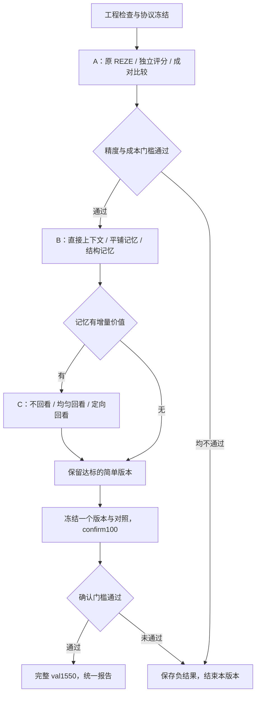

# REZE 高光证据比较：完整执行方案 v1

> 发布状态说明（2026-10-20）：A 阶段 explore100 已完成，但未通过预设继续门槛；随后按用户单独要求完成 P_abs / P_pair 的全量 validation 扩展。B/C 阶段及 confirm100 尚未执行。后文保留 2026-10-19 制定方案时的设计、预算和停止规则，不能将当时的“尚未启动”“尚未实现”当作当前进度。当前结果见[全量报告](reze_fullval_results_2026-10-20.md)。

制定日期：2026-10-19。本文为原始执行方案的公开副本。

本方案落实[研究方向](reze_research_directions_2026-10-19.md)，目标是提高 QVHighlights 高光检测精度，控制实验规模，并逐项检验候选比较、事件证据记忆和定向回看的作用。

[参数清单（冻结快照）](../comparisons/qvhighlights/reze_fullval_2026-10-20/stage_a/plan.json)是规划规格，不是已经实现的运行器配置。下文命名的新模块、服务和命令入口均待实现；现有 REZE 基线和历史 MERIT 实验保持冻结。

## 1. 目标、范围与执行顺序

研究问题：在 REZE 的查询相关性评分之上，可追溯的事件证据与候选比较能否稳定改善高光排序，并证明新增计算的必要性？



- 主任务：HD；每条 query 输出完整 `floor(duration/2)` 个分数。
- 主指标：官方 VeryGood mAP；同时报告 HIT@1、Fair/Good 指标、失败与成本。
- 骨干：冻结 Qwen3-VL-8B-Instruct，BF16，无训练、量化或模型替换。
- 第一版仅重排固定前 5 个 2s 候选。**无法修复候选之外的漏检**；前 5 个 bin 也不等于五个独立事件。
- 候选扩展、全视频记忆优先评分、音频和训练新模型另立后续版本。
- 当前用户请求是制定方案。本轮不启动 GPU；以后收到执行指令后，按预定门槛推进，不在每个常规步骤重复请求确认。

## 2. 已核对的基础与数据

### 2.1 基线

本地完整 val：**42.99 mAP / 71.68 HIT@1，1,550/1,550，零失败**。四张 RTX 4090 的历史墙钟为 32.50 分钟，包含 77,308 次窗口核验；这不能直接当作新增双视频比较和记忆生成的速度。

使用 `reze_val_v2` 的预测及原始记录，预测 SHA256：

`af8efe26f9cd3966e5d3c6b306d87913af8f38f096035bf891df8fa864063452`

该结果是依据论文附录的独立实现，HD-only；论文 test 与本地 val 不直接比较。来源：[REZE 基线与全量结果汇总](reze_fullval_results_2026-10-20.md)。

### 2.2 样本与用途

| 集合 | 数量 | 用途 | 限制 |
| --- | ---: | --- | --- |
| 历史 train20 | 20 | 输入、输出、断点和接口检查 | 已反复开发，不作为独立结论 |
| sustained21 | train20＋qid 7462 | 连续运行与显存检查 | qid 7462 是 explore 中首个不属于 train20 的条目 |
| explore100 | 100 个 query / 100 个源视频 | A/B/C 阶段开发与模块筛选 | 所有条件使用同一分母，不只挑失败例 |
| confirm100 | 100 个 query / 100 个源视频 | 一个冻结版本及其对照的确认评估 | 先审计历史使用；结果出来后不再选版本 |
| val1550 | 1,550 | 最终完整基准评测 | 已经查看过，不能称未触碰测试集 |

已核对 train20 是 explore100 子集；explore 与 confirm 的源视频交集为零。正式执行还要核对 confirm 是否在其他任务中被用于选择方案；不能仅凭名字断言其未使用。若已污染，停止确认阶段，另立数据划分版本并记录原因。

样本路径和 SHA256 已写入参数清单。explore/confirm 的总时长分别为 **14,874 / 14,886 秒**，对应 **7,437 / 7,443 个 2s bin**；按标注时长计算，原 REZE 最多约 **4,962 / 4,964 次窗口核验**，实际数量以解码与残段规则为准。

推理清单仅含 `qid / vid / query / duration / video_path`。GT、saliency、相关区间只供独立评估和事后诊断，不进入候选、提示、建库、选区或恢复逻辑。每阶段全部预测完成后再统一评估，避免根据中途指标改变后续样本。

现有 `launch_reze.py` 固定为 5 条 val smoke 或 1,550 条 val，并依赖先前 CLIP 的视频哈希缓存；现有 `evaluate.py` 也固定读 val 标签。新增运行器须显式绑定 train 的 explore/confirm 清单与对应标签，为这些视频建立独立媒体哈希审计。不能直接拿旧启动器运行 train100，或在旧 val 评估配置中替换路径而破坏历史绑定。

## 3. 公共协议：所有实验必须一致

### 3.1 模型与环境

- 模型 revision：`0c351dd01ed87e9c1b53cbc748cba10e6187ff3b`。
- Python：`source_environment/inference/bin/python`。
- 复用已核对的 torch 2.9.0、vLLM 0.12.0、transformers 4.57.6；不原地升级共享环境。
- temperature=0，seed=0，TP=1；每个 worker 独立加载一份模型。
- 基线完整继承 3s 窗口、2 FPS、原提示、连续 Yes/No 置信度及 2s 读出规则。
- 新评分请求最多输出 1 token，读取 top-20 logits；Yes/No 必须是预期单 token。新组若缺少任一必要 logprob，记为无效请求，不伪装成 0 偏好。原 REZE 的历史 fallback 规则保持不变。
- 新双视频后端初始按 4,096 上下文、pair batch 4、长上下文 batch 2 做工程检查；实际显存、时间编码与缓存边界通过检查后冻结。不能通过悄悄降分辨率解决正式实验中的 OOM。

当前后端只支持单视频、最多 6 帧。新增双视频和最多 12 帧上下文输入需要独立适配，不能只把原 `limit_mm_per_prompt` 数字改大就直接跑全量。

### 3.2 候选与画面

1. 由 B0 的完整 2s 分数降序选 K=5；同分按 clip_id 升序。不做 NMS、事件合并或标签筛选。
2. 候选帧尽量对应 `[2i,2i+2)` 内的四个原采样时刻：`2i + {0, 0.5, 1, 1.5}`。
3. 从 B0 已读取的帧索引与像素中组装；候选归属按原请求采样时刻确定，原始 PTS 和解码帧索引同时保存。禁止拿 MERIT 的旧 JPEG 替换。
4. 残段只使用实际已有观察；处理器的时间 padding 单独计数，不计成新增帧。候选无可用画面时，本 query 的新组回退并记录，不用邻近未归属画面冒充。
5. A/B 双视频均明确标记相互独立的目标区间；记录绝对时间、局部时间和视频顺序。原生时间 token 必须与输入采样时间对应，不能把不均匀上下文伪装成均匀 FPS。
6. 全部硬回答 No 的 query 仍保留连续分数和候选；不使用固定 0.5 阈值删样本。

A 阶段没有 B0 未观察过的帧。B 阶段让比较器看到更多 B0 已观察的上下文；这仍增加信息呈现与计算，必须计费。C 阶段才允许引入 B0 未见过的真实源帧。

### 3.3 共同输出策略

设五个候选原分数降序为 `v1…v5`，新方法给出的候选次序为 `π1…π5`。程序赋值 `score[πr]=vr`，非候选分数保持 B0 原值。

这样只改变候选相对次序，避免不同提示的分数尺度直接混合。原分数存在并列时仍可能并列，不额外添加 epsilon。全视频分数多重集、长度、有限值范围必须与 B0 一致。

该协议是局部排序实验的限制：即使比较正确，也不能突破候选覆盖上限或保证 mAP 大幅提升。后续若要改变候选、产生新分值或破除原同分，必须另立协议，不能在结果不好时临时替换。

## 4. 阶段 A：先验证比较机制

### 4.1 三个实验组

| 组 | 输入与任务 | 新增评分请求/query |
| --- | --- | ---: |
| B0 | 原 REZE，完整时间轴评分 | 约 50，实际随视频时长变化 |
| P_abs | 每次看 A/B 两段，独立判断 A 是否清楚、充分地体现 query | 20 |
| P_pair | 相同 A/B 两段，判断 A 是否比 B 更适合作为该 query 的高光 | 20 |

五个候选产生 10 个无序对；每对都执行 A/B 与 B/A，共 20 个请求。**P_abs 为匹配视觉预算也读取另一候选，但不要求 A 战胜 B**，因此它是“共享候选上下文中的独立评分”，不能描述为单片段无上下文基线。

两组候选、像素、视频顺序和调用次数完全相同，每次最多 8 帧、输出 1 token；提示不同，所以 input tokens、GPU 时间不保证完全相等，必须实测，不用无意义填充文本伪造相同预算。

### 4.2 提示初稿与冻结方式

两组共享 system：

```text
Evaluate query-dependent video highlights using only visible evidence.
A and B are separate target intervals. Judge how clearly and completely
the requested content is shown. Consider emotion, change, or consequences
only when relevant to the query and supported by the supplied evidence.
Do not prefer general excitement unrelated to the query or invent unseen events.
Output exactly one word: Yes or No.
```

P_abs 的问题：

```text
Query: {query}
Evaluate target A. Does A clearly and directly show the requested content,
with sufficient visible evidence to be a good highlight for this query?
B is comparison context; A does not need to outperform B. Answer:
```

P_pair 的问题：

```text
Query: {query}
Is A a better highlight than B for this query, based on clearer or more
complete visible evidence of the requested content?
Answer Yes only when A has a supported advantage. For a tie or insufficient
evidence of an advantage, answer No. Answer:
```

原 query 逐字保留。先用工程集检查格式、token 与视频排列；不按工程集准确率做提示词搜索。冻结实际模板及哈希后才运行 explore100。

### 4.3 从短答案得到排序

- P_abs：`a_i = mean_j P(Yes | A=i, B=j)`，即每个候选四次独立核验的均值。
- P_pair：令 `p_ij=P(Yes | A=i, B=j)`。只有 `p_ij≥0.6 且 p_ji≤0.4` 或反向条件成立时，令 `d_ij=p_ij-p_ji`；其余为 0。阈值是预设一致性规则，不解释为校准概率。
- 候选比较分为 `r_i=sum_j d_ij`。按 `r_i` 降序排序；相同则依原 B0 分数、clip_id 决定。反对称求和处理循环偏好，记录三元循环比例，不强行声称偏好必定传递。
- 两个顺序都倾向 Yes、都缺乏支持或落在模糊区时，不让该配对贡献偏好。少数局部无效请求属于工程失败，不与正常 tie 混为一类。
- 最后统一应用第 3.3 节的原分数置换。

### 4.4 A 阶段推进门槛

对同一 explore100，至少一个新组满足：相对 B0 的 mAP **≥+1.0 pp**，HIT@1 点估计下降不超过 **1.0 pp**；完整分母输出，新增回退不超过 **1/100**；单个方法从 B0 开始的总 input＋output tokens 不超过 B0 的 **2.25 倍**。

若两组都通过，P_pair 需要比 P_abs 再高至少 **0.5 pp mAP** 且 HIT@1 不多降超过 1 pp，才优先保留比较模块；否则保留更简单的达标组 P*。两组均不通过则结束 v1，不继续构建记忆和回看。

这些是开发筛选规则，不是显著性检验或无退化证明。

## 5. 阶段 B：事件、参照与记忆的价值

仅在 A 阶段有达标 P* 后执行。沿用同一候选、评分方式与分数置换规则。

### 5.1 记忆与原始上下文

每个候选最多一次建库，输入目标开始时间相对的：

`{-4,-3,-2,-1,0,0.5,1,1.5,2,3,4,5}` 秒对应的已观察帧，最多 12 帧。边界越界项删除，窗口约 10s，但必须区分 **2s 目标** 与 **支持它的上下文**。

内容生成不输入 query，最多 512 output tokens、6 条简短事实，每条事实不超过 30 个英文词，包含：

```text
fact_id / time_range / actor / visible_action_or_state /
status / frame_ids / optional_reference_fact_ids
```

选哪些窗口依赖 query，因此只能称“候选选区中的查询无关事实记录”，不能称全视频查询无关建库。引用必须指向本次实际输入帧；动作、表情、结果、主体一致性均允许 unknown，不通过生成修复补造事实。

四类 cue 的作用：event 记录动作与结果；emotion 记录可见反应；novelty 需要可见参照；importance 需要支持目标完成或结果变化的证据。不给四类 cue 固定权重，也不要求每条记录都有四项值。

此处 novelty 只相对于实际提供的参照片段，不推断全视频乃至现实世界中的稀有程度。上下文提示要显式标出目标区间；V_context 与两个记忆组使用相同的目标限定，禁止把上下文中发生的动作归给目标 2s。

### 5.2 四个对照

| 组 | 证据 | 用途 |
| --- | --- | --- |
| P* | A 阶段缓存结果 | 无新增上下文参照 |
| V_context | 每个候选最多 12 帧的原始上下文；20 次评分 | 检查直接增加上下文是否已经足够 |
| M_flat | 原 2s 候选画面＋平铺事实与关系描述；20 次评分 | 检查文字证据是否有用 |
| M_graph | 相同画面、相同事实和关系内容，以 ID/关系索引组织；20 次评分 | 检查显式组织的附加作用 |

M_flat/M_graph 共用最多 5 次建库输出。每个候选对最多取 8 条事实：优先各自目标事实，再取最近的前序/后序事实；按时间距离与 fact_id 确定顺序，去重并截取同一集合。记忆序列化上限 1,024 tokens；两组都必须保留完整被选事实，不能一组截断正文、一组不截断。

允许 `precedes / observed_change_from / reference_for`；前后顺序可由时间确定，变化/参照须能追溯到事实。M_flat 必须保留与 M_graph 相同的关系命题，仅以平铺文字表达，否则不能声称只比较组织方式。不存在证据的关系不建立，不生成因果边。

直接上下文组与记忆组的成本结构不同：前者重复呈现更多帧，后者有建库与文本成本。比较精度与冷启动总成本，不能只比较末端评分速度。

### 5.3 B 阶段决策

新增条件相对 P* 至少 **+0.5 pp mAP**、HIT@1 下降不超过 1 pp、回退不超过 1/100；部署时从 B0 开始的完整 token 成本不超过 **4 倍 B0**。

- M_graph 相对 M_flat 还需 ≥+0.5 pp 才保留图索引为必要模块。
- 若 M_flat 与 V_context 的精度差不足 0.5 pp，优先保留实测成本较低者，不声称结构带来稳定收益。
- 若仅 V_context 有效，保留直接上下文版本，跳过 C 阶段，进入冻结与确认。
- 若记忆有效，选择达标的 M*，进入 C；若均无增量价值，保留 P* 进入确认。

## 6. 阶段 C：缺口驱动回看

仅在 B 阶段选出有效 M* 后执行。使用固定动作接口，不引入开放式多轮 agent。

### 6.1 一次计划、最多两次观察

一个最多 384 tokens 的计划请求读取 query、候选、记忆和评分冲突，返回最多两项：

```text
candidate_id / evidence_question / action_type / evidence_gap_fact_ids
```

动作类型：

- `dense_target_2s`：在一个目标 2s 区间检查短动作。
- `context_expand_10s`：围绕目标检查前后状态、结果或反应。
- `reference_inspect_2s`：检查五个候选中的另一个参照候选。

每次最多 12 张 **未出现在 B0 中的不同真实帧**，每 query 最多 24 张。去重依据视频哈希与解码帧索引，同时保存 PTS；不使用生成插帧、重复旧图片或只修改播放速度。

动作问题必须针对 query 所需的可见证据。返回 observed / not_observed / unknown 和帧引用，每次最多 512 output tokens；上下文可解释目标，不把整段背景升级为高光。新增观察与旧记录冲突时保留冲突，不能静默覆盖。

### 6.2 三个条件及公平控制

| 组 | 操作 |
| --- | --- |
| M* | 缓存，不回看 |
| R_uniform | 相同动作类型与次数，在候选中按 seed=42 的固定哈希顺序选择中心 |
| R_targeted | 按证据缺口选择目标候选与参照 |

两组共用同一份计划，按动作配对匹配实际可用的新帧数。若两侧某动作可用帧不足，统一取两者较小数量；少于两张时两侧均跳过。计划不要求回看的 query，两组都不回看。

均匀组的检查问题针对其实际目标重绑定，不能拿属于另一主体的问题去检查不相关片段而制造弱对照。两组均将观察写入相同 schema，重新执行相同的最多 20 次候选评分；没有新增观察时直接复用 M*，避免无意义重复调用。

这里检验的是在固定五个候选内如何分配观察预算；不把它解释为全视频召回改进。候选之外的探索和新候选入队属于后续 v2。

### 6.3 C 阶段决策

R_targeted 同时满足相对 M*、相对 R_uniform 的 mAP **各 ≥+0.5 pp**，HIT@1 各下降不超过 1 pp，回退不超过 1/100，冷启动总 tokens 不超过 **6 倍 B0**，才保留定向回看。

若均匀回看更好或两者差不足 0.5 pp，优先保留达标的均匀版本，并明确没有证明定向调度优势；都未改善则保留 M*。

## 7. 确认、全量评估与成功标准

### 7.1 只冻结一个最终版本

explore 结束后，一次冻结样本、候选、提示、帧处理、排序、阈值、模型和后端。确认组与其配套对照按以下规则预先决定：

| 选中模块 | confirm/val 的配套对照 |
| --- | --- |
| P_abs / P_pair | 另一种评分方式 |
| V_context | P* |
| M_flat | V_context |
| M_graph | M_flat |
| 回看版本 | 另一种回看分配方式 |

B0 和运行依赖的 P*/M* 等中间结果也一并报告，不能在确认后改选“分数最高的另一组”作为成功方法。

### 7.2 confirm100 门槛

最终版本相对新运行的同集合 B0：mAP **≥+1 pp**、HIT@1 点估计下降不超过 1 pp；mAP 不低于配套对照；满足对应成本上限和完成率要求，才进入完整 val。

同时计算按源视频配对的 10,000 次 bootstrap、seed=42。进入下一阶段的点估计门槛不等于区间显著；区间跨零时明确写“尚未确认稳定收益”。确认失败后结束该版本，不在 confirm 上改提示或继续挑候选。

### 7.3 val1550

校验哈希后复用已冻结 B0，运行所选版本和配套对照，保留全部 1,550 条分母。模型和协议冻结后不得按 val 指标修改，不计算与论文 test 的“复现差距”。

正式报告分开回答：

1. 是否超过 B0：完整 val mAP 增益是否至少 1 pp，配对 95% 区间下界是否 >0。
2. 增量模块是否超过对应简单对照：报告其差值、区间和实际预算；只超过 B0 不足以证明每个模块有效。
3. HIT@1、失败与成本是否出现代价：点估计下降≤1 pp 只是筛选标准，不是统计非劣性证明。

如果点估计有提升但区间跨零，仍完整保存结果，结论限定为不确定。一次筛选后的多组探索比较不自动获得独立检验意义。

## 8. 实验量、GPU 预算与时间安排

### 8.1 逻辑请求上限

以下含评分、建库和观察请求，未计重试；缓存命中不重复算实际调用。名义基线窗口数量可能因解码残段略少。

| 阶段 | 最大新增请求 | 构成 |
| --- | ---: | --- |
| A，explore100 | 8,962 | B0 4,962＋两种评分各 2,000 |
| B，条件执行 | 6,500 | 建库 500＋V_context/M_flat/M_graph 各 2,000 |
| C，条件执行 | 4,500 | 计划 100＋两组观察最多 400＋两组评分最多 4,000 |
| explore 全部阶段 | **19,962** | 未通过门槛则提前收缩 |
| confirm100，最完整回看分支 | **13,964** | B0 4,964＋共享祖先/建库/计划及两种回看最多 9,000 |
| 完整 val：仅评分分支 | **62,000** | 两种评分各 20×1,550，B0 已有 |
| 完整 val：记忆分支上限 | **100,750** | 每 query 最多 65 个新增请求，含祖先和对照 |
| 完整 val：回看分支上限 | **139,500** | 每 query 最多 90 个新增请求，含共享祖先与两组回看 |

其中回看分支每 query 的最多 90 次：P* 20＋建库 5＋M* 20＋计划 1＋两组各“观察 2＋评分 20”。共享结果只生成一次，完整方法的冷启动成本仍包含其祖先。

工程调试另设 **2,500 次**新增调用上限；成功工程结果仅在协议与像素完全相同时复用。所有分支均执行时，总逻辑请求上限 **175,926**；实际尝试总量再设 10% 的瞬时故障恢复余量。不能据此将长文本生成和 1-token 评分视为同等成本。

### 8.2 资源与硬上限

优先使用空闲 GPU 4–7，启动前核对占用与 UUID，绝不停止其他任务。每卡一个 TP=1 worker；若卡数改变，先记录部署配置再启动该阶段。记录的是分配 GPU 的运行时长，不称纯 GPU 核函数时间。

| 工作 | 分配 GPU-hours 上限 |
| --- | ---: |
| 工程调试 | 4 |
| explore 全流程 | 6，其中 A ≤2 |
| confirm | 6 |
| 完整 val | 24 |
| 全部阶段总计 | **40** |

这些是停止预算，不是预计耗时。四卡下 40 GPU-hours 相当于最多约 10 小时的累计分配运行时间，实际墙钟还受排队、CPU 读帧和阶段切换影响。

先用 21 条测出各类请求的 tokens/s、请求耗时、峰值显存和读帧开销，再按剩余请求/生成量估算 ETA。若预计超过某阶段硬上限，保存成本报告和当前产物，停止扩展；不自动换小模型、降分辨率或删样本。

工程排期建议：A 阶段实现与首轮结果约 1–2 个工作日；若继续 B/C 与确认，总体预留约 1–2 周。GPU 计算时间单独估算；当前双视频和结构生成后端尚无实测速度，不承诺分钟级完成时间。

## 9. 实现位置与工作清单

新增实现拟放在 `source_workspaces/QVHighlights-ZeroShot/experiments/reze_evidence/`：

| 模块 | 责任 |
| --- | --- |
| `protocol.py` | 版本、哈希、样本白名单、阶段依赖和预算 |
| `candidate_frames.py` | B0 候选、原帧复用、时间与像素校验 |
| `backend.py` | 双视频、上下文、短答案及结构化观察接口 |
| `ranking.py` | 对称偏好、循环统计、确定性排序和原分数置换 |
| `memory.py` | 事实 schema、引用、共同检索、平铺/关系渲染 |
| `revisit.py` | 计划校验、真实新帧、配对均匀对照和增量观察 |
| `runner.py` | 单 worker、原子记录、失败回退、分片 |
| `supervisor.py` | 后台执行、资源检查、预算、门槛和恢复 |
| `evaluate.py` | 官方评估、完整分母、配对统计和成本归因 |

这些模块尚不存在。优先复用已验证的解码与评估逻辑，以冻结快照或受哈希约束的导入使用；不直接改动运行过的 REZE 核心文件。

大产物拟存：`source_runs/qvhighlights-zeroshot/reze_evidence_v1/`。小型指标、冻结配置和对比表存到 ZeroShot 项目的 `results/reze_evidence_v1/`；中文总报告和本方案保留在 MERIT 的 `docs/`。

每个运行保留：`binding.json`、源码快照、推理清单、候选与像素哈希、原始请求/响应、逐 query 记录、完整预测、指标、配对区间、成本、失败台账和 `completion.json`。成功、失败与被淘汰条件都保留。

## 10. 必须通过的检查与无人值守恢复

### 工程门槛

- 20 条历史样本加固定一条 explore 样本连续运行，覆盖双视频、上下文和实际批次，显存无持续增长，无缺失 video placeholder。
- A/B 交换时只交换对应视频与身份；原始 query、帧哈希和时间范围正确绑定。
- 从原始 logits 重放评分，从比较记录重放完整分数；候选外分数及全视频分值多重集与 B0 一致。
- 平铺/图两组事实和关系内容对齐；时间顺序不能自动升级成因果或同一事件。
- 回看真实新帧去重、配对预算、边界和 PTS 检查通过；重复帧/padding 不进入新帧计数。
- 测试无标签泄漏、同分、循环/冲突偏好、尾段不足、缺失 logits、截断 JSON、预算耗尽和断点重放；用小型确定性夹具验证行为，不重写整套旧测试。

另为预先固定的 20 条样本生成证据审阅表，遮盖方法名称、GT 和指标，检查事实、时序关系和比较理由能否由原帧支持。尚未独立审阅的条目保持空白，不能把结构校验或模型自报置信度当作语义正确率；这不妨碍先报告可复核的官方指标。

### 自动化与失败处理

使用独立用户 systemd 服务，终端断开后继续执行。监督器自己等待全部 worker 成功，再评估和判断下一阶段；不使用会在主进程尚未结束时触发的错误后处理配置。

原子保存每个 query 的有效结果；缓存键包含模型、代码、提示、清单、视频、像素、候选与协议哈希。恢复时验证全部绑定，不能把不同提示或不同帧的结果拼接成一次实验。

- worker 最多自动重启 2 次；连续 900 秒无进度先检查已完成请求，再仅处理本任务进程组。
- 传输/进程瞬时错误最多一次请求重试，记录所有尝试并受总预算限制。语义不确定、正常 No、格式错误不靠反复刷新挑选结果。
- B0 若有缺失预测，阶段停止排查，不删 query 或补假分数。
- 新模块失败则显式回退到其上一有效父阶段：A→B0，B→P*，C→M*。保留失败类型、回退向量及完整分母；不得把回退当成成功改进。
- 服务完成、门槛失败、预算耗尽都写明确状态和最终已释放 GPU 记录；系统重启后可由冻结快照恢复。只有审计并配置用户服务开机启动与 linger 后，才能宣称自动跨重启恢复。

预算用尽或任务中断导致尚未执行的 query 标记为未完成，不能填入父组分数后声称整组完成。父组回退仅适用于协议规定的已实际尝试且失败的模块；完整主指标要等预定样本全部获得明确执行状态后再报告。

每阶段只做一次预定指标评估与决策。正式确认前最多选择一个版本；若需要改变方法假设，结束当前版本并保存结果，使用新协议编号。

## 11. 交付与后续边界

第一项交付是 **A 阶段三组 explore100 的可复核结果**，包括固定候选上的 mAP/HIT@1、配对区间、比较一致性和成本。后续模块按门槛决定是否实现与运行，不能把尚未执行的阶段写成完成结果。

最终交付包括统一结果表、完整评分文件、逐 query 胜负/回退、失败案例、预算与运行时、冻结代码和复现入口。新命令须在实现并验证后写入 README；本方案不提供当前不存在的可执行命令。

如果只有简单比较或直接上下文有效，就以该结果收敛；如果没有方法超过 REZE，则交付负结果与误差边界。候选扩展、记忆先行降低密集计算、跨数据集与 MR 均待本轮结论后另行制定。

## 公开版本说明

本次发布增加执行状态说明，并将链接调整为仓库内入口；阶段设计、提示词、样本规模、预算和推进门槛沿用原方案。`source_environment/`、`source_workspaces/` 与 `source_runs/` 表示原实验来源，不是本仓库提供的目录或可直接恢复运行的路径。原始与公开文件的 SHA-256 见[发布清单](reze_plan_publication_2026-10-20.json)。
