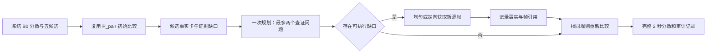

# REZE 高光检测与证据驱动 Agent：下一阶段实验执行方案 v2

制定日期：2026-10-23。状态核对时间：北京时间 2026-10-23 00:05。本文整理此前讨论、会议纪要、已完成实验及当前 QFVS 优化任务，作为**下一轮实现、运行、评价和停止决策的主执行依据**。

本文细化并更新[会议推进计划](next_steps_after_meeting_2026-10-22.md)，保留[原 v1 方案](reze_execution_plan_2026-10-19.md)及其停止结论。当前排队的 QFVS 实验继续遵守自己的冻结协议；本文新增阶段尚未启动，下面标注“待实现”的模块不能视为已有功能。

## 1. 目标与推进原则

首要目标是**提高查询相关高光检测精度，同时控制实验规模**。以 REZE 和现有 P_pair 为底座，验证“明确缺少什么证据，再决定在哪里补看”能否改善高光排序。QFVS 用来诊断长视频概念匹配与摘要覆盖，不能替代高光检测主任务。

近期依次完成四件事：

1. 收尾已冻结的 QFVS 四查询提示消融，区分提示、选择和任务目标问题。
2. 在 QVHighlights 固定开发集验证候选时间分散；沿用已有比较器。
3. 接入最小候选记忆和有限观察器，比较“不补看、均匀补看、定向补看”。
4. 补齐 SVHighlights 七场基线；核心机制通过小规模筛选后，再做独立确认和长视频迁移。

不同时更换模型、窗口、候选、提示和排序算法；不把所有模块在所有数据集上组合一遍。原始预测、标签、源码快照和旧失败记录只读保存。

## 2. 已有结果与尚未成立的判断

### 2.1 实验事实

| 实验范围 | 已有结果 | 对下一步的含义 |
|---|---|---|
| QVHighlights val1550 | B0 / P_abs / P_pair：VeryGood mAP **42.99 / 43.57 / 43.76**；Hit@1 **71.68 / 74.06 / 76.84** | 比较已有收益，首选高光改善较明显；以 P_pair 为强基线。 |
| QV 配对统计 | P_pair 相对 B0：mAP +0.771 pp，95% 区间 [0.479, 1.064]；Hit@1 +5.161 pp，区间 [3.488, 6.863] | P_pair 相对 P_abs 的 mAP 区间仍跨零，不宣称双向比较全面优于绝对复评。 |
| QFVS 四查询开发集 | 原 Top-k Oracle F1 **38.63**；相同分数加时间抑制 **40.41**；同预算 Uniform **50.15** | 时间分散有帮助，但不足以解决迁移问题。 |
| TVSum | 全 50 条完成；固定 val10 / all50 的 Top-5 mAP **61.32 / 54.89** | 可作为查询无关高光的后续迁移验证。 |
| MR.HiSum | 可用 test1888 完成；mAP50 / mAP15 / 摘要 F1 **57.00 / 23.90 / 38.27** | 排序指标与摘要 F1 分开分析；暂不重复全量。 |
| SVHighlights | 原七场 pilot 启动失败，**没有有效 REZE 指标** | 部署修复仍需实卡检查，新建运行后补齐原基线。 |
| MERIT 早期开发 | train20 的复杂 cue、事件关系和纯记忆方案尚未稳定超过直接视觉评分 | 不把更复杂记忆作为收益前提。 |

详细证据见[全量 QV 结果](reze_fullval_results_2026-10-20.md)、[实验总汇](experimental_results_report_2026-10-22.md)、[跨数据集分析](reze_cross_dataset_results_analysis_2026-10-22.md)及 [QFVS 配对消融](reze_qfvs_adaptation_2026-10-22.md)。不同数据集的 mAP、F1 不能横向比较绝对数值。

### 2.2 当前实现的准确边界

- REZE B0：独立读取 3 秒窗口、2 fps，通过 Yes/No token 概率评分，再映射到评价时间网格；不是把整条视频送入一次长上下文推理。
- P_abs：借助其他候选上下文的绝对复评；P_pair：五候选的 20 次有向比较，含 A/B、B/A。
- 现有 P_pair 已要求 query 相关、清晰且完整的可见证据；只有与 query 相关时才考虑情绪、变化和后果。**这套标准已有实现，不再包装成新增提示贡献。**
- 当前 QV 重排只置换五个候选原有分数，其余 2 秒格不变；尚未接入候选外搜索、完整事件图、记忆或定向回看。
- REZE 原论文在 Charades-STA、ActivityNet Captions 和 QVHighlights 测试；其中高光检测是 QVHighlights。我们的 QFVS 等结果属于迁移适配，QV val1550 也不等同于论文 test 划分。[REZE 论文](https://arxiv.org/html/2608.04480v1)

### 2.3 对 QFVS 低分的工作假设

| 假设 | 当前依据 | 如何检验 |
|---|---|---|
| 概念查询与动作核验提示不匹配 | P02 Building/Boat 的原选片概念命中为 0/73；Building 可能被当成搭建动作 | 固定全部输入帧，只改概念出现提示；新结果尚未产生。 |
| 高分片段集中，摘要覆盖不足 | 时间抑制提高 F1；P03 命中数下降而 F1 上升 | 固定分数，分别加入语义去重和代表性覆盖。 |
| 长视频放大覆盖难度 | 视频约 3–5 小时；摘要仅有 2% 预算 | 先做覆盖诊断，后续再设计长短或分段对照；目前没有因果证据。 |
| 概念对无法直接表达完整动作情节 | QFVS query 通常是两个概念 | 将其视作任务定义差异，不直接称为“无效或不明确 query”。 |

原四查询已完整评分，不能把低分归因于超长上下文溢出。约 99.54% 输出为 No 也不等于调用失败：原运行保留了有效的双 token 概率。概念提示改动同时包含任务改写和名词消歧，第一轮不能拆分二者贡献。

## 3. 数据集职责与任务接口

| 数据集 | 输入与输出 | 本轮定位及主指标 |
|---|---|---|
| QVHighlights | 视频＋自然语言 query → 完整 2 秒高光分数 | **主线**；官方 VeryGood mAP、Hit@1，辅报 Fair/Good。 |
| QFVS | 长视频＋概念对 → 原生 5 秒 shot 的 2% 摘要 | 长视频概念/覆盖诊断；Oracle 语义 P/R/F1，辅报用户均值。 |
| SVHighlights | 比赛视频＋固定运动类别提示 → 完整时间轴分数 | 长视频基线与后续观察成本；沿用已冻结官方 HD 评价，不自定义替代指标。 |
| TVSum | 视频；标题属于可选额外信息 → 片段重要性分数 | 查询无关迁移；固定协议 Top-5 mAP。 |
| MR.HiSum | 视频，无自然语言 query → 重播高光分数及可选摘要 | 后续外部验证；mAP50、mAP15 为主，摘要 F1 作诊断。 |
| TVHighlights | 目前无可用原视频和标注 | 暂不进入运行队列；不是 TVSum 的别名。 |

QV 的 query 往往描述具体主体、动作或场景，也有覆盖较长活动的宽泛描述。“符合 query 的优质高光”不必是激烈情绪或罕见事件：清楚展示所问内容、关键过程完整、遮挡较少，都可能重要。比较标准先服从 query，再考虑可见的价值证据。[QVHighlights 标注说明](https://arxiv.org/html/2107.09609#S3.SS1)

QFVS 的语义 F1 使用概念匹配及摘要集合匹配，不是时间 IoU 或 HD mAP。人工摘要也关注视频内容的代表性；因此概念命中数只能用于诊断，不能取代官方指标。[QFVS 论文](https://arxiv.org/abs/1707.04960)

数据与指标细节以[数据集说明](datasets_inputs_outputs_metrics_2026-10-22.md)为准。

## 4. 顺序、依赖和实验总量

| 顺序/编号 | 工作包 | 规模及新增调用上限 | 进入条件 |
|---|---|---|---|
| 0 / S0 | 清单、缓存、特征来源和代码接口审计 | CPU 为主，无新 VLM 正式调用 | 立即可准备。 |
| 1 / Q1 | 完成当前 QFVS 提示 × 时间选择消融 | 4 查询；20,356 次正式评分 | 沿用已冻结任务和 GPU 6 队列。 |
| 2 / V1 | QV 候选 C0/C1 对照 | explore100；C0 可复用，C1 最多 2,000 次比较 | B0、帧、代码及父预测校验通过。 |
| 3 / V2 | 最小 Agent 四条件消融 | 同一 explore100；最多 7,000 次正式新调用 | V1 完成选型；工程检查通过。C1 不通过时用 C0。 |
| 插空 / L0 | SVHighlights 原方法基线恢复 | 固定 7 场；19,014 次正式评分 | 新运行的部署修复和媒体检查通过；不与 Q1 抢卡。 |
| CPU 支线 / Q2 | QFVS 去重、覆盖选择 | 原四查询；复用两套分数，无新 VLM 调用 | Q1 完整输出；视觉特征通过来源审计。 |
| 条件确认 / V3 | QV 冻结版本确认 | confirm100；最坏 15,964 次正式调用，允许核验复用 | V2 达到主线筛选门槛，确认集使用历史审计通过。 |
| 条件确认 / Q3 | QFVS 新查询确认 | 8 查询；两套提示合计 81,424 次正式评分 | Q2 达到独立门槛，且不延误主线确认。 |
| 后续 / T1 | TVSum 小规模任务提示 | 训练划分固定 10 视频，调用数由清单冻结 | QV 核心机制完成开发评估后再安排。 |

GPU 默认串行队列：**先收尾 Q1，再 V1、V2；L0 可在下一主线阶段尚未就绪时运行。** Q2 是低成本支线，不能让 QFVS 多轮调参挤占 HD 主线。V3/Q3 均为有条件阶段，不能因为程序能启动就自动扩大。

本轮不安排 QFVS 全 180 查询、QV val1550 再次全量、MR.HiSum 全量重跑或模型训练。通过确认后再形成下一版扩展清单；不回写本轮门槛。

## 5. Q1：先完成冻结的 QFVS 因子对照

保持 P01 Desk/Face、P02 Building/Boat、P03 Book/Lady、P04 Garden/Hall，完整视频、模型 revision、3 秒窗口、2 fps、像素输入、评分读出及 2% 摘要预算不变。

| 条件 | 提示 | 选择器 |
|---|---|---|
| B0_topk | 原动作核验 | 分数 Top-k |
| B0_temporal | 原动作核验 | 固定 10 秒中心距离抑制 |
| Concept_topk | 概念出现、OR 语义；Building 指建筑物 | 分数 Top-k |
| Concept_temporal | 同上，复用同一分数 | 同一时间抑制 |
| Uniform | 不读取预测分数 | 同样 2% 预算，冻结均匀规则 |

分别计算固定选择器下的提示效应、固定提示下的选择效应及二者交互；主表保留全部条件和逐查询结果。记录概念命中、连续区间数量、最长连续段及时间覆盖，但不据此替换 F1。

截至本文核对时，新任务为 `waiting_for_idle_gpu`，0/4 查询、0/20,356 正式评分；此前有一次模型加载显存不足，未形成预测。原任务最多三个 worker 尝试，当前剩余两次；**不得通过清空账本或重建同名目录恢复预算**。加载前空闲而加载时显存不足，属于资源可用性变化的线索，不能据此确认是算法错误。

任务总请求上限 20,416，含 12 次工程调用和补试；活动 worker 上限 12 小时、无进度超时 900 秒。计时器已配置约每分钟检查一次。完成后由既有流程生成 `comparison.json/.md`；没有完整预测和配对检查，不宣布新提示有效。

## 6. Q2/Q3：区分概念相关性、去重与摘要覆盖

### 6.1 Q2 先只改变选择器

两套冻结分数分别使用 Top-k、Temporal、Semantic、Semantic+Coverage；共享 Uniform 和无 query 的 Coverage-only 对照。除原有四条件外均为待实现的 CPU 选择对照，不重新调用 VLM。

候选数固定 `K = floor(0.02 × n_shots)`，不使用标签、人工概念向量或参考摘要参与选择。视觉特征必须证明来自无 QFVS 标签训练的编码器，并核对 shot 对齐、视频覆盖和提取采样。现有 H5 文件存在，**不等于来源和零样本资格已经核实**；无法核实则暂停语义分支，先保留时间选择结果，不默认下载新模型。

首轮固定规则如下，参数是工作假设，不是已证明最优：

- **Semantic**：将每条视频的原分数转为 [0,1] 的并列平均百分位 `r_i`；贪心最大化 `r_i − 0.2 × max(sim(i,j), j∈S)`。特征先 L2 归一化，`sim=max(0, cosine)`；空集合惩罚为零，同分按 shot ID。
- **Semantic+Coverage**：先用不看 query 的代表性覆盖选择 `floor(0.2K)` 个锚点，再按上述规则补满 K。覆盖增益定义为全视频各 shot 到已选集合的最大相似度之和的增量，采用分块计算。
- **Coverage-only**：用同一覆盖增益选满 K，不使用 query 或 REZE 分数。它用于检查改进是否仅来自通用摘要覆盖。
- 保留原 Top-k 和 Temporal 的原始概率排序；百分位变换只服务于语义惩罚尺度。不得搜索多个权重后只公布最高分。

特征提取若增加了视觉输入，必须记录其帧数、模型和成本；结论应称“加入视觉特征的选择改进”，不能称严格同输入对照。报告分开列出已有特征的增量复用成本与从零提取成本。

**进入 Q3 的开发门槛**：选定组合的四查询平均 Oracle F1 同时超过 Uniform 50.15 和当前最强原分数对照；至少 3/4 查询不低于各自 B0；并检查其相对 Coverage-only 的收益。若不超过 Coverage-only，不主张 query 条件选择有效。未通过则结束本轮 QFVS 方法扩展，保存失败分析，继续 QV 主线。

### 6.2 Q3 固定八条新查询确认

在看新查询模型结果之前，每个视频排除原开发查询，对剩余合法 query ID 按 `SHA256("42:" + video_id + ":" + query_id)` 排序，取前两个，共八条。公布清单、原始 query 文本和哈希，不按概念命中、难度或预期收益挑样本。

只运行原提示和开发阶段选定提示两套分数；复用它们计算 B0、提示单独改动、最终选择器、Uniform、Coverage-only。同一视频两查询使每套提示约需 40,712 次窗口评分，两套合计 **81,424**；不能只报新方法的一半开销。可审计缓存存在时才扣除实际新调用。

确认集不再选参数或切换最佳方法。报告八条全结果、四视频分组结果和用户均值；支持继续扩展的点估计门槛是平均 F1 超过原方法及 Uniform、至少 6/8 不退化，并保留相对 Coverage-only 的差值。这只是小样本方向确认；八查询仍来自同四视频，**不是未见视频泛化，也不足以支撑稳定统计结论**。

## 7. V1：QV 候选时间分散对照

开发集沿用已有 train explore100（100 个源视频）。先核验无标签推理清单、原 B0 和 P_pair 的完整性、媒体/帧哈希。开发集已用于多轮研究，所有结果按开发结果报告。

| 条件 | 候选产生规则 | 比较及输出 |
|---|---|---|
| C0 | 原 2 秒格分数 Top-5；同分按 clip ID | 原 P_pair，20 次有向比较；可核验复用。 |
| C1 | 按原分数贪心选取，抑制与已选 clip ID 距离 ≤2 的格；选不足五个时按原排序补满 | 同一 P_pair、同一阈值、每候选最多四张 B0 已观察帧、同样 20 次比较。 |

C1 只是固定 4 秒中心距离的时间分散，不宣称检测到了不同语义事件。候选不足或补满行为写入日志，不根据结果调抑制半径。原全量 Top-5 中 60.1% 只形成一至两个连续区间，是开展此对照的动机，不是语义重复的证据。

两组均只在各自五个候选内置换原有分数，非候选分数不变；相同分数不添加 epsilon。C1 纳入原排名较低的格，也可能无法超过集合外高分格；完整时间轴指标必须如实反映这一限制，不能把“候选时间更分散”直接当成召回改善。

**实现约束**：现有 `reze_evidence/protocol.py` 把原 Top-5 写入校验逻辑。C1 必须新增协议版本和校验器，不能修改旧快照或把 C1 输出标记为旧协议。保存候选 ID、每帧来源、20 个方向分数和完整预测。

主报 mAP、Hit@1、逐查询差值；辅报候选覆盖、时间集中程度、方向冲突、并列和成本。标签只在评估端用于候选内诊断上限，不能决定候选。

**选型门槛**：C1 相对 C0 的开发 mAP ≥+1 pp、Hit@1 降幅 ≤1 pp，失败回退不增加。通过则选 C1，否则 V2 继续 C0；不因 C1 失败取消对定向观察的检验。

## 8. V2：最小 Agent 与四组可归因消融

### 8.1 固定阶段流程



第一版采用有限状态控制器，不引入自由工具循环。底座保留 REZE 的数据隔离、缓存、计费、恢复和评估；MERIT 提供事实索引与时间邻域思路，LensWalk 仅作为观察接口参考。迁入外部框架不是本阶段的必要条件。

### 8.2 候选记忆的最小定义

每候选一次事实提取，最多五次/query，只读取该候选最多四张 B0 旧帧；不重新对全视频生成密集 caption。事实生成不接收 query，检索与价值比较接收 query。

```text
candidate_id, target_interval, observed_interval
actor_or_event, observed_facts, evidence_frame_ids, frame_pts
evidence_cues: event / emotion / novelty / importance
reference_candidate_ids, missing_evidence, verification_status
model_revision, prompt_hash, source_pixel_hash
```

每卡最多六条事实，每条必须引用可见帧；未知保留 unknown。生成上限 512 token/卡，送入一次比较的记忆文本最多 1,024 token，确定性截断并记录。cue 不直接加权求和成高光分数。

后续观察事实带有独立时间戳。比较器须区分目标 2 秒格与观察上下文：上下文可解释目标，但目标格之外才发生的事件不能被描述成目标格已经清楚展示的内容。

“五类高光价值”的完整定义尚未给出；当前只使用已明确的四类 cue，不补造第五类。事件前后关系先只记录可见时序和参照，例如 `precedes`，不把先后关系当因果。进球前传球可成为理解证据，但不能自动把整段传球过程标成高光。

### 8.3 四个条件

| 条件 | 额外信息 | 要回答的问题 |
|---|---|---|
| E0 | 冻结候选上的原 P_pair | 原始强基线。 |
| E_memory | 同一旧帧生成的事实卡；无新源帧 | 结构化记忆/文字表述本身是否改变结果？ |
| E_uniform | 同一事实卡、同一查证问题；均匀补看 | 增加观察本身能带来多少收益？ |
| E_targeted | 同一事实卡、同一问题；规划的局部时间范围 | 在相同观察预算下，定向选帧是否额外有效？ |

E_memory、E_uniform、E_targeted 使用同一带证据输入的比较模板和原保守分数置换规则。E0 与 E_memory 的差异不能完全归为“记忆架构”：事实卡生成和比较输入也发生变化。真正检验观察位置的主对照是 **E_targeted − E_uniform**。

### 8.4 缺口、动作和预算配平

一次文本规划读取初始比较与事实卡，最多输出两个问题，每个包含 `candidate_id / evidence_question / allowed_interval / targeted_interval / requested_frames / stop_reason`。规划输出上限 384 token。

- 可触发：query 所需动作结果未见、决定比较的细节不可见、已有比较方向冲突且存在可查证问题。
- 不单凭 P(Yes) 偏低触发；概率未证明已校准。只给出“精彩程度不确定”也不构成可执行缺口。
- 每次观察最多 24 个**新增唯一源帧**，每 query 最多两次、48 帧；观察事实输出最多 512 token/次。模型上限须在工程检查验证，不能直接沿用旧双视频四帧配置。
- 每个候选允许观察区间默认是 2 秒目标格向前、向后各扩 4 秒并裁剪到视频边界。定向范围必须位于其中；第一轮不向整个视频自由搜索。
- E_targeted 在规划子区间内均匀取新帧，E_uniform 在同一个候选允许区间内均匀取新帧。两组共享触发查询、候选和问题，只改变采样范围；两次动作一次性规划，不根据第一组结果额外加调用。
- 去除初始旧帧及本组已用帧后，先计算两组可行数量，再以较小值配平实际新帧数。不足两帧的动作两组同时取消并记录；重复帧和模型内部 padding 不算新证据。
- “慢动作”体现为在短区间更密地读取不同源帧，不生成插值图像，也不重复旧图片冒充新观察。
- 无可执行缺口时，E_uniform/E_targeted 直接复用 E_memory 预测。无新证据、预算耗尽或无法核实都显式结束；不能反复生成直至答案满意。

观察问题必须服务于 query，例如“球是否穿过篮网”“画面中是否清楚显示拿起指定物体”。情绪强度和群体反应只在查询需要时比较，不能默认奖励庆祝片段。

### 8.5 模块接口与失败处理

拟新增三个内部工具函数：`retrieve_evidence(candidate_ids, question)`、`observe_segment(interval, frame_budget, question)`、`compare_candidates(a, b, query, evidence)`。由固定控制器调用，全部写审计记录；第一版不依赖模型自主生成外部工具调用。

事实、规划或观察格式失败不做语义重试：记录错误并退回有效父条件；触发分支需配对取消，避免只给一组额外机会。重评分失败保留 E_memory 或 E0 的有效预测，注明路径。所有失败查询保留在评价分母，不能只报成功子集。

最坏每 query 正式新调用为 `5 张卡 + 1 规划 + 20 次 E_memory 比较 + 2×(2 观察 + 20 次比较) = 70`；100 查询最多 **7,000 次**。两观察组共同依赖的记忆与规划只生成一次，但独立方法的端到端成本必须分别包含它们，不能靠平摊成本制造效率优势。

## 9. V3：门槛、确认与结果解释

### 9.1 开发门槛

E_targeted 进入精度确认需同时满足：

1. 相对 `E0 / E_memory / E_uniform` 中开发 mAP 最高者，VeryGood mAP **至少 +1 pp**。
2. Hit@1 相对该对照下降不超过 1 pp；完整分母，回退率不高于对应父条件且不超过 1/100。
3. 相对 E_uniform 的优势来自相同模型、触发集合、实际新增帧数及比较次数；偏离必须单列，不能混入配对主结果。
4. 在冻结调用、GPU 时间与 token 预算内完成；统计实际开销，不能只看模型生成时间。

未通过则停止本版本扩展，保留最强简单方案；用逐查询退化案例区分候选遗漏、问题错误、采样错位、无新事实、事实幻觉和比较失效。E_uniform 好而 E_targeted 差，支持“多看有用、定位尚无收益”；E_memory 好而二者无增益，只支持证据表示作用。

所有门槛使用未四舍五入的原始指标；表格小数仅供阅读。开发集门槛是筛选规则，不是统计显著性证明。

### 9.2 确认集与统计

优先使用既有 confirm100：先审计是否参与过方案选择，并确认与 explore100 源视频不重叠。若已经污染，在官方 train 范围内按 seed42 和无标签视频元数据冻结新的 100 条，排除所有已用开发源视频；不能把看过结果的集合重新命名为独立确认集。

进入确认前固定一个最终版本及必要对照、提示、阈值和失败处理；不在 confirm 上重新挑版本。报告完整时间轴 mAP/Hit@1、逐查询差值和按源视频聚类的配对 bootstrap（10,000 次，seed42），同时展示置信区间。

确认需检查开发门槛能否复现，且 E_targeted 对 E_uniform 的 mAP 差值区间下界大于零，才支持稳定的定向观察收益；区间跨零就报告证据不足。门槛和显著性是两件事。此前 val1550 已查看，后续在其上验证可报告完整基准结果，但不能称未见测试。

最坏确认调用：B0 4,964＋C0 P_pair 2,000＋C1 P_pair 2,000（仅选 C1 时）＋Agent 四组新增 7,000＝15,964。复用有完整收据的父预测可降低增量，独立复现成本仍完整报告。

## 10. 长视频与其他数据集的条件扩展

### 10.1 L0：先补齐 SVHighlights 原七场

原失败涉及 GPU UUID 解析；已有数值索引部署修复尚未实卡验证。建立新 `v2` 运行，保留原七场身份、3 秒/2 fps、模型及评价协议；不修改已停的 `v1` 或清零旧账本。先完成七场首中尾 21 个媒体探针和 GPU smoke，再执行 19,014 次正式评分。

失败应输出明确的资源、媒体或模型错误；启动成功本身不是实验完成。先获得完整 B0，之后才在同样本上接入通过 QV 门槛的机制。长视频确认另取源视频不重叠的比赛，同场不同裁剪不能当独立泛化。

### 10.2 精度路线与粗到细效率路线分开

V2 在完整密集 B0 之后补看，包含完整 B0 成本，**不能称减少了全片密集评分**。待精度路线完成后，才另设粗到细协议：低成本全片粗扫 → 候选 → 局部精看，未精看区域保留粗评分，始终输出完整时间轴。

效率路线必须预先声明，以总成本降低至少 30%、主 mAP 降幅不超过 0.5 pp 为开发筛选目标；配置匹配预算的均匀观察对照，报告粗候选召回及配对非劣区间。不因精度实验失败而事后改用速度作为成功标准。

### 10.3 TVSum、MR.HiSum 与边界细化

TVSum 从原训练 40 条按类别和 seed42 固定 10 条开发视频；先比较当前通用提示与重要性提示，再单独检查标题输入。标题是额外信息，不能与提示同时改后归为 Agent 收益。全 50 条此前已有结果，因此这批视频属于开发，不能称全新未见测试。

MR.HiSum 后续先从官方 train/val 预选约 50 条，避免用已看过的 test1888 调参。TVHighlights 等待真实数据入口，不用 TVSum 代替其结果。

区间细化在排序有效后单独做。理解上下文区间与输出高光区间分别保存；QV 2 秒 HD 标签不能证明亚秒边界准确。完整时间轴分数始终用于 HD 评价，用户展示的 all/top-k 和片段合并属于单独输出策略。

## 11. 工程落地清单

现有研究代码位于 `$ZEROSHOT_ROOT/experiments/`；Git 发布副本位于 `baselines/zeroshot/experiments/`。实际路径通过本机配置解析，不把运行目录复制进 Git。

| 模块 | 复用入口 | 下一步改动与验收 |
|---|---|---|
| QFVS 配对运行 | `reze_qfvs/prepare.py`、`pairing.py`、`dispatch.py`、`compare_adaptation.py` | 当前 Q1 不改；Q2 独立增加选择器，Q3 增加 manifest 驱动的确认入口。现有概念 pilot 入口不能直接当作八查询运行器。 |
| QV 候选与比较 | `reze_evidence/ranking.py`、`candidate_frames.py`、`backend.py`、`protocol.py` | 新版候选选择与协议；保留旧 20 次比较、阈值、分数置换和帧校验。 |
| 最小 Agent（待实现） | 建议新建 `experiments/reze_agent_v2/` | 实现 schema、memory、planner、observer、controller、runner；旧目录及快照只读。 |
| SVHighlights | `reze_svhighlights/prepare.py`、`dispatch.py`、`worker.py` | 新运行加载已修复源码，验证设备映射和预算继承。 |
| 评估与发布 | 各数据集冻结 evaluator；`scripts/verify_publication.py` | 输出完整结果、配对统计、失败和成本报告；同步源码与文档清单。 |

有行为变化时补必要测试：候选不足/同分、非候选不变、候选任意集合验证、标签隔离、时间边界、唯一帧计数、两组配平、非法帧引用、无触发复用、失败回退、断点恢复不重复收费。工程样本只检查解析、引用、显存与预算，不用其高光指标搜索提示。

每阶段冻结 `plan.json`、无标签 `manifest.jsonl`、代码/模型/提示/视频/像素哈希、父运行收据、`budget.json` 后才启动正式评分。既有 QV 模型固定为 Qwen3-VL-8B-Instruct，revision `0c351dd01ed87e9c1b53cbc748cba10e6187ff3b`，BF16、temperature 0、无微调；新观察后端不得静默换量化或模型。

## 12. 资源、自动化与时间预算

| 阶段 | 正式请求上限 | 工程/补试约束 | 活动 GPU 时间上限 |
|---|---:|---|---:|
| Q1 已冻结 | 20,356 | 总计 20,416，最多三次 worker，保留已用次数 | 原冻结 12 小时 |
| V1 | 2,000 | 工程 ≤100，瞬时故障额外尝试 ≤100 | 2 GPU 小时 |
| V2 | 7,000 | 工程 ≤500，瞬时故障额外尝试 ≤350 | 6 GPU 小时 |
| L0 | 19,014 | 新 binding 不超过既有 19,014＋48 总调用协议；21 媒体探针另列，不计成模型调用 | 12 GPU 小时 |
| V3（条件） | 15,964 | 工程 ≤100，额外尝试 ≤5% 正式请求，向下取整 | 6 GPU 小时 |
| Q3（条件） | 81,424 | 工程 ≤24，额外尝试 ≤5% 正式请求，向下取整 | 6 GPU 小时 |

以上是停止上限，不是预计耗时；正式预算不含排队时间，GPU 时间记录模型加载、失败尝试和占卡等待。新 QV 条件的端到端输入＋输出 token 不超过同清单 B0 的 6 倍；由缓存或工程实测冻结基准和绝对 token 上限，不在看结果后放宽。每个具体阶段仍执行更严格的调用、时间或 token 先到先停规则。

QFVS 原四查询单卡约 35 分钟，八查询两套提示按原吞吐约为四倍，仅是推理量级参考；排队、生成型 Agent 和不同视觉后端不能沿用这个估算。每阶段完成工程检查后，用真实吞吐更新预计时间，不给没有依据的日历完成承诺。

当前 Q1 绑定物理 GPU 6；00:05 快照显示它仍被占用。其他卡状态会变化，不能修改冻结任务自动迁移或终止其他用户进程。新阶段默认单卡串行；额外卡可用时先核对使用范围、UUID 和空闲状态，再冻结新的调度配置。

自动化沿用用户级 systemd、进程锁、逐批原子检查点、有界补试及 900 秒无进度停止。共享 GPU 的瞬时空闲不等于持续可用，加载前再次核验。预算耗尽输出停止原因，不能无限重启；SSH 断开续跑与机器重启恢复分别检查服务和 linger 配置。

## 13. 产物、发布和组会报告

每阶段至少交付：冻结协议与清单、完整预测、逐查询结果、失败明细、请求账本、实际新帧及 PTS、token/解码/推理/墙钟/占卡成本、配对统计、Markdown 分析及 `decision.json`。后者逐条记录门槛值、实测值、是否通过和下一阶段，不能只保存一句“效果更好”。

成本同时给出：①本轮核验缓存后的新增成本；②从原视频和模型开始的端到端成本；③多 query 复用后的摊销成本。等待设备时间单列，不混入模型吞吐。既有通用特征、B0 评分、记忆生成和重评分都必须有来源。

报告与可维护代码同步到 Git 发布副本。每次推送包含本轮报告、方案、索引及哈希清单；原视频、模型、大型缓存和机器私有路径指针保留本地。提交前运行发布完整性检查并检查 Markdown 链接。本文生成不等于已经向远程推送，也不表示新增 GPU 阶段已启动。

下一次阶段汇报优先展示：QFVS 完整因子对照、QV C0/C1、Agent 四组对照；SVHighlights 若完成则补充原基线。失败或未运行条件明确标注，不用计划图替代实验结果。

## 14. 下一次执行的操作顺序

1. 读取本文和本机运行指针；检查 Q1 `status.json`、`worker_attempts.json`、计时器、GPU 和预算。不重复启动已经排队的任务。
2. CPU 核验 explore100、confirm100 使用历史、B0/P_pair 收据和候选帧；建立新的 v2 协议，先实现 V1。并行准备 QFVS 特征来源审计及 L0 新运行检查，但不额外占 GPU。
3. Q1 完成后发布四条件和 Uniform 全结果；若失败则写明工程原因并保留全部账本。Q2 只在特征合格后使用冻结分数开展。
4. V1 工程检查通过后运行 explore100；按门槛选 C0 或 C1，冻结 V2 候选，不再反复调整时间半径。
5. 实现最小事实卡、一次规划、两次观察和四组对照；通过配平、失败恢复和预算检查，再运行 V2。
6. 按 `decision.json` 决定进入 V3、Q3 或停止该分支；补齐 L0，不直接扩大到全部数据集。

**本轮要验证的核心命题是：在相同模型、候选和新增观察预算下，针对查询相关证据缺口选择观察位置，能否比均匀补看产生更好的高光排序。** 提示适配、时间分散、语义去重和普通覆盖选择先作为可解释的基线；只有经过配对消融的证据选择收益，才构成后续 Agent 方法的实验依据。
