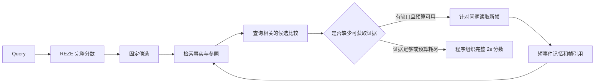

# 基于 REZE 的高光检测改进方向

> 发布状态说明（2026-10-20）：A 阶段 explore100 已完成，但未通过预设继续门槛；随后按用户单独要求完成 P_abs / P_pair 的全量 validation 扩展。B/C 阶段及 confirm100 尚未执行。后文保留 2026-10-19 制定方案时的设计、预算和停止规则，不能将当时的“尚未启动”“尚未实现”当作当前进度。当前结果见[全量报告](reze_fullval_results_2026-10-20.md)。

日期：2026-10-19。使用 `brainstorming-research-ideas` 的失败分析、模块拆分和简化检验三个视角。沿用“优先提高 HD 精度、控制实验规模、使用冻结 Qwen3-VL-8B-Instruct”的研究目标。

本轮完成论文核对和已有预测的 CPU 离线诊断，没有启动新模型推理。以下方案均为待验证假设。

后续执行细则已整理为[完整执行方案 v1](reze_execution_plan_2026-10-19.md)，包含实验组、固定协议、样本、预算与推进门槛；新增实验尚未启动。

## 1. 推荐研究问题

REZE 提供了较强的查询相关性分数，但独立短窗口的识别置信度，未必能够区分多个相关片段的高光价值。建议研究：**能否通过可追溯的事件与比较证据，在有限新增观察预算内改善查询相关的高光排序？**

优先顺序是：候选价值比较 → 轻量证据记忆与时序参照 → 缺口驱动回看。第一阶段保留完整 REZE 分数作基础，检验增量模块；记忆优先的省计算路线另立实验。

## 2. 已有证据支持什么

### REZE 已建立的基础

本地 REZE + Qwen3-VL-8B 在完整 QVHighlights val 1,550 条上达到 **42.99 VeryGood mAP / 71.68 HIT@1**，失败 0 条；四张 RTX 4090 墙钟 32.50 分钟，77,308 次窗口核验。它是论文附录的独立实现，详细边界见[已发布的基线与全量结果汇总](reze_fullval_results_2026-10-20.md)。

论文将每个 3s 窗口以 2 FPS 采样，用 Yes/No 的相对 logits 形成连续分数，HD 再读出 2s 分数。该值是相对置信度，不是已校准概率。短窗口、连续分数和程序化输出值得保留。[REZE 原文](https://arxiv.org/html/2608.04480v1)

### 本轮新增离线诊断

读取全部冻结预测、逐查询指标及 1,550 份原始记录，核对预测哈希和逐记录凭证。没有修改原预测。

| 诊断量 | 结果 | 含义与边界 |
| --- | ---: | --- |
| 最高分 2s 片段落在标注相关区间 | 86.52% | 只是相关区间命中，不能当作官方 HD 成绩 |
| 官方 VeryGood HIT@1 | 71.68% | 最高分片段至少获一名标注者 4 分 |
| 在现有前 5 个 2s 片段中用标签选最优，HIT@1 上限 | 90.45% | 候选内重排存在空间，不是可实现成绩预测 |
| 在现有前 10 个 2s 片段中用标签选最优，HIT@1 上限 | 94.45% | 同上；增加候选也增加计算 |
| 原 top-1 未命中、但 top-5 中已有 VeryGood | 291 条 | 支持先测试候选排序，不能证明错误由某类 cue 引起 |
| 所有窗口硬回答 No | 186 条 | 其连续分数仍有 27.48 mAP / 51.61 HIT@1 |

Oracle 只按固定的预测排序选候选，然后用标签检查是否存在正例；同分按较早时间优先。前 5/10 个 bin 可能属于同一事件，这不是事件去重后的候选召回，也不是 mAP 上限。诊断是已查看 val 上的事后分析，不参与在线选区或评分。

依据[官方说明](https://github.com/jayleicn/moment_detr/blob/main/data/README.md)，QVHighlights 评估查询对应的 2s saliency，三名标注者分别给出 0–4 分。因此“情绪激烈”“罕见”应由 query 决定是否相关，不能直接替代官方高光标准。

### 之前记忆实验的教训

- 固定 train20 的 Memory_text / Memory_cue 为 **21.60 / 16.53 mAP**，加 cue 没有自动改善排序。novelty / importance 约 **94.5% / 94.8% unknown**，需要真实参照。
- R1 修复显式 ID 与引用后为 **25.55 mAP**，仍有 5/20 整段常数；长数组生成和读取仍不可靠。
- 旧局部重评分存在全局与局部分数标尺问题。新模块不宜直接把另一种提示产生的绝对分数覆盖原分数。
- 这些是反复开发的 train20 结果，不能与 REZE 的完整 val 直接计算方法差距；也不能据此否定所有记忆方法。

来源：原工作区的 `highlight_memory_only_analysis_2026-10-17.md` 与 `highlight_memory_reader_run_2026-10-17.md`；对应诊断和 R1 结果已整理在[实验总汇](reproduction_results_summary_2026-10-19.md)第 6.4 节。两份原始开发报告未随本次方案发布。

## 3. 发散后的候选清单

保留所有候选及取舍，后续逐项检验，避免一次加入整套系统。

| 编号 | 候选方向 | 当前取舍 |
| --- | --- | --- |
| C01 | 分开识别“query 是否成立”和“哪个相关片段更适合成为高光” | 第一优先，直接对应任务差异 |
| C02 | 同 query、同证据条件下成对比较候选 | 第一优先；测试相对排序是否改善 |
| C03 | 四类 cue 由 query 选择，改为短的可验证问题 | 融入比较协议，先用适用维度 |
| C04 | 保存事件前后状态、结果和真实帧引用 | 第二阶段；为缺失上下文提供证据 |
| C05 | 复杂 query 拆为子事件，并核验顺序关系 | 条件使用；简单 query 不强制拆分 |
| C06 | novelty 检索同视频的同类参照事件 | 保留，先验证参照是否可得 |
| C07 | importance 检索目标完成和结果变化 | 保留，禁止无证据的“决定胜负”等判断 |
| C08 | 针对短动作取更密集的新帧 | 第三阶段，与均匀回看作同预算比较 |
| C09 | 针对上下文缺口扩大时间范围 | 第三阶段；和高 FPS 回看分开计费 |
| C10 | 候选外保留少量固定探索，减少漏检 | 回看阶段纳入；不能只查高分区域 |
| C11 | 2s 对齐、3s 窗口平移或多尺度核验 | 简单对照；属于必要工程基线 |
| C12 | 把逐段 Yes/No 核验接口迁移到文字记忆读取 | 后续记忆优先路线；防止描述遗漏/幻觉被强化 |
| C13 | CLIP 与 REZE 分歧辅助定位待查区域 | 暂缓，避免引入额外模型与归因变量 |
| C14 | 多查询共享记忆、缓存局部视觉证据 | 后续效率实验；完整计入建库成本 |
| C15 | 音频/ASR、训练新评分头或大型事件图 | 暂缓，超出本轮小规模视觉无训练方案 |

## 4. 收敛后的四个方向

### 方向一：查询条件下的候选高光比较

**假设：** REZE 能召回一部分正确候选，但独立识别分数不足以可靠比较它们。

保留原始 query 和连续分数，先固定前 5 个 2s 候选做小实验，不进行事件去重或候选策略联调。比较的问题是“哪个片段更清楚、完整地体现 query 所要求的内容及关键结果”；只有 query 涉及情绪、变化或重要转折时才引入相应维度。对一般展示类 query，不强制偏好更激烈的动作。

比较使用 A/B 选择或对应二元 logits，交换 A/B 顺序检查位置偏差；不一致时保留原排序。五个候选全配对共 10 对，双顺序最多 **20 次额外短输出请求/query**。这是 pilot 上限，调用数不是 token 或时间等价预算；视频输入呈现量也需计入。

首轮仅重排候选已有分数，候选外保持原值，保留原分数多重集；不要把新提示的 0–4 分直接加到 P(Yes) 上。这一保守协议用于隔离候选排序效果：原同分仍可能无法区分，不能靠人为微扰制造优势。需预先固定由比较结果形成全序及处理循环/冲突的规则。

**反证条件：** 在固定输入和候选上，比较不能超过独立高光核验；或改善仅在 HIT@1、mAP 持续下降。此时先检查候选覆盖与比较尺度，不扩大比较模块。

### 方向二：支持目标片段的事件证据记忆

**假设：** 部分 query 需要跨窗口的过程、结果或前后状态；3s 内缺少证据不代表事件未发生。

记忆单元以事实为主：`时间范围、可见事实、真实帧引用、观察状态、参照事件 ID`。原 REZE 的 query 条件分数单独绑定 query、提示与模型版本，不能当成查询无关事实。先只为候选及有限邻域生成短记录，避免全视频重建冗长四类字段。

例如“传球→射门→进球”，保存各节点及有证据的先后关系；查询目标是进球时，传球属于支持判断的上下文，不自动获得与进球相同的高光分。镜头相邻不能直接证明同一次进攻，更不能证明因果。

novelty 要有“与哪个已观察事件比较”；importance 要有“哪项可见结果发生变化”。没有参照时标 unknown 并跳过该维度，不能赋零，也不能凭庆祝画面补造进球、扳平或制胜结论。

**最小对照：** 相同候选、观察帧、事实内容和最终比较器，对比平铺事实与带时序/参照索引的事实；报告文本长度和 token 差异。若新组增加帧或新增事实，需另立对照，不能把额外观察的收益都计入图结构。

### 方向三：证据缺口驱动的回看

**假设：** 一部分排序错误可以通过获取特定缺失证据修复，定向取证比相同预算均匀补帧有效。

触发信号包括候选比较冲突、结果帧缺失、主体/群体反应不可辨认、参照不足。P(Yes) 接近 0.5 只能作为启发式，不能当作校准的不确定性；全部 No 也不意味着没有候选。保留固定候选外探索入口以检查高置信漏检。

- 短动作缺口：例如“球是否进入球门”，在原时间轴上增加不同真实帧。
- 事件上下文缺口：例如“这是准备还是动作完成”，扩大前后窗口，保持较低 FPS。
- 比较缺口：例如“哪段群体反应更明显”，获取双方可比的视觉证据。

首个版本可设每 query 最多 2 次回看、每次最多 12 张新增帧。重复原图片或只改变播放速度不算新证据。新证据写回记忆，并记录是否实际改变了候选次序。

**必要对照：** 定向回看、相同新增帧/token 预算的均匀回看、不回看。总量还需包含候选比较的重复输入、建库和重试。若定向方法未超过均匀回看，不能主张调度策略有效。

### 方向四：记忆优先的核验接口与成本控制

精度路线验证后，可以回到此前“先读 memory、再按需看视频”的目标：逐段短记忆 → 二元核验 logits → 不确定或缺证据位置视觉 REZE → 程序生成完整 2s 分数。需同时测独立片段读取和带少量检索上下文的读取，避免再让模型一次生成完整长分数数组。

这是替代密集 REZE 的独立假设，不能以第一阶段的密集 REZE 加记忆结果证明记忆优先有效。记忆事实错误或遗漏仍可能降低精度。

本次 val 的 **1,550 条 query 只对应 1,519 个视频片段**，每个评测片段平均约 1.02 条 query，多查询摊销空间有限。效率结论应区分首次建库成本、查询增量成本和多查询成本；单次查询不能把已有记忆当免费输入。

## 5. 与用户此前四类 cue 的对应

| 原思路 | 在 REZE 基础上的具体角色 | 禁止的推断 |
| --- | --- | --- |
| event cue | 对动作、状态、过程和结果做短问题核验 | 单凭事后反应补出未观察到的动作 |
| emotion cue | 在适用 query 下比较可见反应、持续时间和参与人数 | 所有 query 都给激烈情绪加分 |
| novelty cue | 从记忆检索同类参照，再判断差异 | 无参照时从单帧断言稀有 |
| importance cue | 利用前后状态判断对 query 目标和结果的作用 | 将常识上的重要性当作视频中的已知事实 |

四类 cue 是可选择的证据问题，不是必须填满的四个绝对分数。没有足够证据时可以停止修改并保留 REZE 分数。



这是精度优先路线。展示用的 all/top-k 结果在完整评分之后组织，不能把非 top-k 的 HD 分数清零。

## 6. 最小实验与两周 pilot

先完成方向一，再决定后续模块；以下是建议安排，不是已启动任务。

| 阶段 | 工作 | 判定目的 |
| --- | --- | --- |
| 第 1–2 天 | 利用已有 val 做离线诊断；旧 train20 仅作工程检查；固定样本、候选、帧与比较协议 | 分开排序错误、候选遗漏、短动作和上下文缺失；案例不只选成功样本 |
| 第 3–5 天 | 既有 explore100 上跑 REZE、独立高光核验、候选比较 | 检查比较是否优于只增加一个高光问题；新增 REZE train 基线不能用 val 成绩替代 |
| 第 6–8 天 | 仅在有效基础上增加事实参照/事件链，与相同事实的平铺版本比较 | 检验结构与记忆是否提供可归因的收益 |
| 第 9–10 天 | 若查证缺口真实存在，再做定向/均匀回看的同预算对照 | 区分更聪明地取证与简单增加视觉计算 |
| 第 11–14 天 | 冻结最多一个版本，审计预留 confirm100 是否仍未用于选参，满足条件才做确认评估 | 检查开发集之外能否保持收益，之后再考虑完整 val |

explore100 与 confirm100 的清单已存在，每组 100 个源视频；执行前重新审计源视频交集和历史使用情况。此前 train20 是反复使用的开发集；val 已查看，也不能称未触碰测试集。若在开发标签上选提示或超参数，应如实称为冻结模型的 training-free 开发流程。

首轮优先做三个条件：**原 REZE / REZE＋独立高光核验 / REZE＋候选比较**。固定模型、候选和输入证据，先记录实际计算差异，再用同预算的额外视觉核验基线排除单纯增加计算的解释。不要一次做所有 cue、窗口、图结构与回看的笛卡尔积。

沿用项目开发筛选标准作为参考：mAP 至少提高 1 pp、HIT@1 下降不超过 1 pp、失败率不增加，并明确额外成本。它只是预先确定的工程筛选门槛，不是显著性证明；确认阶段报告完整分母和源视频聚类的配对区间。

各组记录 VeryGood mAP/HIT@1、每 query 改善与退步、完整预测覆盖、并列、比较顺序一致性、候选覆盖、首次建库成本、调用/输入输出 tokens、新增独立帧与重复呈现、GPU 数和墙钟时间。骨干和执行调度尽量固定；现有 BF16 批处理数值差异已在 REZE 报告披露，小幅收益需检查稳健性。

## 7. 新颖性与最强反对意见

最强反对意见是：“这是否只是给 REZE 增加计算和更长提示词？”回答需要依靠固定候选/证据对照、相同事实的平铺对照，以及同预算均匀回看；不能用可解释的图或更多字段代替精度证据。

子事件拆分与时序关系已有 [TFVTG](https://arxiv.org/abs/2408.16219)；成对排序已有 [Pairwise Ranking Prompting](https://arxiv.org/abs/2306.17563)。REZE 也已做过窗口长度对照，其表 11 的约 0.7 点提升指 **MR mAP**，不能套到本项目 HD。单独缩短到 2s、增加 cue 或使用 pairwise，尚不足以支撑新的方法贡献。

更有价值的贡献假设是：**显式区分相关性证据与高光比较证据，根据缺失的证据选择观察，并把新增证据稳定转化为全视频排序改进。** 本次是定向文献核对，未完成系统查新，不能宣称首创。

若仅候选比较有效，先保留这一简洁结果；若事件结构与自适应回看都不能超过简单对照，应收缩方法，而非继续叠加组件。

## 8. 本轮可复核产物

- 原工作区 `comparisons/qvhighlights/reze_research_diagnosis_2026-10-19/analysis.json`：全量统计、两类硬回答分组、逐查询记录和输入哈希。
- 同目录 `analyze.py`：仅标准库；读取冻结产物，拒绝覆盖输出。

以上离线诊断 JSON、脚本及其依赖的完整原始查询记录保留在原工作区，未随本次方案发布。以下是原工作区中的历史复核命令，不能直接在本公开仓库运行。公开预测的指标复算请使用[结果包说明](../comparisons/qvhighlights/reze_fullval_2026-10-20/README.md)。

从原 MERIT 工作区根目录复核，另指定一个尚不存在的输出文件：

```bash
python comparisons/qvhighlights/reze_research_diagnosis_2026-10-19/analyze.py \
  --output /tmp/reze-research-diagnosis-new.json
```

在 2026-10-19 制定研究方向时，未改变 AGENTS.md、旧实验预测或评分规则，未启动 GPU 服务或推送远程；本文现于 2026-10-20 随方案发布。

## 公开版本说明

本次发布增加执行状态说明，并将链接调整为仓库内入口；阶段设计、提示词、样本规模、预算和推进门槛沿用原方案。`source_environment/`、`source_workspaces/` 与 `source_runs/` 表示原实验来源，不是本仓库提供的目录或可直接恢复运行的路径。原始与公开文件的 SHA-256 见[发布清单](reze_plan_publication_2026-10-20.json)。
